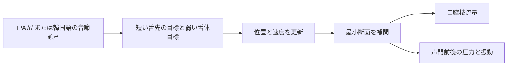

# 歯茎の弾き音 /ɾ/

固定上流は `c6147d0198890475dbe8a65a0bb8f56240c539b7`。韓国語「싫어」の2音目と、同じ母音で挟んだ /ɾ t d/ を調べる。[事前登録](../cases/alveolar-tap.json)

## 入力から制御まで

IPA の入力から `plan_utterance` が音素の時刻を決める。韓国語の `word_syllables` は「싫어」を /ɕi.ɾʌ/ とする。前の音節の末尾にもㄹが残ると音節頭は /l/ になる例があり、「신라」は /ɕil.la/。ロシア語にも /ɾ/ が出る。巻き舌で声が約100 ms途切れたため短い弾き音を採用した、と上流テストに記されている。[韓国語の音節選択](../../../../docs/reference/chimera-vocal-synth/upstream/crates/chimera/src/phonetics/korean.rs#L254)・[韓国語テスト](../../../../docs/reference/chimera-vocal-synth/upstream/crates/chimera/tests/syllables.rs#L98)・[ロシア語テスト](../../../../docs/reference/chimera-vocal-synth/upstream/crates/chimera/tests/russian.rs#L31)

`inventory::phoneme` では舌先目標が /t d/ と共通で、前後6.25 cm、高さ9.68 cm。ただし `Manner::Tap` の `oral_gestures_into` は開放子音と同じタイミングで、音素区間を `[a,b]` とすると強い目標の開始は `a−8 ms`、終了は `max(a+10 ms,b)`。強さ40、ランプ30/18 ms、速度倍率2.8の指定は解放ランプの後も45 ms残る。舌体は区間 `[a,b]` で (3.2, 7.4) cm に向かう。こちらは強さ1.2、前後50 msのランプを使い、母音の目標も残る。/t d/ は閉鎖に時間を見込み、閉鎖先行31 msと早い目標解除20 ms、速度倍率1.55を使う。[音素表](../../../../docs/reference/chimera-vocal-synth/upstream/crates/chimera/src/phonetics/inventory.rs#L234)・[音素ごとの計画](../../../../docs/reference/chimera-vocal-synth/upstream/crates/chimera/src/phonetics/planner.rs#L453)・[調音時間と強さ](../../../../docs/reference/chimera-vocal-synth/upstream/crates/chimera/src/phonetics/planner.rs#L820)

発話の長さ表は /ɾ/ の固有長と最小長をともに20 msとするので、明示指定がないと音素長は20 msを話速で割った値。歌唱の頭子音は既定25 msの0.8倍を拍より前に置く。短い音符では、前の音符の末子音と次の頭子音の長さが調整される。話速が1を超えると調音のランプと速度倍率の維持時間も短縮する。口蓋化を受けた /ɾ/ では空いている舌体の前後・高さに /j/ の弱い目標が加わる。[持続時間表](../../../../docs/reference/chimera-vocal-synth/upstream/crates/chimera/src/phonetics/durations.rs#L74)・[歌唱の音素配置](../../../../docs/reference/chimera-vocal-synth/upstream/crates/chimera/src/phonetics/sing.rs)・[口蓋化と話速](../../../../docs/reference/chimera-vocal-synth/upstream/crates/chimera/src/phonetics/planner.rs#L733)

## 観測と予測

`Score::blend_all` で時刻に応じた目標と強度を混ぜ、同じ制御更新で調音器の位置・速度を進める。目標値は各ジェスチャーの余弦ランプ活動度と強さの積で重み付けする。位置 `x`、速度 `v`、混合した目標 `T`、角周波数 `ω` に対し、先に `v ← v + Δt[ω²(T−x)−2ωv]`、続いて `x ← x+Δt·v`。舌先X/Yの位置はcm、速度はcm/s。96 kHzの内部レートでは制御更新が128内部サンプルごとに入る。速度倍率はその軸に有効な目標が混ざる間に使われる。声道断面を次の時刻へ補間し、最小断面が `2×10⁻⁴ cm²` を下回るセルでは隣接枝の流量を0にする。/ɾ/ 自身は声門開大を追加しない。声門面積の周期は肺側・口側の圧差や声門の状態にも依存するため、口腔閉鎖と周期が続くかは別の測定になる。[制御更新](../../../../docs/reference/chimera-vocal-synth/upstream/crates/chimera/src/voice/human_voice.rs#L457)・[調音器](../../../../docs/reference/chimera-vocal-synth/upstream/crates/chimera/src/control/articulators.rs#L109)・[気道の枝の更新](../../../../docs/reference/chimera-vocal-synth/upstream/crates/chimera/src/airway/network.rs#L925)

母音と予定長をそろえた /ɾ t d/ で閉鎖の長さを比較する。/ɾ/ の狭窄を一回と予測し、完全閉鎖を検出した場合は内側の前後の枝流量を照合する。声門は狭窄中央を挟む面積の二山の間隔とF0を比較し、声門流のRMSと振動係数も記録する。固定上流・CLIの加工前PCM、実ブラウザで保存した歌唱ケースとCLIの再実行を照合する。[判定の定義](../cases/alveolar-tap.json)

## 実装と実測

候補の `speech::alveolar_tap_gestures` が舌先の速い目標と舌体の弱い目標をスコアに加える。舌先の座標は既存の /t d n l ɫ/ と共通にした。体型別の声道、閉鎖中の流量遮断、声門モデルは既存の経路を通る。CLIと上流のプローブに口腔内の各枝流量を加えた。[候補の調音](../crates/vocal-core/src/phonetics/speech.rs)・[上流の計測プローブ](../tools/upstream_bilabial_probe.rs)・[計測スクリプト](../tools/measure_alveolar_tap.py)

### 事前登録の改訂

第1版の64判定のうち、話速1.8で一回の狭窄を作るという予測だけが外れた。最小断面は上流・候補とも約0.324 cm²で、0.05 cm²の狭窄閾値に達しなかった。最初の閾値と実行記録を保存し、第2版は通常速度と1.8の間に話速1.35を追加した。さらに男性体型で /iɾi/ を測り、母音だけを変更した比較を加えた。また通常速度の /ɑɾɑ/ では、狭窄中央に加えて完全閉鎖の両端を同じ声門周期が挟むかを調べた。[第1版の結果](../runs/alveolar-tap-20261120-a/summary.json)・[第2版の条件](../cases/alveolar-tap-v2.json)

| 条件 | 最小口腔断面 (cm²) | 完全閉鎖 (ms) |
| --- | ---: | ---: |
| 成人男性 /ɑɾɑ/・話速1 | 0 | 0.188 |
| 成人男性 /ɑtɑ/・話速1 | 0 | 33.58 |
| 成人男性 /ɑdɑ/・話速1 | 0 | 33.58 |
| 成人男性 /ɑɾɑ/・話速1.35 | 0.0892 | 0 |
| 成人男性 /ɑɾɑ/・話速1.8 | 0.3243 | 0 |
| 成人男性 /iɾi/・話速1 | 0 | 42.02 |
| 成人女性 /iɾi/・話速1 | 0 | 39.04 |
| 成人男性 /ɑɾʲɑ/・話速1 | 約0 | 0.208 |
| 「싫어」の /ɾ/ | 0 | 39.13 |

成人男性の通常速度の /ɑɾɑ/ では、閉鎖セルの隣接枝の流量は0、同じ間の声門流量はRMS 8.33 cm³/sだった。声門面積のピークはフレーム14,635と15,062で、完全閉鎖の14,839〜14,847を挟む。計測周期は8.90 ms、モデルF0から予測した周期に対する比は0.999だった。同じ体型の /iɾi/ と「싫어」では閉鎖が長く、狭窄中央で登録した周期条件を満たす二山は検出されなかった。[第2版の計測](../runs/alveolar-tap-20261120-b/summary.json)

/ɑɾɑ/ では、話速1・1.35・1.8のいずれも舌先最高位置は9.54 cm付近だった。それぞれ最高位置の時点の口腔最小断面は0.082・0.281・0.931 cm²で、同じ窓の最小断面は最高位置より後に現れた。舌先の最高位置だけでは閉鎖を判定できない。舌体形状と面積の補間がどれだけ寄与するかは、観測した時刻の姿勢を保つ対照で切り分けられる。[発話のCSVと出力ハッシュ](../runs/alveolar-tap-20261120-b/manifest.json)

### 上流との差と回帰

固定上流とのPCM最大絶対差は中間話速の `1.49×10⁻⁸`。最初のPCMビット差はフレーム5,943（123.8 ms）で、/ɾ/ の予定開始228.5 msより前だった。ジェスチャーは数値まで一致し、観測初回の口腔セル断面と唇の断面に丸め幅の差があった。たとえば唇の断面は候補1.7244517845712857、上流1.7244517845712855 cm²。フレーム0で口端流量と放射系列にも小差があり、声門流の差はフレーム2、舌先座標の差は10,688から観測された。差はいずれも登録した許容差内だった。[中間話速の全系列と比較](../runs/alveolar-tap-20261120-b/summary.json)

AudioWorklet で歌唱「싫어」の91,200サンプルを取得し、CLIと保存ケースの再実行にビット一致した。64フレーム間隔の1,425点で内部状態10系列を照合した。既存の /t/ と /l/ では各9ファイルが旧通過版とハッシュ一致した。韓国語の既存のネイティブ計測、候補のワークスペーステスト18件、整形検査、Clippy、固定上流のテスト33件も通過した。[ブラウザ保存ケース](../runs/alveolar-tap-20261120-b/artifacts/browser/sireo-case.json)・[/t/ の回帰](../runs/alveolar-t-20261120-tap-regression/manifest.json)・[/l/ の回帰](../runs/lateral-l-20261120-tap-regression/manifest.json)・[韓国語の回帰](../runs/korean-lyrics-20261120-tap-regression/manifest.json)

第2版を研究ディレクトリと `/tmp` から実行し、各84項目を通過した。PCM・内部系列・ケースなど、105出力のうち97ファイルのSHA-256が一致した。要約で変わった数値はブラウザの停止までの時間（0.7093 sと0.7147 s）だった。[第2版の再実行](../runs/alveolar-tap-20261120-repeat/manifest.json)
