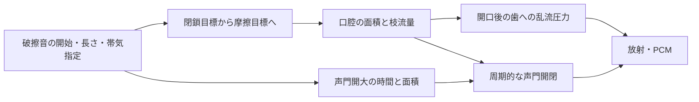

# 歯茎硬口蓋破擦音 /tɕ dʑ/

固定上流 `c6147d0198890475dbe8a65a0bb8f56240c539b7` の IPA・韓国語歌唱を調べる。前回の /ɕ ʑ/ を解放時の狭窄の基準にする。[事前登録](../cases/alveolopalatal-affricates.json)・[摩擦音の基準](alveolopalatal-fricatives.md)

## 上流の経路

IPA の字句解析は `tɕ` と `dʑ` を一つの音素として読む。韓国語では `word_syllables` が音節を作り、語頭の ㅈ・ㅊ・ㅉ に /tɕ/ と帯気指定を付ける。順に開大を決める VOT 指定は45 ms、90 ms、帯気なし。語内で有声音の次の ㅈ は /dʑ/。歌唱計画では頭子音を拍より前に置き、指定を発話計画へ渡す。閉鎖と摩擦の長さの計算は発話と歌唱で共通。[IPA解析](../../../../docs/reference/chimera-vocal-synth/upstream/crates/chimera/src/phonetics/ipa.rs)・[韓国語の頭子音](../../../../docs/reference/chimera-vocal-synth/upstream/crates/chimera/src/phonetics/korean.rs#L230)・[歌唱](../../../../docs/reference/chimera-vocal-synth/upstream/crates/chimera/src/phonetics/sing.rs)

`inventory::phoneme` は両方に六つの閉鎖目標を与える。舌先は (5.85, 10.0) cm、舌体は (3.6, 8.1) cm、唇の突出は0、幅制御値は0.7。顎は解放時に /ɕ/ または /ʑ/ の目標から加わり、舌先の高さにも摩擦音の体型別較正が入る。音素の区間を `[t₀,t₁]`、長さを `d` とすると、`split=t₀+0.45d` が計画上の閉鎖と摩擦の境目になる。閉鎖目標の開始は `t₀−31 ms`、終了は `max(t₀+10 ms, split−20 ms)`、速度倍率は2.0。解放目標の起点 `a=max(t₀,split−15 ms)` に開放子音の8 ms先行が加わり、ジェスチャーは `[a−8 ms,max(a+10 ms,t₁)]`、速度倍率1.4。両方とも強さ40、ランプ30/18 ms、解放時の速度維持45 msを使う。接触の解ける時刻は姿勢の追従と面積補間で決まる。[音素表](../../../../docs/reference/chimera-vocal-synth/upstream/crates/chimera/src/phonetics/inventory.rs#L215)・[閉鎖・解放の分割](../../../../docs/reference/chimera-vocal-synth/upstream/crates/chimera/src/phonetics/planner.rs#L472)・[調音目標の組み立て](../../../../docs/reference/chimera-vocal-synth/upstream/crates/chimera/src/phonetics/planner.rs#L820)

明示の指定がない /tɕ/ では `open=t₀+0.15d`、/dʑ/ では `open=split`。 `affricate_folds` は `max(open,t₁−30 ms)` まで開大目標0.36 cm²を保つ。立ち上がりは35 ms、下降は `min(30 ms,t₁−open)`。短い区間では保持を省き、下降開始と目標の開始が重なる。韓国語の /tɕ/ のように帯気か VOT が渡ると、破裂音と共通の開大を使う。開始は `t₀+0.25d`。帯気ありの韓国語の終端は `t₁+max(0,VOT−30 ms)/rate`、下降は45 ms。帯気なしは `t₁+4.8 ms`、下降20 ms、開大0.22 cm²。制御更新では目標開大に活動度と体型の面積倍率を掛けて基礎開大に足す。話速が1を超えると、設定後の調音・開大のランプと速度維持を話速で割る。[開大の選択](../../../../docs/reference/chimera-vocal-synth/upstream/crates/chimera/src/phonetics/planner.rs#L509)・[短い区間の下降](../../../../docs/reference/chimera-vocal-synth/upstream/crates/chimera/src/phonetics/planner.rs#L678)・[制御更新](../../../../docs/reference/chimera-vocal-synth/upstream/crates/chimera/src/voice/human_voice.rs#L457)

解析は口腔セルの最小断面、同じセルに隣接する枝流量、歯への乱流注入、加工前 PCM、声門面積とF0を時系列で観測する。上流の `AirwayNetwork::step` では接触中に隣接枝の流量を止める。開口して噴流が生じると `update_noise` が選んだ枝から歯へ乱流圧力が伝わる。上流の破擦音テストは /tʃ dʒ/ の10 ms窓で低域の比率と音量から摩擦・発声を検出する。本ケースでは /tɕ dʑ/ の口腔閉鎖と声門振動を内部系列から測り、比較した時刻をPCMにも結び付ける。[閉鎖の境界条件](../../../../docs/reference/chimera-vocal-synth/upstream/crates/chimera/src/airway/network.rs#L925)・[乱流の配置](../../../../docs/reference/chimera-vocal-synth/upstream/crates/chimera/src/voice/human_airway.rs#L329)・[上流の破擦音試験](../../../../docs/reference/chimera-vocal-synth/upstream/crates/chimera/tests/affricates.rs)

## 実装と実測

候補の `speech::affricate_gestures` は閉鎖、摩擦への解放、声門開大の順にイベントを作る。解放の七軸は既存の摩擦音と共有し、帯気指定を受けた無声破擦音は破裂音の開大関数を使う。CLI の内部系列に口腔の枝流量を追加し、上流観測プローブで同じ位置を記録する。音響更新後の最小断面から閉鎖区間を求め、各フレームで最小セルに隣接する枝を選ぶ。開口後に検出した声門面積の山二つが、モデルF0から計算した周期と一致する最初の時点を周期復帰とした。[候補の調音計画](../crates/vocal-core/src/phonetics/speech.rs#L391)・[CLI観測](../crates/vocal-cli/src/timing_case/speech_voice.rs#L767)・[独立計測](../tools/measure_alveolopalatal_affricates.py)

| 条件 | 閉鎖 (ms) | 開口 − 計画境界 (ms) | 開口から周期復帰 (ms) | 周期復帰 − 音素終端 (ms) |
| --- | ---: | ---: | ---: | ---: |
| 成人男性 /tɕ/ | 40.17 | −2.41 | 80.31 | 5.52 |
| 成人男性 /dʑ/ | 31.04 | −2.60 | 73.52 | 8.88 |
| 成人女性 /tɕ/ | 39.46 | −1.74 | 89.06 | 14.94 |
| 44 ms の /dʑ/ | 10.73 | 7.57 | 29.52 | 12.90 |
| 「주」/dʑ/ | 24.38 | −3.08 | 61.27 | 5.40 |
| 「자」/tɕ/・帯気45 ms指定 | 73.29 | −2.32 | 125.83 | 61.92 |
| 「차」/tɕ/・帯気90 ms指定 | 32.33 | −2.32 | 168.88 | 104.96 |
| 「짜」/tɕ/・帯気なし | 32.33 | −2.32 | 93.48 | 29.56 |

閉鎖セルに隣接する枝流量は全条件で0。成人男性の通常の /tɕ dʑ/ では開口から1.90・1.44 msで歯の乱流が活動した。閉鎖最初の15 msの声門振動係数の中央値は /tɕ/ が0.014、/dʑ/ が0.500。44 msに短縮した /dʑ/ の声門開大は保持時間がゼロで、24.2 msで下降した。口腔の開口は通常の長さでは計画境界の約2〜3 ms前、短縮条件では7.57 ms後だった。[全時系列の判定](../runs/alveolopalatal-affricates-20261120-a/summary.json)

韓国語の三つの /tɕ/ では、開大の指定に応じて周期復帰までの時間が異なった。譜例内では音高と前の母音も変わるため、指定だけの寄与は同じ音高・前後母音にそろえた対照で切り分けられる。また IPA の通常 /tɕ dʑ/ と譜例の「주」では、歯の乱流が活動するフレームが、周期の復帰後にも観測された。[比較結果](../runs/alveolopalatal-affricates-20261120-a/summary.json)

固定上流との加工前PCMの最大絶対差は44 msの条件の `9.31×10⁻¹⁰`。計画と内部系列は登録した許容差以内に収まった。AudioWorklet で「아주 자 차 짜」の163,200サンプルを取得し、CLIと保存ケースの再実行にビット一致した。64フレームおきの2,550点の内部状態10系列も照合した。[初回の実行](../runs/alveolopalatal-affricates-20261120-a/manifest.json)・[ブラウザ保存ケース](../runs/alveolopalatal-affricates-20261120-a/artifacts/browser/korean-affricates-case.json)

既存の /t/ の9ファイル、/ɕ ʑ/ と「시야」のネイティブ計測70ファイルは以前の通過版とハッシュが一致した。ワークスペーステスト18件、整形検査、Clippy、上流テスト16件が通過した。[/t/ の回帰](../runs/alveolar-t-20261120-affricate-regression/manifest.json)・[/ɕ ʑ/ の回帰](../runs/alveolopalatal-fricatives-20261120-affricate-regression/manifest.json)

閉鎖開始、再開口、歯が活動し始める位置、周期復帰の先頭と周期長は、すべての観測対象で固定上流と同じフレームだった。

研究ディレクトリと `/tmp` から実行し、各42項目を通過した。PCM、ケース、内部系列など65出力中57件のSHA-256が一致した。要約に残る差はブラウザで停止するまでの時間の丸めだけだった。ブラウザの計測ログは開始フレームと実行時間にも依存する。[再実行の記録](../runs/alveolopalatal-affricates-20261120-repeat/manifest.json)
