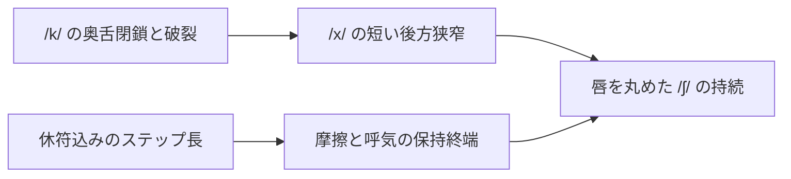

# クラッシュ音 kch の破裂、狭窄と持続時間

固定上流の単発キットは、成人男性の準備姿勢、呼気ゲート0、肺圧設定8 cmH₂Oで打音0.250秒を渡す。`BeatPlayer::gestures` が遅延−13 msを引くためスコアの原点は0.263秒。パターンは先読み200 msで予約し、現在のステップから次の打音までの休符込みの長さをレシピに与える。上流の打音試験は表記、準備時間と先読みへの収まりを検証し、Engine試験はブロックを分割したときの出力を検査する。[単発キット](../../../../docs/reference/chimera-vocal-synth/upstream/crates/chimera-cli/src/render.rs#L621)・[予約と呼び出し](../../../../docs/reference/chimera-vocal-synth/upstream/crates/chimera/src/control/beat_player.rs#L162)・[打音試験](../../../../docs/reference/chimera-vocal-synth/upstream/crates/chimera/tests/beatbox.rs#L37)・[Engine試験](../../../../docs/reference/chimera-vocal-synth/upstream/crates/chimera/tests/engine.rs#L78)

`crash` は /k/ で舌体Yを8.35 cmに上げ、強い閉鎖目標を速度4・減衰8 msで解除する。顎0.7 cmと舌体X=2.3 cmは弱い目標。後続の /x/ は舌体Yを成人男性の較正値7.365 cmに移して奥の狭窄を保つ。その後 /ʃ/ の舌先X/Y（5.7、9.512 cm）、顎、唇の突き出し0.75 cmと横幅0.2を同時に指示する。両摩擦音の立上りは8 msに短縮し、/x/ の舌体速度は1.35倍、/ʃ/ は1.4倍。肺は `1.75 × accent`、声門開大は0.45 cm²の目標を受ける。摩擦目標と呼気の保持終端は `max(0.14, min(0.34, 2 × ステップ長))` 秒。声門開大の保持はそこから0.16秒後まで、さらに0.03秒かけて減衰する。[打音レシピ](../../../../docs/reference/chimera-vocal-synth/upstream/crates/chimera/src/phonetics/beatbox.rs#L246)・[音素目標](../../../../docs/reference/chimera-vocal-synth/upstream/crates/chimera/src/phonetics/inventory.rs#L191)・[調音計画](../../../../docs/reference/chimera-vocal-synth/upstream/crates/chimera/src/phonetics/planner.rs#L820)

| 目標 | 単発での保持開始–終了（秒） | 立上り／減衰（秒） |
| --- | --- | --- |
| /k/ の舌体Y | 0.179–0.229 | 0.030／0.008 |
| /k/ の顎と舌体X | 0.203–0.263 | 0.050／0.050 |
| /x/ の舌体Y | 0.257–0.308 | 0.008／0.030 |
| /x/ の舌体X | 0.265–0.308 | 0.008／0.050 |
| /ʃ/ の調音目標 | 0.280–0.563 | 0.008／0.018 |
| 声門開大 | 0.228–0.723 | 0.020／0.030 |
| 呼気 | 0.218–0.563 | 0.020／0.140 |

64出力フレームごとにジェスチャーを合成し、声道形状を更新する。乱流源の登録は咽頭・口腔で最小の正の断面を選び、断面が広がると利得を落とす。内部サンプルでは枝の絶対流量と断面からレイノルズ数を求め、しきい値1800を超えると狭窄付近へ帯域雑音を注入する。口端へ向かう流れなら狭窄の前方、逆流なら奥側の枝を使う。歯への噴流衝突も、狭窄位置と歯の距離で強さが変わる。[乱流源の配置](../../../../docs/reference/chimera-vocal-synth/upstream/crates/chimera/src/voice/human_airway.rs#L328)・[内部ステップの乱流](../../../../docs/reference/chimera-vocal-synth/upstream/crates/chimera/src/airway/network.rs#L1155)

単発では奥舌閉鎖・解除、解除後と持続部の有効な狭窄枝位置、唇の突き出し、持続部のPCMを観察する。描画はキットと同じ0.5秒にし、スコアの終端は計画JSONで照合する。240 BPMで統一した二つのパターンでは、後続休符の数だけを変え、ステップ長62.5 msと500 msで140 ms・340 msの端を検証する。どちらも最初のアクセントは1.3。保持終端と遅い区間のゲート・PCMを比べ、ゲートと声門開大は別の計算で復元する。[単発ケース](../cases/beatbox-crash.json)・[短いパターン](../cases/beatbox-pattern-crash-short.json)・[長いパターン](../cases/beatbox-pattern-crash-long.json)

## 初回の差と較正値

初回の単発・短いパターンは保持時間と独立計算の時系列が合った一方、調音目標と音響の比較で不合格だった。最初の計画差は4番目のジェスチャーにある /x/ の舌体Yで、基礎表の7.700 cmを使った候補に対し、上流は7.365 cmだった。 /ʃ/ の舌先Yも基礎表では9.500 cm、上流は9.512 cmだった。`phoneme` は音素の基礎表に `consonantTargets.generated.json` の体型別設定を重ねる。固定版の成人男性の較正値を接続した。単発の最初の時系列差はフレーム11968（249.354 ms）の唇端面積で、/x/ の立上りの直後だった。初回のPCM最大差は単発で約0.182。元の実行と入力を保存し、同じ登録ケースで再計測した。[単発の初回](../runs/crash-20261120-single-a/summary.json)・[短いパターンの初回](../runs/crash-20261120-short-a/summary.json)・[較正の適用](../../../../docs/reference/chimera-vocal-synth/upstream/crates/chimera/src/phonetics/inventory.rs#L264)・[成人男性の較正値](../../../../docs/reference/chimera-vocal-synth/upstream/crates/chimera/src/phonetics/consonantTargets.generated.json#L27)

## 結果

単発とパターンに8ジェスチャーの共通レシピを追加した。上流・候補が登録した狭窄乱流源の枝番号を、咽頭の先頭から口端へ向かう0始まりのセル番号に換算して比較した。単発では242.688 msで閉鎖が解除され、閾値0.005以上の狭窄乱流源は243.604 msに23番、254.688 msに34番、325.354 msに28番で観測された。持続部における唇の突き出し中央値は0.749 cm、横幅中央値は0.200。遅い観測窓のPCM RMSは0.03719だった。[共通レシピ](../crates/vocal-core/src/phonetics/beatbox.rs)・[計測器](../tools/measure_beatbox_crash.py)・[単発の要約](../runs/crash-20261120-single-b/summary.json)・[枝番号と乱流振幅のCSV](../runs/crash-20261120-single-b/artifacts/upstream.csv)

| 観測量 | 単発 | 短いパターン | 長いパターン |
| --- | ---: | ---: | ---: |
| 入力のステップ長 | 150 ms | 62.5 ms | 500 ms |
| 摩擦と呼気の保持終端（音源時刻） | 563 ms | 353 ms | 553 ms |
| 515–545 msの平均呼気ゲート |  | 0.03295 | 2.27500 |
| 同じ窓のPCM RMS |  | 0.001477 | 0.04313 |
| PCMの固定上流との差（最大絶対値） | `7.28×10⁻¹²` 以下 | `2.92×10⁻¹¹` 以下 | `1.46×10⁻¹¹` 以下 |

短い条件では `2 × 62.5 ms` に下限140 ms、長い条件では `2 × 500 ms` に上限340 msが効いた。両パターンとも最初の打音200 msに13 msの時刻補正が加わる。呼気ゲートと声門開大を独立計算で照合した最大差はそれぞれ `5.01×10⁻¹⁴`、`2.01×10⁻¹³ cm²` 以下だった。単発は13項目、パターン2条件は各15項目が通過。128・77フレームのブロック分割ではPCMがバイト一致した。[単発](../runs/crash-20261120-single-b/manifest.json)・[下限](../runs/crash-20261120-short-b/manifest.json)・[上限](../runs/crash-20261120-long-b/manifest.json)

出力48 kHz、内部96 kHz、macOS arm64、Rust 1.94.1、Python 3.14.4、NumPy 2.4.4で実行した。既定の乱数シードは乱流12345、声門周期の揺らぎ777、F0のドリフト4242で、上流と候補で共通。候補のRust整形・Clippy・ワークスペーステストと固定上流の `beatbox`・`engine` テストが通過した。[乱流の乱数](../../../../docs/reference/chimera-vocal-synth/upstream/crates/chimera/src/airway/network.rs#L429)・[声門の乱数](../../../../docs/reference/chimera-vocal-synth/upstream/crates/chimera/src/sources/glottis.rs#L121)

研究ディレクトリと `/tmp` から再実行し、設定、PCM、時系列、要約など単発11ファイル、パターン各12ファイルのハッシュが一致した。奥舌の閉鎖・摩擦を共有するリムショットと吸気スネア、既存の `P!` パターンも再実行し、各7ファイルが実装前の結果と一致した。[単発の再実行](../runs/crash-20261120-single-repeat/manifest.json)・[下限の再実行](../runs/crash-20261120-short-repeat/manifest.json)・[上限の再実行](../runs/crash-20261120-long-repeat/manifest.json)・[リムショットの回帰](../runs/crash-20261120-rim-after/manifest.json)・[吸気スネアの回帰](../runs/crash-20261120-inward-after/manifest.json)・[唇の打音の回帰](../runs/crash-20261120-pop-pattern-after/manifest.json)
