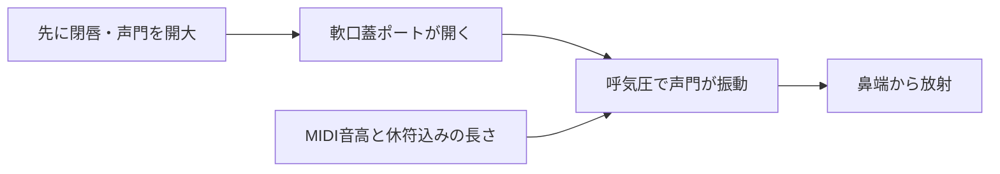

# 鼻音の打音 m とMIDI音高

単発キットは成人男性の準備姿勢と肺圧設定8 cmH₂O・演奏者ゲート0で `BeatPlayer::gestures` を呼ぶ。公称打音0.250秒から遅延5.6 msを引いた0.2444秒がスコアの原点。パターンでは小節線と休符を解釈し、音色の後ろの `:整数` をMIDIノート、末尾の `>` をアクセント1.3として扱う。音高指定なしではMIDI 40。音高目標は `440 × 2^((MIDI − 69) / 12)` Hzとなる。上流の打音試験では `m:43` の解析、記譜の往復、全音色が先読み時間内に収まることを検査する。[単発キット](../../../../docs/reference/chimera-vocal-synth/upstream/crates/chimera-cli/src/render.rs#L621)・[予約と調音スコア](../../../../docs/reference/chimera-vocal-synth/upstream/crates/chimera/src/control/beat_player.rs#L162)・[記譜と既定音高](../../../../docs/reference/chimera-vocal-synth/upstream/crates/chimera/src/phonetics/beatbox.rs#L307)・[音高変換](../../../../docs/reference/chimera-vocal-synth/upstream/crates/chimera/src/math.rs#L165)・[上流試験](../../../../docs/reference/chimera-vocal-synth/upstream/crates/chimera/tests/beatbox.rs#L37)

`hum` は /m/ の唇開度−0.25 cmを強い目標とし、閉鎖の指示を22 ms、解除の指示を19 ms前倒しする。手前で声門を一時開大し、閉鎖を作るときに動く空気を肺側へ通す。軟口蓋の目標面積は0.9 cm²で、合成された有効度に応じて鼻腔ポートが開く。呼気目標は `0.95 × accent`。鼻腔・呼気・音高の各保持終端は原点に `max(0.06, 0.92 × ステップ長)` 秒を足す。[打音レシピ](../../../../docs/reference/chimera-vocal-synth/upstream/crates/chimera/src/phonetics/beatbox.rs#L259)・[/m/ の目標](../../../../docs/reference/chimera-vocal-synth/upstream/crates/chimera/src/phonetics/inventory.rs#L172)・[閉鎖計画](../../../../docs/reference/chimera-vocal-synth/upstream/crates/chimera/src/phonetics/planner.rs#L820)

| 目標 | 単発の保持開始–終了（秒） | 立上り／減衰（秒） |
| --- | --- | --- |
| 唇の閉鎖 | 0.1924–0.3634 | 0.030／0.018 |
| 軟口蓋 | 0.2244–0.3824 | 0.030／0.030 |
| 準備時の声門開大 | 0.1644–0.2144 | 0.020／0.020 |
| 呼気 | 0.2344–0.3824 | 0.020／0.040 |
| 音高 | 0.2244–0.3824 | 0.015／0.020 |

制御更新では、音高スコアに重みがある間は基準音高に重み0.02、各音高目標に余弦ランプの重みを掛け、目標と現在値の対数差を時定数30 msで追従する。スコアが終わると基準へ時定数60 msで戻る。声門周期に使う瞬時F0には別にドリフトが加わる。声道形状をそれより先に更新し、正の軟口蓋面積を咽頭末尾と鼻腔先頭を結ぶポートの目標にする。内部サンプルでは肺圧、声門、伝搬、鼻端と口端の放射を更新し、声門の振動は上下の圧力差で立ち上がる。[制御順序](../../../../docs/reference/chimera-vocal-synth/upstream/crates/chimera/src/voice/human_voice.rs#L455)・[鼻腔の接続](../../../../docs/reference/chimera-vocal-synth/upstream/crates/chimera/src/voice/human_airway.rs#L155)・[ポートの形状目標](../../../../docs/reference/chimera-vocal-synth/upstream/crates/chimera/src/voice/human_airway.rs#L322)

単発では口端閉鎖と発声の順、鼻端と口端の体積流量、MIDI 40の音高を観測する。短いステップ62.5 msの比較は保持時間の下限60 msを計画値で確かめる。パターンでは `m:43>` と `M:47` を各定常窓で観測し、鼻端への放射、PCMの周期、休符込みの保持終端を照合する。別計算で音高と呼気ゲートの制御を再現し、PCMの自己相関から出力の周期を検査する。[単発ケース](../cases/beatbox-hum.json)・[パターンケース](../cases/beatbox-pattern-hum.json)

## 結果

単発とパターンに5つのジェスチャーを接続し、MIDI音高をステップ、予約、調音スコアまで渡した。単発ケースの `midi_note` は省略時に40を使う。 `inspect` ではパターンのスロット音高と、音高指定がある予約の値を保存する。鼻音の観測では軟口蓋の位置・目標、補間後の鼻腔ポートの面積・流量、ドリフトを掛ける前のF0を採った。初回から単発15項目、パターン16項目が通過し、判定条件を改訂する必要はなかった。[調音と音高](../crates/vocal-core/src/phonetics/beatbox.rs)・[予約時の記譜解析](../crates/vocal-core/src/phonetics/beatbox/player.rs)・[独立計測](../tools/measure_beatbox_hum.py)

| 観測量 | 単発 MIDI 40 | パターン MIDI 43 | パターン MIDI 47 |
| --- | ---: | ---: | ---: |
| 入力のステップ長 | 150 ms | 375 ms | 625 ms |
| 音高、呼気、軟口蓋の保持終端（音源時刻） | 382.4 ms | 539.4 ms | 1144.4 ms |
| MIDI変換による音高 | 82.407 Hz | 97.999 Hz | 123.471 Hz |
| PCMの自己相関ピークからの音高 | 82.474 Hz | 97.959 Hz | 123.711 Hz |
| 鼻端流量のRMS（cm³/s） | 166.08 | 303.32 | 162.42 |
| 鼻腔ポート面積の中央値（cm²） | 0.899 | 0.900 | 0.900 |

単発は194.417 msで閉唇し、口端の最小面積が0.0002 cm²を下回った。鼻腔ポートの面積が0.0002 cm²を超えたのは212.021 ms、鼻端流量の絶対値が10 cm³/sを超えたのは215.688 ms、振動ゲートが0.1に達したのは247.354 msだった。三つの定常窓で、口端流量のRMSは候補・上流ともに `10⁻²⁵ cm³/s` 未満。ステップ長62.5 msの比較では60 msの下限が適用され、単発と同じ開始時刻から保持終端304.4 msを得た。[単発の測定](../runs/hum-20261120-single-a/summary.json)・[単発の時系列](../runs/hum-20261120-single-a/artifacts/upstream.csv)・[パターンの測定](../runs/hum-20261120-pattern-a/summary.json)

音高の独立計算との差は最大 `1.65×10⁻¹² Hz`、軟口蓋の位置では `4.68×10⁻¹⁴ cm²` 以下。単発・パターンとも固定上流とのPCM最大絶対差は `7.28×10⁻¹²` 以下で、128・77フレームのホスト分割はバイト一致した。出力48 kHz、内部96 kHz、macOS arm64、Rust 1.94.1、Python 3.14.4、NumPy 2.4.4で実行した。乱数シードは乱流12345、声門周期の揺らぎ777、F0ドリフト4242。Rustの整形、Clippy、ワークスペーステストと固定上流の `beatbox`・`engine` テストも通過した。[単発の実行](../runs/hum-20261120-single-a/manifest.json)・[パターンの実行](../runs/hum-20261120-pattern-a/manifest.json)

研究ディレクトリと `/tmp` からの再実行で、設定・PCM・時系列・要約など単発16ファイルとパターン12ファイルがバイト一致した。クラッシュの単発と下限・上限パターンの回帰は、実装前後で各7ファイルが一致した。単発ケースに `midi_note` を45と指定して `inspect` を実行すると、音高ジェスチャーは110 Hzになった。[単発の再実行](../runs/hum-20261120-single-repeat/manifest.json)・[パターンの再実行](../runs/hum-20261120-pattern-repeat/manifest.json)・[クラッシュ単発の回帰](../runs/hum-20261120-crash-after/manifest.json)・[下限パターンの回帰](../runs/hum-20261120-short-after/manifest.json)・[上限パターンの回帰](../runs/hum-20261120-long-after/manifest.json)
