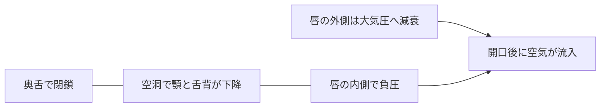

# 唇を使う打音 P! の閉鎖と空洞圧

上流の単発キットは成人男性の準備姿勢から打音0.250秒、呼気ゲート0で描画する。 `BeatPlayer::gestures` は `P!` の遅延−1 msを引くため、調音スコアの原点は0.251秒になる。パターンは同じレシピを200 ms先読みし、`p!>` を `P!` のアクセント1.3として予約する。この音色のレシピはアクセントとステップ長による補正を持たない。上流の音色試験では全音色の前後時間と予約時の先読み、および記譜の往復を確認している。気道の閉鎖試験は、圧力が残る閉鎖の解除で放射が過大にならないことを調べている。[単発キット](../../../../docs/reference/chimera-vocal-synth/upstream/crates/chimera-cli/src/render.rs#L621)・[打音の予約と変換](../../../../docs/reference/chimera-vocal-synth/upstream/crates/chimera/src/control/beat_player.rs#L165)・[音色試験](../../../../docs/reference/chimera-vocal-synth/upstream/crates/chimera/tests/beatbox.rs#L46)・[気道の閉鎖試験](../../../../docs/reference/chimera-vocal-synth/upstream/crates/chimera/tests/airway_adversarial.rs#L165)

`lip_pop` では /p/ の唇開度を−0.08 cmに上書きし、軽い唇の接触を作る。閉鎖目標の保持はスコアの原点の19 ms前に終わり、減衰は6 ms、速度倍率は5。奥舌の閉鎖には /k/ の舌体Y=8.35 cmを使い、弱い顎0.7 cmと舌体X=2.3 cmの目標を重ねる。唇が閉じている間に、同じ強いジェスチャーで顎を1.6 cmへ下げ、舌背の変位を1へ近づける。舌背が下がると舌体中心から舌先の間の舌表面が `−0.9 × dorsum × sin²(πu⁰·⁸)` cmだけ下がる。顎と舌背は自然周波数10 Hz・9 Hzの二次系で、制御更新ごとに速度、位置の順に進む。[上流レシピ](../../../../docs/reference/chimera-vocal-synth/upstream/crates/chimera/src/phonetics/beatbox.rs#L237)・[/p/ と /k/ の目標](../../../../docs/reference/chimera-vocal-synth/upstream/crates/chimera/src/phonetics/inventory.rs#L134)・[調音計画](../../../../docs/reference/chimera-vocal-synth/upstream/crates/chimera/src/phonetics/planner.rs#L820)・[調音器](../../../../docs/reference/chimera-vocal-synth/upstream/crates/chimera/src/control/articulators.rs#L109)・[舌背変形](../../../../docs/reference/chimera-vocal-synth/upstream/crates/chimera/src/anatomy/human.rs#L862)

| 目標 | 単発の保持開始–終了（秒） | 立上り／減衰（秒） | 重み |
| --- | --- | --- | --- |
| 唇の閉鎖 | 0.109–0.232 | 0.030／0.006 | 40 |
| 奥舌の舌体Y | 0.107–0.247 | 0.030／0.030 | 40 |
| /k/ の顎、舌体X | 0.131–0.281 | 0.050／0.050 | 2.2、0.25 |
| 顎を下げる動き、舌背 | 0.181–0.255 | 0.040／0.050 | 40 |

口腔セルの体積 `V=AΔx` の増加は、内部サンプルごとの `−ΔV/Δt` を通じて負の体積流量源となる。口端を閉じると最終セルは外気側として扱われ、内部1サンプルあたり圧力は0.98倍、放射流量の状態は0.995倍になる。開口時は音響コンプライアンスと並列R–L放射負荷を連立し、慣性係数は断面の平方根に反比例する。放射全体の体積流量の差分が出力段への入力になる。[体積流量源](../../../../docs/reference/chimera-vocal-synth/upstream/crates/chimera/src/airway/network.rs#L834)・[閉口時の減衰と開口時の放射](../../../../docs/reference/chimera-vocal-synth/upstream/crates/chimera/src/airway/network.rs#L1071)

唇と後側の口腔セルが閉じた連続区間を見つけ、内側の体積、体積で重み付けした圧力、顎と舌背の移動量を測る。唇側の解除時に奥が閉じたままか、解除後30 msの口端流量の符号とPCMピークも確認する。閉鎖した口端での2出力フレームの比較から、圧力と流量が内部サンプル数に応じた倍率で減るかを検査する。顎・舌背は余弦ランプ、目標の合成と二次系を別計算で積分する。[単発ケース](../cases/beatbox-lip-pop.json)・[パターンケース](../cases/beatbox-pattern-lip-pop.json)

## 結果

既存の唇と奥舌の閉鎖、口腔セルの計測を使い、新しい打音スコアをCLIの単発とパターンに接続した。固定上流と比較した保持時刻・目標は全件一致し、閉鎖セル6・17の間の10セル（0始まりで7〜16）の体積と圧力が許容差内だった。無次元の舌背の位置を独立計算で積分した最大誤差は `2.22×10⁻¹³` 以下、顎は `1.27×10⁻¹³ cm` 以下。[レシピ](../crates/vocal-core/src/phonetics/beatbox.rs)・[計測器](../tools/measure_beatbox_lip_pop.py)

| 観測量 | 単発 `P!` | パターン `B . p!> \| -` |
| --- | ---: | ---: |
| 二重閉鎖開始–開唇 | 129.083–249.375 ms | 329.083–449.375 ms |
| 二重閉鎖中の空洞の体積（初期→最大） | 7.820→13.650 cm³ | 7.778→13.650 cm³ |
| 二重閉鎖中の顎の下降量 | 0.936 cm | 0.939 cm |
| 空洞圧の最小とその時刻 | −24,445 dyn/cm²、233.938 ms | −29,598 dyn/cm²、433.938 ms |
| 開唇後30 msの口端流量の最小値 | −366.58 cm³/s | −438.43 cm³/s |
| 開唇後30 msのPCMピーク | 0.06793 | 0.08044 |
| 固定上流との差（PCMの最大絶対値） | `7.28×10⁻¹²` 以下 | `7.28×10⁻¹²` 以下 |

空洞の圧力が最小になるのは開唇の15.438 ms前で、両条件の閉鎖中の口端圧はその時点でほぼ0 dyn/cm²。出力2フレームがともに閉じていた6,799・6,849組では、口端の圧力は `0.98²`、放射流量は `0.995²` の減衰式と一致した。最大残差は圧力で `2.85×10⁻¹⁴ dyn/cm²`、流量で `8.89×10⁻¹⁶ cm³/s` 以下。単発では奥舌が開いたのは開唇の29.625 ms後だった。単発の閉鎖セル番号は断面が実質ゼロの64フレームで異なり、舌打ちで登録済みの同率判定に従って各セルの面積を照合した。[単発の要約](../runs/lip-pop-20261120-single-a/summary.json)・[パターンの要約](../runs/lip-pop-20261120-pattern-a/summary.json)

単発13項目、パターン16項目が初回から通過。出力48 kHz、内部96 kHz、macOS arm64、Rust 1.94.1、Python 3.14.4、NumPy 2.4.4で実行し、128・77フレームでPCMがバイト一致した。候補のRust整形、Clippy、ワークスペーステスト、上流の `beatbox`・`engine` と `cargo test --locked -p chimera --test airway_adversarial a_realistic_sliding_closure_with_trapped_pressure_releases_without_spikes` が通過した。[単発の実行](../runs/lip-pop-20261120-single-a/manifest.json)・[パターンの実行](../runs/lip-pop-20261120-pattern-a/manifest.json)

研究ディレクトリと `/tmp` からの実行で、設定、PCM、時系列、要約などのハッシュが単発11ファイル、パターン12ファイルで一致した。口腔の計測を共有する舌打ち音の単発とパターンも実装前後で再実行し、各7ファイルが一致した。[単発の再実行](../runs/lip-pop-20261120-single-repeat/manifest.json)・[パターンの再実行](../runs/lip-pop-20261120-pattern-repeat/manifest.json)・[舌打ち単発の回帰](../runs/lip-pop-20261120-click-after/manifest.json)・[舌打ちパターンの回帰](../runs/lip-pop-20261120-pattern-after/manifest.json)
