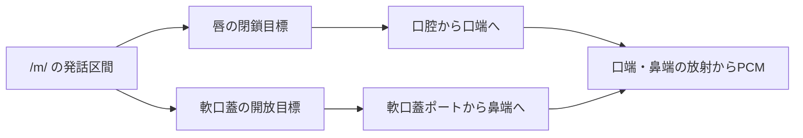

# 両唇鼻音の閉鎖と鼻腔への流れ

固定上流版は `c6147d0198890475dbe8a65a0bb8f56240c539b7`。第5段階の `ɑmɑ` を発話スコア、唇と軟口蓋、ポートと放射の順で調べる。

## 上流の入口と更新

1. CLIの `render speech` がIPAを `plan_utterance` に渡す。上流の /m/ は有声の両唇鼻音で、閉鎖目標の唇の開きは −0.25 cm。鼻音の閉鎖予定を音素の始点から10 ms遅らせる。短い音素では音素長から30 msを引いた非負の値が上限。予定から22 ms前に閉鎖の保持に入り、終端は `max(予定+10 ms, 音素終端−19 ms)`。入り30 ms、出18 ms、強さ40、速度1.55倍、速度延長45 msは両唇破裂音と共通。[CLI](../../../../docs/reference/chimera-vocal-synth/upstream/crates/chimera-cli/src/render.rs#L110)・[目録](../../../../docs/reference/chimera-vocal-synth/upstream/crates/chimera/src/phonetics/inventory.rs#L175)・[閉鎖遅れ](../../../../docs/reference/chimera-vocal-synth/upstream/crates/chimera/src/phonetics/planner.rs#L694)・[口腔ジェスチャー](../../../../docs/reference/chimera-vocal-synth/upstream/crates/chimera/src/phonetics/planner.rs#L820)
2. 鼻音は軟口蓋に0.45 cm²・強さ4のジェスチャーを持つ。入り50 ms、出30 msで、保持は音素の始点20 ms前から終端20 ms前まで。後続が有声破裂音の場合は終端5 ms前まで保持する。発話末の鼻音は共鳴音と扱い、声門の追加開大が保持に達する時刻は発話末から45 ms後。話速が1を超えると調音・追加開大のランプを短縮する。[軟口蓋の計画](../../../../docs/reference/chimera-vocal-synth/upstream/crates/chimera/src/phonetics/planner.rs#L486)・[発話末](../../../../docs/reference/chimera-vocal-synth/upstream/crates/chimera/src/phonetics/planner.rs#L595)
3. スコアの活性は余弦で変化する。軟口蓋の有効目標は `base + min(1, weight/2) × (target−base)`。角周波数 `ω = 2π×12` rad/sで、速度と位置を `v += dt(ω²(y−x)−2ωv)`、`x += dt v` の順に更新する。位置 `x` と有効目標 `y` は符号付きのcm²、物理ポートの終点は `max(0,x)`。制御ブロックの内部サンプルで前回の面積から線形補間する。[調音の制御式](../../../../docs/reference/chimera-vocal-synth/upstream/crates/chimera/src/control/articulators.rs#L106)・[ポート面積](../../../../docs/reference/chimera-vocal-synth/upstream/crates/chimera/src/anatomy/human.rs#L1270)・[気道への接続](../../../../docs/reference/chimera-vocal-synth/upstream/crates/chimera/src/voice/human_airway.rs#L322)
4. 鼻端の放射流量と軟口蓋ポートを抜ける流量は、異なる位置の時系列である。口腔の聴覚的な閉鎖指標には、上流テストと同じ0.05 cm²の断面積を使い、気道ネットワークの唇の閉鎖指標には最小断面0.0002 cm²を使う。通常の声門・量子化・乱数の比較は先行ケースと設定をそろえる。[鼻音の時刻テスト](../../../../docs/reference/chimera-vocal-synth/upstream/crates/chimera/tests/nasal_spans.rs#L17)・[母音への鼻音の広がりと末尾](../../../../docs/reference/chimera-vocal-synth/upstream/crates/chimera/tests/speech_quality.rs#L53)

## 実装前の条件と予測

内部96 kHz・出力48 kHzで、計画、唇・軟口蓋と両出口の流量を全フレームで測る。幾何の上流との差は `10⁻⁹`、PCMは絶対差 `10⁻⁶`、軟口蓋の独立計算は `10⁻¹⁰ cm²` を許容する。スコア実行に加えてホスト分割77・128フレームの結果を比較する。[基本](../cases/bilabial-nasal-m.json)・[有声破裂音前](../cases/bilabial-nasal-mb.json)・[無声破裂音前](../cases/bilabial-nasal-mp.json)・[発話末](../cases/bilabial-nasal-final.json)・[基準5発話](../cases/bilabial-nasal-vcv.json)

- `ɑmɑ` の /m/ は211.82212〜280.32212 ms。軟口蓋の保持開始を191.82212 ms、終了を260.32212 msと予測した。音素区間の30〜65%でポートのピークは0.2 cm²を超え、口と鼻の放射流量のRMS合計に占める鼻端の比率は80%以上になる。
- `ɑmbɑ` と `ɑmpɑ` の /m/ は同じ211.82212〜277.77212 ms。/b/ の前では保持終了が15 ms遅れる。ポートが0.01 cm²を再び下回る時刻の差は、制御周期の丸めを見込み12〜18 msと予測した。
- `ˈɑm` の終端は448.5 ms。声門の追加開大の保持に達する時刻は493.5 msで、発話末から150 ms以降のPCMのRMSは全区間ピークより50 dB以上低下すると予測した。5発話を連結した対照では分割順、音素ラベル、各ジェスチャーの時刻、波形を上流と比較する。

## 実装と実測

[発話スコア](../crates/vocal-core/src/phonetics/speech.rs) は /m/ と /p b/ の唇ジェスチャーの組み立てを共用し、/m/ の閉鎖遅れ、軟口蓋と発話末の共鳴音の扱いを追加した。/s z/ から両唇破裂音へつながるときの補正も上流に合わせ、`ɑspɑ` の計画で /p/ の唇の保持が音素の2 ms前から始まることを確認した。観測値の時刻は `(frame+1)/48000` 秒。5発話を連結したケースでは /s z/ があるため、乱流源も一つの気道で連続して動作する。[観測コード](../crates/vocal-cli/src/timing_case/speech_voice.rs)・[上流のMIT通知](../LICENSE-CHIMERA)

唇・軟口蓋・口鼻端の観測値は固定上流の時系列と照合した。初回の `ɑmɑ` は鼻端優位の補助指標に瞬間流量を使ったため、周期内の一時的な交差を開き始めの172.21 msで拾った。再実行では、直前5 msのRMSで比較した。軟口蓋の開閉、口腔断面の閾値、中央窓の流量比、PCMの判定は同じ。独立した軟口蓋計算には余弦と等価な三角関数を使い、目標の混合・速度と位置・ポートの補間を順に計算した。[瞬間値を使った初回](../runs/bilabial-nasal-m-20261119-a/summary.json)・[RMSを使った結果](../runs/bilabial-nasal-m-20261119-b/summary.json)

`ɑmɑ` ではポートが0.01 cm²を上回ったのが170.69 ms、口腔セルの平均断面の最小値が0.05 cm²を下回ったのが228.73 ms、唇の最小断面が0.0002 cm²を下回ったのが238.65 ms。直前5 msのRMSで鼻端が口端を上回ったのは228.65 msだった。中央窓の鼻端と口端の流量のRMSはそれぞれ186.58、9.31 cm³/sで、RMS合計の95.25%を鼻端が占めた。閉鎖の閾値より小さいポートで枝流量が常に0であることも確認した。[基本ケースの要約](../runs/bilabial-nasal-m-20261119-b/summary.json)

`ɑmbɑ` と `ɑmpɑ` の /m/ 区間は同じ。軟口蓋が0.01 cm²を下回る時刻は /p/ の前312.83 ms、/b/ の前327.85 msで、15.02 msの差だった。発話末の `ˈɑm` では、発話終端から150 ms以降のRMSが全区間ピーク比で−75.07 dBだった。[破裂音の対照](../runs/bilabial-nasal-mb-20261119-b/summary.json)・[発話末](../runs/bilabial-nasal-final-20261119-b/summary.json)

全5条件のジェスチャーと観測した実測時刻が固定上流版に一致した。PCM最大絶対差は `2.33×10⁻¹⁰`。基準5発話は202,527出力フレームで一致した。[基準5発話の要約](../runs/bilabial-nasal-vcv-20261119-b/summary.json)

別ディレクトリ `/tmp` から再実行し、候補・上流の時系列・PCM・設定・計画の45ファイルが先行実行とバイト一致した。直前の両唇破裂音と歯茎摩擦音も再実行し、比較した18ファイルが一致した。軟口蓋の独立計算と実装との差は、有効目標・位置・ポート面積を合わせて最大 `7.22×10⁻¹² cm²`。候補の整形・テスト・Clippyと上流の鼻音時刻・発話品質テストを通過した。[基準5発話の実行記録](../runs/bilabial-nasal-vcv-20261119-b/manifest.json)・[歯茎摩擦音の回帰](../runs/sibilant-s-20261119-d/manifest.json)・[両唇破裂音の回帰](../runs/bilabial-p-20261119-e/manifest.json)
