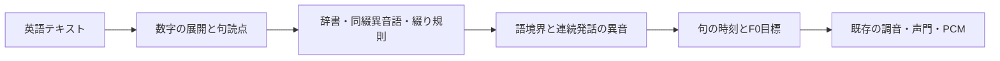

# 英語テキストから音素・句・F0へ

固定上流版は `c6147d0198890475dbe8a65a0bb8f56240c539b7`。第5段階の英語発話を、正規化、語の発音、句の時刻と抑揚、音声の順で調べる。

## 上流の読み方

1. `render text` は gzip で保存されたCMUdictの「語・タブ・ARPAbet」表を読み込む。同じ見出し語が複数あれば後の行が有効。音声の辞書を持つ場合も `read` や `wind` など6語は規定の同綴異音語を先に選ぶ。辞書にないハイフン付きの語は部分に分け、最後に規則による読みへ進む。[CLIの辞書読み込み](../../../../docs/reference/chimera-vocal-synth/upstream/crates/chimera-cli/src/render.rs#L39)・[辞書と語の発音](../../../../docs/reference/chimera-vocal-synth/upstream/crates/chimera/src/phonetics/english.rs#L109)
2. 右シングル引用符をアポストロフィにし、ASCII数字の連続を数詞へ展開する。100万未満は十・百・千の構造を使い、100万以上は浮動小数点へ丸めた表現の数字を個別に読む。ASCIIの英字・アポストロフィ・ハイフンを残して語に分ける。連続した句読点のまとまりで句を閉じ、疑問符があれば疑問型。休止は終止符・感嘆符・疑問符で0.35秒、コンマ・コロン・セミコロンで0.18秒、句読点のない末尾で0.30秒。[句処理](../../../../docs/reference/chimera-vocal-synth/upstream/crates/chimera/src/phonetics/english.rs#L132)・[数詞](../../../../docs/reference/chimera-vocal-synth/upstream/crates/chimera/src/phonetics/english.rs#L295)
3. ARPAbetの末尾数字から強勢を得る。子音の強勢は0、無強勢の `AH/ER` は /ə ɚ/。機能語を弱める指定で強勢を落とし、一部の単音節語を /ə/ に寄せる。未知語はUTF-16符号単位上で順序付き規則のうち、文字列と前後の条件が合う先頭のものを選ぶ。最初の母音だけに主強勢。発音が空のトークンは語境界を作らない。[ARPAbetと連続発話の異音](../../../../docs/reference/chimera-vocal-synth/upstream/crates/chimera/src/phonetics/english.rs#L239)・[未知語の規則](../../../../docs/reference/chimera-vocal-synth/upstream/crates/chimera/src/phonetics/english.rs#L350)
4. 句の音素列を作ってから、母音や /ɹ/ の後の /t d/ を無強勢母音の前で /ɾ/ にする。前の音素が語末なら舌先の弾きに替えない。後続が母音以外か /l/ 自身が語末なら /ɫ/。語境界と辞書の参照結果は観測できる形で残す。[異音](../../../../docs/reference/chimera-vocal-synth/upstream/crates/chimera/src/phonetics/english.rs#L269)
5. `render::say` の最初の句は50 ms、次の句は前の区間の終端と休止の和から開始する。実際の音素には既存の呼気リード60 msが付く。成人男性の基準F0は112 Hz。最後の母音の目標は疑問文で基準の1.35倍、平叙文で最後に0.82倍。最後の句の終端に300 msを加えてPCMの長さを決める。[CLIの英語発話](../../../../docs/reference/chimera-vocal-synth/upstream/crates/chimera-cli/src/render.rs#L179)・[句の配置](../../../../docs/reference/chimera-vocal-synth/upstream/crates/chimera/src/phonetics/planner.rs#L878)・[F0の規則](../../../../docs/reference/chimera-vocal-synth/upstream/crates/chimera/src/phonetics/planner.rs#L614)

## 実装前の予測と判定

- `Hello world` の末尾の /l/ は /ɫ/、`water` の /t/ は /ɾ/。辞書登録のない語は規則、`read` などは上書きを報告する。`007; 42: 1001, 1000000.` は先頭のゼロを省き、100万を1と6個の0に展開する。疑問符や空のトークンも含めて、語と語末マークが一対一になることを照合する。
- `Mom? Pop.` の最後のF0目標は151.2 Hzと91.84 Hz。次の句の計画起点は最初の計画終端+350 ms。固定上流と句の構造・強勢・語境界は完全一致、区間とF0は絶対差 `10⁻¹²` 以下を許容する。TypeScript参照の504語・9件のARPAbet・38文も検証する。
- `Mom? Pop.` で既存の調音とWAVへの経路を検証する。音素・ジェスチャーを固定上流と照合し、周期変動と乱流を止めた条件でPCMの差を `10⁻⁶` 以下、ホストの77・128フレーム分割で同一のWAVと出力CSVを予測する。

[発音・句分割ケース](../cases/english-frontend.json)・[英語音声ケース](../cases/english-mom-pop.json)・[上流の照合テスト](../../../../docs/reference/chimera-vocal-synth/upstream/crates/chimera/tests/golden_phonetics_text.rs#L60)

## 実装と実測

[英語の実装](../crates/vocal-core/src/phonetics/english.rs) では、辞書の平文を保持し、見出しとARPAbetを参照する表を一度構築する。各語について辞書・同綴異音語・ハイフン分解・綴り規則を記録する。綴り規則90件は固定上流の順序を保持したデータで、最初の抽出で件数を93と見込んだ点を原典の全タプルを数えて訂正した。CMUdictは固定上流と同じ gzip とライセンスを同梱し、126,052の見出しと両ファイルのSHA-256を照合した。[綴り規則](../crates/vocal-core/src/phonetics/english/lts.generated.json)・[上流のMIT通知](../LICENSE-CHIMERA)・[CMUdictのライセンス](../data/CMUDICT-LICENSE.txt)

登録入力に既存のTypeScript参照を加え、86件のテキスト、514件の語入力、12件のARPAbet入力を固定版と照合した。参照にある504語は辞書あり・なしの弱形・通常形と綴り規則の5種類、38文は辞書あり・なしの両方、ARPAbetは9入力を比較した。構造が一致し、比較した句の開始・終了とF0目標の最大差は0。句の開始については前句の終端に休止を足し、最後の句の終端に300 msを足す計算も確認した。[比較器](../tools/measure_english_frontend.py)・[最終結果](../runs/english-frontend-20261119-b/summary.json)

`Mom? Pop.` の第1句は50 msから518.5 ms、第2句は868.5 msから1,350.45 ms。最後のF0目標は151.2 Hzと91.84 Hz。候補は固定版と同じように110 Hzで声門を初期化し、基準112 Hzへ滑らかに移行する。ピッチの周期変動と乱流を0にした比較で、PCMの差は最大 `2.33×10⁻¹⁰`。上流の通常CLIと表示されたIPAおよび48 kHzの79,222フレームが一致した。[再実行のPCM](../runs/english-frontend-20261119-b/artifacts/english-audio/pcm-128.wav)・[音声の設定と計画](../runs/english-frontend-20261119-b/artifacts/english-audio/settings.json)

`Hello world` の発音・区間・F0目標も得られた。`unavailable_speech_symbols` はこの文の音声化に必要な /d h l w ɫ/ を表示する。`render-pcm` で同じ文を指定すると、これらの音素名を報告して終了コード1を返すことを確認した。[英語入力の全件](../runs/english-frontend-20261119-b/artifacts/frontend.json)

`/tmp` からの再実行で、発音・計画・音声・要約など17ファイルが初回とバイト一致した。基準IPAの5発話は回帰試験の全判定に通り、計画・音声・要約の10ファイルが先行実行とバイト一致した。再実行のマニフェストにある入力と出力はすべてSHA-256を照合した。[英語の実行記録](../runs/english-frontend-20261119-b/manifest.json)・[IPAの回帰](../runs/bilabial-nasal-vcv-20261119-c/summary.json)
