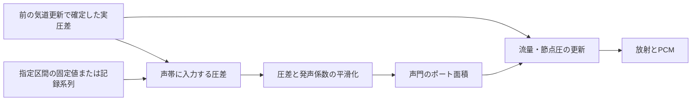

# 声門振動に渡す圧力差だけを差し替える対照

## 固定上流の呼び出しと観測点

固定版は `c6147d0198890475dbe8a65a0bb8f56240c539b7`。 `HumanVoice::render` は調音と呼気の制御更新を挟みながら、内部サンプルごとに肺の圧力境界を更新する。最初に気管末端の声門下圧と咽頭入口の声門上圧を読み、差を `ParametricGlottis::next` へ渡す。ここで読むのは前回の気道更新で確定した圧力。声門模型は面積を返し、`AirwayNetwork::step` が、その面積の声門ポートを通る流量と新しい節点圧を計算する。放射流量の微分を間引き、直流成分を除き、リミッタを通してPCMを得る。[発声の更新順序](../../../../docs/reference/chimera-vocal-synth/upstream/crates/chimera/src/voice/human_voice.rs#L371)・[声門モデルの更新](../../../../docs/reference/chimera-vocal-synth/upstream/crates/chimera/src/sources/glottis.rs#L148)

- **声帯に渡る圧力差。** 実圧差は `P下[n−1] − P上[n−1]`。差し替えるのは `next` の入力の一か所。入力圧差を30 Hzの一極フィルタに通し、2.5 cmH₂O（2,451.66 dyn/cm²）の0.8〜1.6倍を三次補間して0〜1の発声係数を得る。開大と閉鎖の係数を掛け、さらに25 Hzで平滑化する。声門面積は、位相で決まる周期パルスに発声係数と振幅を掛け、静的な開口を足す。基本周波数と位相は今回の圧差の差し替えから独立し、呼気ゲートから決まる発声の強さも同じ設定を使う。
- **気道を流れる体積速度。** 気道は声門に設定された面積と、圧力節点に残っている実圧差からポートの流量を求める。声門の前後の半セルの慣性と、自身の慣性・スリットの粘性抵抗・流向に応じた非線形抵抗を使う。肺境界の流量補正も通常の設定で追従する。観測は dyn/cm²、声門面積は cm²、流量は cm³/s、口・鼻・壁の流量和の微分は cm³/s²。[枝の更新と運動量](../crates/vocal-core/src/airway/network.rs#L177)・[呼気と気道の接続](../crates/vocal-core/src/breath.rs#L120)



上流の `lung_port` 試験は肺ポートの補償が声帯で見える圧力と発声の強さを保つことや、開大が周期振動に与える効果を確認する。 `voice_source` 試験は声門の閉じ方とスペクトルの関係を確認する。既存の簡略気道の `glottal-oral-closure` は、口端閉鎖後に実圧差と面積・流量の周期成分がともに下がることを確認した。今回は発声中の唇軌跡を再利用し、振動計算へ入力する値と流量を駆動する圧力を個別に記録する。[上流の肺ポート試験](../../../../docs/reference/chimera-vocal-synth/upstream/crates/chimera/tests/lung_port.rs)・[上流の音源試験](../../../../docs/reference/chimera-vocal-synth/upstream/crates/chimera/tests/voice_source.rs)・[簡略気道の声門結合](glottal-coupling.md)

## 事前に登録した三つの条件

前回の18セル条件は、96 kHz・制御周期128サンプル・肺圧設定7.2 cmH₂O・ F0 110 Hzで、同じ唇閉鎖と再開口を含む。発声開始100〜130 msの時刻で平均圧差を求め、口端が閉じ始める内部サンプル17,087から描画の終端まで、その値を声帯の入力として固定する。通常条件と、通常の実圧差を同じ位置からサンプル単位で再入力する対照も実行する。閉鎖中の比較は220〜300 ms、再開口後は326〜346 ms。固定圧差のときは面積パルスが残る一方、平均流量は開口時より小さくなると予測した。[事前登録の条件と閾値](../cases/glottal-pressure-feedback.json)・[元の軌跡と閉鎖時刻](tract-grid-lip-closure.md)

通常CLIの `render` と `render-pcm` を入口にする。実験ケースの `glottal_pressure_override` に開始内部サンプルと、十進文字列の `values_dyn_cm2` を並べる。記録されたf64の圧差はRustの数値パーサーで再入力する。 `measurement.glottal_pressure` を選ぶと、更新前の物理圧差、声帯入力、平滑化した圧差、発声の強さと開大・閉鎖の設定を保存する。固定上流は別の一時展開に、同じ時刻の入力を置き換えて観測する差分を加えた。各段の値を使い、前サンプルの圧差、30 Hz・25 Hzの平滑化、独立な面積モデル、放射流量の微分、48 kHzへの出力処理を照合する。[候補の圧差入力](../crates/vocal-core/src/voice.rs)・[ケースの読込](../crates/vocal-cli/src/articulation_case.rs)・[比較プログラム](../tools/measure_glottal_feedback.py)

## 閉鎖中に残る声門振動と流量

開口中100〜130 msの実圧差の平均は6,633.33 dyn/cm²だった。この値を内部サンプル17,087から声帯に渡し、閉鎖中220〜300 msの状態を集計した。発声係数は通常条件の平均0.00228から、固定入力ではほぼ1.000になった。固定入力の面積パルスの交流RMSは開口時0.05045 cm²に対して0.05215 cm²。平均声門流量は開口時136.81 cm³/sから7.19 cm³/sへ下がり、開口時の5.26%だった。通常条件と固定入力のどちらも口端・鼻端流量は閉鎖中に0で、全放射に残った信号は壁の項から求められた。[三条件の数値と判定](../runs/glottal-pressure-feedback-20261121-b/summary.json)

| 閉鎖中220〜300 ms | 通常条件 | 声帯の入力圧差を固定 |
| --- | ---: | ---: |
| 声帯に渡した圧差の平均 dyn/cm² | 1,517.20 | 6,633.33 |
| 気道の実圧差の平均 dyn/cm² | 1,517.20 | 195.42 |
| 発声係数の平均 | 0.00228 | 1.00000 |
| 声門面積の交流RMS cm² | 0.000508 | 0.052149 |
| 声門流量の平均 cm³/s | 3.72 | 7.19 |
| 声門流量の交流RMS cm³/s | 0.679 | 11.969 |
| PCMの交流RMS | 0.0000600 | 0.0011689 |

閉鎖中も周期的に開く声門では、少ない平均流量と比較的大きい交流成分が同時に観測された。声門の開いている49,147点ずつを逆算したところ、運動量の収支と実圧差の誤差は最大1.02×10⁻¹⁰ dyn/cm²だった。固定入力の逆算値と声帯入力との差は最大6,633.38 dyn/cm²。再開口後326〜346 msのPCMの交流RMSは通常0.0662、固定入力0.1081だった。これらは同じ軌跡での数値で、聴取による評価は別に残る。[運動量と再開口の対照](../runs/glottal-pressure-feedback-20261121-b/summary.json)

## 差が最初に現れた時刻

サンプル17,087で声帯入力と30 Hzの平滑化後の圧差が分かれた。通常条件の発声係数を求める三次曲線の上端は3,922.66 dyn/cm²。通常条件の平滑化圧差が3,924.94から3,919.45へ下がった17,732で、発声係数、声門面積、声門流量の差が検出された。介入から約6.72 ms後になる。気道の実圧差を次に読む17,733で実圧差の差が生じ、放射流量の微分では17,736、PCMでは48 kHzの出力フレーム8,885で差を検出した。各列に事前登録した検出下限を使用している。[差が現れたサンプルの要約](../runs/glottal-pressure-feedback-20261121-b/summary.json)・[通常条件の内部系列](../runs/glottal-pressure-feedback-20261121-b/artifacts/normal/candidate-samples.csv.gz)・[圧差固定の内部系列](../runs/glottal-pressure-feedback-20261121-b/artifacts/fixed/candidate-samples.csv.gz)

通常時の圧差を再入力すると、候補と固定上流はそれぞれ通常条件の観測系列とPCMをビット単位で再現した。上流参照とのPCMの最大絶対差は三条件を通して1.82×10⁻¹²、独立式の声門面積との最大差は7.77×10⁻¹³ cm²、放射の差分との最大差は5.83×10⁻¹¹ cm³/s²だった。[固定上流に加えた観測差分](../runs/glottal-pressure-feedback-20261121-b/artifacts/upstream-glottal-pressure.patch)

## 実行と保存

macOS 15.6.1 arm64、Rust 1.94.1、Python 3.14.4、NumPy 2.4.4、SciPy 1.17.1。全三条件で各49,152の内部サンプルと24,576の出力フレームを評価した。17判定、上流の肺ポート・音源の5試験、候補の41試験、既存の簡略気道の口端閉鎖の回帰、ClippyとWASMのコンパイル検査に通過した。入力が空、終端を越える、非有限の指定はファイルを作る前に拒否した。負の圧差を一サンプルだけ与え、次のサンプルで実圧差へ戻ることも確認した。初回実行にスリットの運動量収支の照合を加えた正式実行は約50.75 MBで、RTL9210B-CGに保存した。 `/tmp` から再実行し、各41出力のサイズとSHA-256をマニフェストに照合した。音声、圧差系列、要約など36出力がバイト一致した。[別ディレクトリからの再実行](../runs/glottal-pressure-feedback-20261121-repeat/manifest.json)[初回実行](../runs/glottal-pressure-feedback-20261121-a/manifest.json)・[正式実行](../runs/glottal-pressure-feedback-20261121-b/manifest.json)・[既存閉鎖ケースの回帰](../runs/glottal-pressure-feedback-regression-20261121-a/summary.json)

```bash
cd /Users/dolphilia/github/voice-simulator/research/experiments/chimera-rebuild
CHIMERA_RUN_STORAGE=rtl9210b CHIMERA_RUN_BYTES=536870912 ../../.venv/bin/python tools/measure_glottal_feedback.py glottal-pressure-feedback-local-1
cargo test --workspace --locked
```

次は同じ固定声道と基本周波数で、今回と同じ圧力結合の音源と、固定したLF波形による駆動を比較する。声門で与える体積流量の単位と放射の観測点をそろえ、開口部と録音評価で得られる差を別に記録する。
