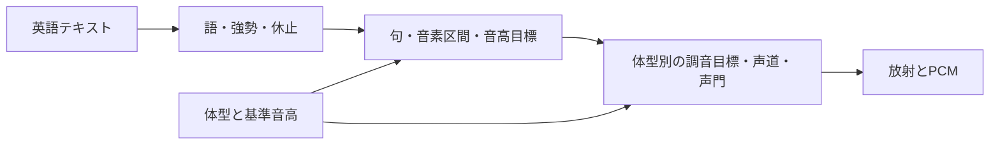

# 英語テキスト発話の体型選択

同じ英語テキストを成人男性・成人女性・子ども・混合体型で発話する。混合体型では基準F0を180 Hzと明示した条件も置く。辞書の結果、句の時刻、抑揚、調音目標、放射と波形を対応させる。[事前登録ケース](../cases/human-body-english.json)・[体型別IPA発話](human-body-ipa.md)

## 上流の読解

- `render::say` は英語テキストを辞書・文字規則で音素列に変え、各句の区間、疑問・平叙、休止を `plan_phrases` に渡す。数字や曲がったアポストロフィを正規化し、単語末と語のリストを記録する。句読点のコンマは0.18秒、文末のピリオド・疑問符などは0.35秒で、最後のレンダー余白は0.30秒。体型は発音辞書の探索に使われず、調音と音源を作るときに使われる。[上流の英語処理](../../../../docs/reference/chimera-vocal-synth/upstream/crates/chimera/src/phonetics/english.rs#L132)・[上流の英語レンダー](../../../../docs/reference/chimera-vocal-synth/upstream/crates/chimera-cli/src/render.rs#L179)
- 句の計画は50 msから始め、句内の音素を並べた後に休止を足して次の句の開始時刻を決める。 `plan_utterance` は英語の単語末や強勢を時刻と抑揚に反映する。/oʊ/ のような二重母音は表示上の一音素から、レンダー時の複数目標へ展開する。最後の音高目標は平叙で基準の0.82倍、疑問で1.35倍。句末のF0目標は区間の属性で、気道と声門の応答を経た実測音高とは別に観測する。[句の連結](../../../../docs/reference/chimera-vocal-synth/upstream/crates/chimera/src/phonetics/planner.rs#L880)・[句末の音高](../../../../docs/reference/chimera-vocal-synth/upstream/crates/chimera/src/phonetics/planner.rs#L612)
- 上流CLIの `text_f0` は成人男性112 Hz、成人女性205 Hz、子ども250 Hz。混合体型で使う英語の既定F0は、この3値を上流の `engine::default_f0` と同じ対数補間でつなぐ方針とした。端点の値はそのまま選び、明示したF0があれば優先する。音源は110 Hzから始まり、基準へ時定数0.06秒で対数補間する。較正母音と歯茎摩擦音の目標、気道と声門には同じ体型を渡す。[音高の端点](../../../../docs/reference/chimera-vocal-synth/upstream/crates/chimera-cli/src/render.rs#L169)・[体型補間](../../../../docs/reference/chimera-vocal-synth/upstream/crates/chimera/src/engine.rs#L26)・[音源側の音高更新](../../../../docs/reference/chimera-vocal-synth/upstream/crates/chimera/src/voice/human_voice.rs#L540)
- 上流の `english` テストは辞書・強勢・句読点・未知語・語境界を確認する。`golden_phonetics_text` は英語の計画と歌詞などを固定出力に照合する。今回の波形は、中立姿勢と上記の正規化した音源条件を設定したプローブで上流Rustと比較する。上流CLIの既定条件では端点の表示と長さも照合する。[英語テスト](../../../../docs/reference/chimera-vocal-synth/upstream/crates/chimera/tests/english.rs)・[固定の音素系列テスト](../../../../docs/reference/chimera-vocal-synth/upstream/crates/chimera/tests/golden_phonetics_text.rs)



## 再実装と独立計算

- 既存の `BodyMix` の対数補間を英語の3端点にも使い、`plan_voice_with_body` から句ごとのジェスチャー生成に同じ体型を渡した。CLIは `inspect` で計画と目標を、`render` で各フレームの断面・圧力・流量などを、`render-pcm` で出力を返す。計画開始時の声門は110 Hz。基準F0へ移る最初の64出力サンプル後の値を `110 × (基準F0 / 110)^(1 − exp(−64 / (出力レート × 0.06 s)))` で独立に計算する。[英語の基準音高と計画](../crates/vocal-core/src/phonetics/english.rs#L294)・[CLI](../crates/vocal-cli/src/timing_case/speech_voice.rs#L123)・[計測器](../tools/measure_body_english.py)
- 48 kHz出力・96 kHz内部計算で `Mom, pop. Is it so?` を118,748フレーム生成する。句の開始時刻は0.0500、0.6985、1.53045秒。二重母音 `/oʊ/` の語末マークは辞書の音素列に残り、実行計画では `/o/` と `/u/` が別区間になる。上流CLIの通常入口でも3端点の発音表示とサンプル数を確認する。内部計測の比較では上流プローブに同じ初期姿勢・音源・ゲイン・乱数条件を渡す。[テキスト・計測条件](../cases/human-body-english.json)

## 初回の不合格と判定の改訂

初回は5条件すべてで `oral_minimum_cell` の整数番号が異なり、70項目中65項目が通過した。元のケースと計測器を含むスナップショットを初回の実行ディレクトリに保存した。最初に食い違った成人男性の6079番フレームでは、候補の16・17番セルはどちらも0 cm²だった。上流は16番が `7.996×10⁻¹⁹ cm²`、17番が0 cm²だった。混合体型の最初の差でも、候補と上流で選んだセルの面積差は `1.356×10⁻¹⁸ cm²` 未満だった。[初回の実行記録](../runs/bodyenglish-20261120-a/manifest.json)・[初回の結果](../runs/bodyenglish-20261120-a/summary.json)

計測第2版は、[歯茎破裂音で使用済みの比較](../tools/measure_alveolar_stop.py#L113)を使う。選ばれたセルが各実装で真の最小値を持つことを確認し、相手が選んだセルとの差を両側の断面積で測る。同じ `10⁻⁹ cm²` の許容差と、同じ `0.0002 cm²` の閉鎖閾値を使い、全セルの開閉判定の一致も求める。番号の食い違いと最初の時点は測定結果に残す。各セルの面積、乱流源の位置、圧力、流量、PCMの判定は引き続き行う。[第2版の条件](../cases/human-body-english.json)

## 計測結果

| 体型と音高設定 | 基準F0（Hz） | 疑問句末のF0目標（Hz） | 最後の母音窓での声門F0中央値（Hz） | /m/ の鼻端流量のピーク（cm³/s） |
| --- | ---: | ---: | ---: | ---: |
| 成人男性 | 112.00 | 151.20 | 142.48 | 737.88 |
| 成人女性 | 205.00 | 276.75 | 260.78 | 450.25 |
| 子ども | 250.00 | 337.50 | 318.03 | 170.26 |
| 混合 | 168.79 | 227.87 | 214.72 | 430.31 |
| 混合・180 Hz指定 | 180.00 | 243.00 | 228.98 | 428.97 |

5条件で発音・句の区間が一致し、抑揚目標は平叙で基準F0の0.82倍、疑問で1.35倍だった。110 Hzから始まる最初の音高更新の独立計算との差は最大 `2.85×10⁻¹⁴ Hz`。混合体型で180 Hzを指定した場合、調音ジェスチャーを保持したまま音高目標が変わった。声門F0の中央値は音高ランプの途中を含む母音窓から求めており、句末の目標値とは観測時点が異なる。

`pop` の両唇が閉じた時刻は0.74775〜0.74908秒で、同じ混合体型の音高を変えた2条件ではともに0.74865秒だった。開放時刻は0.84402〜0.84404秒。第1休止の終盤でのPCM絶対ピークは最大 `5.02×10⁻⁴`。各実装が選んだセル番号は端点では64フレーム、混合2条件では128フレームで食い違った。相手が選んだセルとの最大面積差は `1.36×10⁻¹⁸ cm²` で、全セルの開閉と乱流の注入セル番号は一致した。PCM差は180 Hz指定で最大 `3.73×10⁻⁹`。最初のビット差は1963〜20492番の間に現れた。[時系列とPCMの判定](../runs/bodyenglish-20261120-repeat/summary.json)

第2版は両方の実行で70項目を満たした。通常の作業場所と `/tmp` からの再実行で、入力・計画・観測系列・PCM・要約の56ファイルのSHA-256が一致した。第1版と第2版の間でも要約を除く同じ55ファイルが一致し、差分が判定器に限られることを確認した。[第2版](../runs/bodyenglish-20261120-b/manifest.json)・[別ディレクトリからの再実行](../runs/bodyenglish-20261120-repeat/manifest.json)

成人男性の既存英語ケースは変更前後で計画、観測、PCM、要約が一致した。既存のWorklet英語ケースは15項目を通過した。Cargoのワークスペーステスト、Clippy、上流の `english`、`golden_phonetics_text`、`body_mix` も通過した。体型を指定したブラウザ発話は次の比較で扱う。[成人男性の変更前](../runs/bodyenglish-20261120-male-before/manifest.json)・[変更後](../runs/bodyenglish-20261120-male-after/manifest.json)・[Workletの回帰](../runs/bodyenglish-20261120-worklet/summary.json)

研究ワークスペースで第2版の比較を再実行するときは、新しい実行IDを指定する。

```bash
python3 tools/measure_body_english.py body-english-local-1
```
