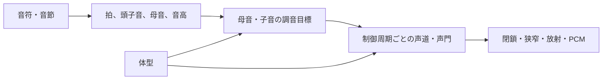

# 歌唱の体型選択

同じ音符と /pɑ sɑ zɑ/ の3音節で、成人男性・成人女性・子ども・混合体型の歌唱を比較する。中立姿勢、音源設定、シードは揃える。音符・音節から得た計画と、閉鎖・歯への圧力注入・出力音高を別に照合する。[事前登録ケース](../cases/human-body-song.json)・[体型別IPA発話](human-body-ipa.md)

## 上流の読解

- 上流CLIの `render notes` はMIDI音符と歌詞または構造化音節を読み込む。第1音符の音高を `HumanVoice` の基準に渡し、各フレーズを `plan_song` で計画する。この計画には `SongOptions::body` が入り、構築する気道も同じ体型になる。今回の有声比較は、同じ初期姿勢と音源設定、変動と乱流の共通条件を指定できる比較プローブを通す。[上流CLI](../../../../docs/reference/chimera-vocal-synth/upstream/crates/chimera-cli/src/render.rs#L538)・[上流の歌唱計画](../../../../docs/reference/chimera-vocal-synth/upstream/crates/chimera/src/phonetics/sing.rs#L167)
- `plan_song` は `60 / BPM` 秒を拍の単位にし、音符の拍長を積み上げる。次の音符の頭子音はその音符の直前に割り当て、同じMIDI周波数 `440 × 2^((m−69)/12)` Hz を与える。子音の長さは指定がなければ目録の長さの0.8倍。今回の p・s・z は68、96、72 msで全体型共通。短い音符では子音を比例配分で縮め、母音の時間を確保する。長い最終音符では終端50 msを確保する。絶対時刻の音素列を作った後で、体型を渡した `plan_utterance` が母音や歯茎摩擦音の目標を決める。[子音と音高](../../../../docs/reference/chimera-vocal-synth/upstream/crates/chimera/src/phonetics/sing.rs#L27)・[音符から音素列へ](../../../../docs/reference/chimera-vocal-synth/upstream/crates/chimera/src/phonetics/sing.rs#L188)・[発話計画への受け渡し](../../../../docs/reference/chimera-vocal-synth/upstream/crates/chimera/src/phonetics/sing.rs#L287)
- 母音が0.3秒を超えるとビブラートを設定する。長い有声区間が句末にあると、終了の90 ms前から声門が開き始め、終了の15 ms後まで呼気を保つ。声門開大には体型長さ比の二乗を掛ける。ピッチは目標のスコア重みを基準音高の重み0.02と合成し、対数空間で時定数0.03秒、目標がないときは0.06秒で追従する。調音・声門・肺圧を同じ制御クロックで更新してから放射とPCMを得る。[ビブラートの付加](../../../../docs/reference/chimera-vocal-synth/upstream/crates/chimera/src/phonetics/sing.rs#L325)・[語尾の呼気と開大](../../../../docs/reference/chimera-vocal-synth/upstream/crates/chimera/src/phonetics/planner.rs#L596)・[音源の制御](../../../../docs/reference/chimera-vocal-synth/upstream/crates/chimera/src/voice/human_voice.rs#L457)
- 上流の `sing_fast` は短い音符でも母音が拍に到達し、頭子音から新しい音高を使うことを検査する。`sung_release` は長音と短音の脱力開始、早く開大した場合の振幅低下を追う。今回の計測では拍、音素の長さ、音高、開大の独立計算に加え、上流とネイティブCLIの閉鎖・乱流・PCMを測る。[拍と閉鎖のテスト](../../../../docs/reference/chimera-vocal-synth/upstream/crates/chimera/tests/sing_fast.rs#L30)・[語尾のテスト](../../../../docs/reference/chimera-vocal-synth/upstream/crates/chimera/tests/sung_release.rs#L49)

## 実装と結果

ネイティブCLIの `song_voice.body` を、歌唱のジェスチャー生成と可動声道の初期化に渡した。較正済みの母音目標と /s z/ の舌先高さはIPA発話と同じ処理を使う。歌唱の音高は音符が指定し、第1音符の周波数を基準に重ねる。比較器では同じ設定を上流へ渡し、音高軌跡と開大を余弦ランプの重みから独立に計算した。[歌唱スコアの実装](../crates/vocal-core/src/phonetics/song.rs)・[ネイティブの入口](../crates/vocal-cli/src/timing_case/speech_voice.rs)・[比較器](../tools/measure_body_song.py)

4体型で41項目が通過した。母音は0.300、0.800、1.300秒に始まり、対応する頭子音は0.232、0.704、1.228秒に新しい音高を受け取った。ビブラート前の実測F0が隣り合う音符の幾何平均を超えた時刻は、全体型で0.73602秒と1.26002秒だった。母音の拍より約64 ms、40 ms早い。独立計算との最大差は平滑したF0で `4.78×10⁻¹¹ Hz`、声門開大で `2.39×10⁻¹³ cm²`。語尾での開大は2.160秒に始まり、呼気は2.265秒まで保持された。[計画・時系列・判定](../runs/bodysong-20261120-a/summary.json)

| 体型 | /p/ 閉鎖・再開口（秒） | /s/ 狭窄の中央値（cm²） | /z/ 狭窄の中央値（cm²） | PCMから推定した3音のF0（Hz） |
| --- | --- | ---: | ---: | --- |
| 成人男性 | 0.22246・0.30002 | 0.09798 | 0.13178 | 218.92・260.91・329.31 |
| 成人女性 | 0.22223・0.30004 | 0.08001 | 0.10689 | 218.71・261.27・329.22 |
| 子ども | 0.22119・0.30004 | 0.05531 | 0.07572 | 219.07・260.63・329.62 |
| 3体型の混合 | 0.22217・0.30004 | 0.07890 | 0.10650 | 218.73・261.17・329.30 |

狭窄の中央値は各摩擦音の中央50%で求めた。4体型の全フレームでこの窓内の歯に乱流が入った。PCMと上流との差は最大 `9.31×10⁻¹⁰`。初期フレーム0で歯までの距離に最大 `3.55×10⁻¹⁵ cm` の微小差があり、最初のPCMビット差は男性4114、女性1963、子ども3096、混合1996フレームだった。主要な比較は全件が登録した許容差以内。成人男性の二音の既存歌唱は変更前後で波形・観測・計画を含む6ファイルが一致し、成人男性のブラウザ歌唱も15項目を通過した。[計測のハッシュ](../runs/bodysong-20261120-a/manifest.json)・[変更前](../runs/bodysong-20261120-male-before/manifest.json)・[変更後](../runs/bodysong-20261120-male-after/manifest.json)・[ブラウザの回帰](../runs/bodysong-20261120-worklet/manifest.json)

`/tmp` からの再実行も41項目を通過し、入力・計画・観測・PCM・要約の41ファイルでSHA-256が一致した。体型選択の検証範囲はこのネイティブ歌唱の譜例。ブラウザでの体型切り替えは次の工程に残る。[再実行](../runs/bodysong-20261120-repeat/manifest.json)・[再開地点](../progress.md#未達の条件と次の作業)
