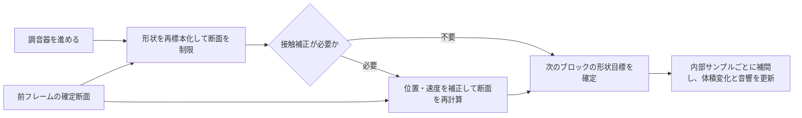

# 体型ごとの可動声道

固定した体型の中で、較正済みの /i/ から /a/、/u/ へ移動する。制御境界で選んだ目標、接触補正前後の断面、内部サンプルごとの補間と音響を観測する。別に子どもの舌先を口蓋へ接触させる。[事前登録ケース](../cases/human-body-tract-motion.json)・[前工程の較正目標](human-body-calibrated-vowels.md)

## 上流の処理

- `HumanVoice::control` は調音器を進めて `HumanAirway::apply` を呼ぶ。接触は体型長さ比を `k` として距離が `−0.1k cm` を下回ると補正する。接触法線の変位を頭部の基準座標に戻す際は縦を `1/k` 倍し、口側の横はさらに `1/0.86` 倍する。法線方向の内向き速度を引いて、その位置でもう一度 `reapply` する。体型選択後も調音目標と速度は基準座標で扱う。[制御更新](../../../../docs/reference/chimera-vocal-synth/upstream/crates/chimera/src/voice/human_voice.rs#L496)・[接触補正](../../../../docs/reference/chimera-vocal-synth/upstream/crates/chimera/src/voice/human_voice.rs#L558)
- `HumanAirway::new` は解剖上見込む短い管長と設計クーラン数0.93から整数のセル数を決め、調音中もそのトポロジーを使う。`apply` は前回の確定面積と最小断面を保存し、矢状面と再標本化から今回の生の断面と解剖長を求める。歯より口端側のセルでは、閉鎖付近の開口が緩やかになる。固定速度項 `45, 5, 7 cm²/s` と面積閾値 `0.03, 0.4 cm²` は `k²` 倍。速度の面積比例項 `40 s⁻¹ × 面積` は同じ係数を使う。最小断面は0以上かつセル面積以下に収める。再計算の `reapply` も、同じ制御周期と保存済みの前回断面を参照する。[セル数](../../../../docs/reference/chimera-vocal-synth/upstream/crates/chimera/src/voice/human_airway.rs#L107)・[断面の更新](../../../../docs/reference/chimera-vocal-synth/upstream/crates/chimera/src/voice/human_airway.rs#L214)
- 音響に渡す管長は `max(解剖長, セル数 × c / (fs × 0.97))`。単位はcm。接触補正後に一度だけ `begin_block` し、現在値と目標との差を内部ブロックのサンプル数で割る。`step` の冒頭で面積・最小断面・セル長・軟口蓋ポートを進め、体積差を符号付き流量 `−fs × ΔV` に変換する。閉鎖近傍では隣接セルへ配分した後に低域通過させ、圧力更新へ渡す。上流の閉鎖圧力と接触のテスト、成人男性の既存系列も実行する。[管長と目標](../../../../docs/reference/chimera-vocal-synth/upstream/crates/chimera/src/voice/human_airway.rs#L310)・[標本間の更新](../../../../docs/reference/chimera-vocal-synth/upstream/crates/chimera/src/airway/network.rs#L708)・[伝搬の順序](../../../../docs/reference/chimera-vocal-synth/upstream/crates/chimera/src/airway/network.rs#L827)・[閉鎖のテスト](../../../../docs/reference/chimera-vocal-synth/upstream/crates/chimera/tests/airway_adversarial.rs#L233)・[接触のテスト](../../../../docs/reference/chimera-vocal-synth/upstream/crates/chimera/tests/speech_quality.rs#L97)

## 再実装と計測

固定気道と共通の体型情報を可動声道の初期化にも使い、断面目標から同じ体型の気道を作る。制御側は体型別の断面制限と接触補正を行い、確定した目標だけを内部サンプル間で補間する。CLIでは、形状変化だけの経路と有声の経路を同じ調音入力で測った。有声の4条件は110 Hzに揃え、成人女性の音高を省略した追加確認では205 Hzで動いた。[断面制御](../crates/vocal-core/src/airway/tract_control.rs)・[接触補正](../crates/vocal-core/src/articulators.rs#L255)・[有声の経路](../crates/vocal-core/src/voice.rs#L246)・[上流のMIT通知](../LICENSE-CHIMERA)

初回は比較器の3体型混合で、女性の重みに掛ける成人の比を誤って `1−f` としていた。重みの和が0.96になり、独立計算のセル数と断面制限が不合格になった。式を `((1−c)(1−f), (1−c)f, c)` に修正して重みの和を確認し、登録ケースと許容差を維持して再実行した。[初回の不合格](../runs/bodymotion-20261120-a/summary.json)・[比較器](../tools/measure_body_tract_motion.py)

## 結果

| 条件 | 内部レート（kHz） | 咽頭・口腔のセル数 | 咽頭セル長の変化幅（cm） | 口腔セル長の変化幅（cm） | 口腔中央の体積流量の最大絶対値（cm³/s） |
| --- | ---: | ---: | ---: | ---: | ---: |
| 成人男性 | 96 | 18・18 | 0.03918 | 0.13238 | 128.20 |
| 成人女性 | 96 | 15・16 | 0.05946 | 0.12401 | 99.82 |
| 子ども | 64 | 8・9 | 0.03842 | 0.09784 | 68.75 |
| 3体型の混合 | 96 | 15・16 | 0.04053 | 0.10915 | 97.92 |
| 子どもの接触 | 96 | 11・13 | 0.00005 | 0.04508 | 20.13 |

5条件で70項目が通過した。制御時点の断面積・最小断面積の上流との差は最大 `1.04×10⁻¹³ cm²`、内部サンプルのセル長は最大 `1.43×10⁻¹⁴ cm`。無発声時の圧力・流量・放射の差は各上流系列のピークに対して最大 `2.31×10⁻¹²`。口腔中央は今回の条件で近隣への体積流量再配分が生じない面積範囲にあり、圧力収支から逆算した体積流量と独立計算との差は全条件で `1.00×10⁻¹¹ cm³/s` 未満だった。子どもの接触ではフレーム40から計104回再計算した。補正前の途中結果を基準にすると最大0.06254 cm²の差が出た。[結果と時系列](../runs/bodymotion-20261120-b/summary.json)

有声PCMの差は最大 `1.11×10⁻¹⁶`。子どもと3体型の混合ではサンプルが一致した。比較できる最初の出力時点（内部サンプル1）から、セル長または断面に丸めの差が観測された。`/tmp` からの再実行も全70項目を通過し、入力・観測・PCM・要約の83ファイルでSHA-256が一致した。成人男性の既存の可動声道は変更前後の観測と要約が一致し、有声の既存ケース26項目とブラウザの成人男性IPA12項目も通過した。[再実行](../runs/bodymotion-20261120-repeat/manifest.json)・[変更前](../runs/bodymotion-20261120-male-before/manifest.json)・[変更後](../runs/bodymotion-20261120-male-after/manifest.json)・[有声の回帰](../runs/bodymotion-20261120-male-voice/manifest.json)・[ブラウザ](../runs/bodymotion-20261120-ipa-worklet/manifest.json)
