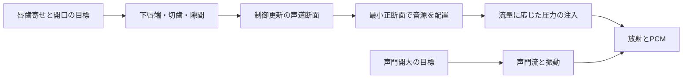

# 唇歯摩擦音 /f v/

固定上流は `c6147d0198890475dbe8a65a0bb8f56240c539b7`。ロシア語のデモ譜に残る /v/ を含め、無声の /f/ と有声の /v/ を調べる。[事前登録](../cases/labiodental-fricatives.json)・[ロシア語歌唱の読解](russian-lyrics.md)

## 調音目標と声門

`inventory::phoneme` は唇歯寄せ（無次元）を1にし、唇開口目標を較正表から体型ごとに取る。成人男性では /f v/ が0.016・0.031 cm、成人女性は0.013・0.028 cm、子どもは0.006・0.020 cm。補間体型は女性比 `f`、子ども比 `c` とすると重み `[(1−c)(1−f),(1−c)f,c]` の加重平均。音素区間 `[a,b]` の口腔ジェスチャーは `a−8 ms` から `max(a+10 ms,b)`、強さ40、ランプ30/18 ms、速度倍率1.3と45 msの解放中の速度指定を持つ。声門開大は `a−15 ms` から /f/ では `b+5 ms` まで0.30 cm²、/v/ は `b` まで0.09 cm²を目標とする。実際の開大には活動度と体型の面積倍率が入る。[音素定義と体型補間](../../../../docs/reference/chimera-vocal-synth/upstream/crates/chimera/src/phonetics/inventory.rs#L185)・[体型別の較正](../../../../docs/reference/chimera-vocal-synth/upstream/crates/chimera/src/phonetics/consonantTargets.generated.json)・[声門開大の計画](../../../../docs/reference/chimera-vocal-synth/upstream/crates/chimera/src/phonetics/planner.rs#L532)

## 下唇と断面

体型縮尺 `k`、唇歯寄せ `λ∈[0,1]`、上顎切歯の位置 `(xᵢ,yᵢ)` のとき、下唇端は通常の位置から `(xᵢ+0.05k, yᵢ−max(開口·k,−0.1))` へ `λ` を重みに移動する。上唇端も `0.7λ` を重みに切歯の前上へ移動する。唇同士の接触を抑える項は、三次平滑関数 `h=smoothstep(0,0.5,λ)` に対して開口へ `0.3k·h/(1−h)` を足し、`h=1` でその制約を解除する。さらに `λ>0.7` では下唇端より前の空間が滑らかに開く。輪郭から得た隙間を歯の後ろの面積則と前の楕円スリット則で補間し、声道セルの断面に変換する。上流の幾何試験は寄せを0から1へ掃引して面積の跳びを測り、波形試験は摩擦開始時の短いクリックを調べる。[輪郭の計算](../../../../docs/reference/chimera-vocal-synth/upstream/crates/chimera/src/anatomy/human.rs#L809)・[接触の移行と面積](../../../../docs/reference/chimera-vocal-synth/upstream/crates/chimera/src/anatomy/human.rs#L1167)・[上流の幾何試験](../../../../docs/reference/chimera-vocal-synth/upstream/crates/chimera/tests/geometry_continuity.rs#L236)・[波形試験](../../../../docs/reference/chimera-vocal-synth/upstream/crates/chimera/tests/consonant_artifacts.rs#L125)

## 乱流と観測

`HumanAirway::update_noise` は制御更新時の咽頭・口腔の最小正断面 `A` を選ぶ。枝を割り当てられるときの狭窄音源ゲインは `1.364e−6·[1−smoothstep(0.35k²,0.9k²,A)]`。帯域はローパス2600 Hz、ハイパス350 Hz。歯での衝突音源は `(歯の軸上距離−狭窄セル中心)/k` が1以下で重みが0になる。各内部サンプルで `AirwayNetwork::compute_noise` は枝面積 `Aⱼ` と流量 `U` から `Re=2|U|/(ν√(πAⱼ))` を求め、閾値を超えたときフィルターを通した乱数を枝の流れに合わせて圧力として加える。上流の /v/ の試験では二段の1 kHzローパス後の電力を先行母音と比較する。[乱流源の配置](../../../../docs/reference/chimera-vocal-synth/upstream/crates/chimera/src/voice/human_airway.rs#L329)・[サンプルごとの乱流](../../../../docs/reference/chimera-vocal-synth/upstream/crates/chimera/src/airway/network.rs#L1155)・[/v/ の低域評価](../../../../docs/reference/chimera-vocal-synth/upstream/crates/chimera/tests/voiced_fricatives.rs#L29)

前後母音を揃え、口端へ移る下唇座標、狭窄音源の活動、歯の音源の登録、声門の開大と振動を照合する。同じ /v/ で乱流倍率だけを0にして、源の配置を残したまま圧力注入を止める。ロシア語「ве́тер」で /v/ と軟音の /j/ を含む音節を歌唱し、実ブラウザのPCMと保存ケースの再演を確認する。[判定条件](../cases/labiodental-fricatives.json)

## 実装と初回の差

候補は体型別の唇開口の較正を共通の加重平均で読み、既存の声道幾何に目標を渡す。CLIでは、最後の制御更新で使った輪郭から下唇内側七点の末端を採取する。同じ行の口腔断面は制御更新の間を補間した音響状態で、輪郭との観測時点に違いがある。初回は下唇端の取得先を固定声道の構造体に置いたためビルドが失敗した。可動声道の輪郭を保持する構造体から取得するよう修正した。[発話計画](../crates/vocal-core/src/phonetics/speech.rs)・[初回の実行](../runs/labiodental-fricatives-20261120-a/manifest.json)

第1版の計測では成人男性の112 Hz指定で、最初のフレームの声門F0が候補112 Hz、上流110.04357 Hzだった。調音ジェスチャーと口腔セル断面は許容差内で、差は圧力、声門流、放射にも現れた。上流の `set_source` は基準F0を目標へ渡し、現在のF0を110 Hzから制御周期ごとに移行させる。候補の成人男性IPAにもこの経路を適用した。時定数が0.06 sの最初の制御更新は、初期F0を `f₀`、指定値を `fₜ` として `f₀(fₜ/f₀)^(1−exp(−Δt/0.06))` で独立に照合した。同じ設定をWASM入口でも確認する試験を追加した。[最初の差](../runs/labiodental-fricatives-20261120-b/summary.json)・[上流のF0更新](../../../../docs/reference/chimera-vocal-synth/upstream/crates/chimera/src/voice/human_voice.rs#L542)

同じ第1版の計測で、成人男性 /v/ の全声道最小正断面の中央値は0.425 cm²で、当初の0.35 cm²の上限を超えた。話速1.3の補間体型では0.778 cm²、狭窄乱流が活動した割合は41.1%だった。歯までの軸上距離が13 cmを超えるフレームがあり、全声道最小断面が咽頭側を指す場合があった。第2版では、口腔だけの最小断面を先行母音と比較する。唇歯付近の狭窄音源を選んだフレームに対して活動を判定し、全フレームに対する選択率も保存する。補間体型の通常速度と話速1.3、成人男性の話速1.3を加えた。[第1版の判定](../runs/labiodental-fricatives-20261120-b/summary.json)・[第2版の条件](../cases/labiodental-fricatives-v2.json)

## 第2版の実測

発話の値は子音予定区間の中央50%で測った。口腔最小断面はその窓の中央値で、唇歯音源の比率は同じ窓内で該当する音源が登録されたフレームの割合。[全測定値](../runs/labiodental-fricatives-20261120-c/summary.json)

| 条件 | 口腔最小断面 (cm²) | 唇歯付近に狭窄音源を登録 (%) | 狭窄音源の圧力RMS (dyn/cm²) |
| --- | ---: | ---: | ---: |
| 成人男性 /f/ | 0.196 | 100 | 10.88 |
| 成人男性 /v/ | 0.426 | 98.8 | 3.73 |
| 成人男性 /v/・話速1.3 | 0.899 | 53.2 | 0.64 |
| 成人女性 /v/ | 0.310 | 89.5 | 2.76 |
| 子ども /f/ | 0.120 | 100 | 6.43 |
| 補間体型 /v/・話速1.0 | 0.320 | 89.5 | 3.14 |
| 補間体型 /v/・話速1.3 | 0.894 | 41.1 | 1.19 |
| 成人男性 /v/・乱流倍率0 | 0.426 | 98.8 | 0 |

成人男性 /v/ の下唇端は先行母音の (6.841, 6.103) cm から (6.264, 7.803) cm へ動いた。成人男性 /f v/ の声門開大は0.30225・0.09225 cm²で、振動係数の中央値は約 `2.70×10⁻⁶` と0.9784。/v/ の男性・女性は、同じ二段ローパスで先行母音に対し−7.83・−7.50 dBだった。乱流倍率0では座標・狭窄・音源の割り当てが一致し、圧力注入は全系列で0になった。狭窄音源ゲインの独立計算と実測の最大差は `4.57×10⁻²²`。唇歯付近で狭窄音源が登録された区間では歯での衝突音源が登録されなかった。[発話と無効対照](../runs/labiodental-fricatives-20261120-c/summary.json)

「ве́тер」は /v j e.t j e ɾ/ として計画した。実ブラウザのAudioWorkletから取得した91,200サンプルはCLIと保存ケースの再演にビット一致し、64フレーム間隔の内部状態1,425点も照合した。固定上流とのPCM最大絶対差は全条件で `4.66×10⁻¹⁰`。112 Hzのケースは初回のF0差が除かれ、第2版では冒頭のF0が独立計算と上流の110.043568075 Hzに一致した。[第2版の実行](../runs/labiodental-fricatives-20261120-c/manifest.json)・[ブラウザの保存ケース](../runs/labiodental-fricatives-20261120-c/artifacts/browser/veter-case.json)

候補のワークスペーステスト19件、整形、Clippyと上流の関連テスト9件を通過した。上流の突き出した下唇の既知の連続性試験1件は、上流で指定された通常実行の除外条件に従った。既存の歯茎硬口蓋摩擦音も回帰計測を通過した。ロシア語のデモ入力をCLIの `inspect` に再度渡すと、音響未対応欄は /tʃ x/ になった。[上流の除外条件](../../../../docs/reference/chimera-vocal-synth/upstream/crates/chimera/tests/geometry_continuity.rs)・[歯茎硬口蓋摩擦音の回帰](../runs/alveolopalatal-fricatives-20261120-labiodental-regression/manifest.json)・[デモの入力](../runs/russian-lyrics-20261120-repeat/artifacts/lyric-inputs.json)

第2版を実験ディレクトリと `/tmp` から実行して各116項目を通過し、105出力中97ファイルのSHA-256が一致した。PCM、内部系列、保存ケースが含まれる。要約で変わった数値はブラウザの停止までの時間だった。既存の /z/ では計測9ファイルのハッシュ、/ɕ ʑ/ ではネイティブ計測70ファイルのハッシュが以前の通過版と一致した。[第2版の再実行](../runs/labiodental-fricatives-20261120-repeat/manifest.json)・[/z/ の回帰](../runs/sibilant-z-20261120-labiodental-regression/manifest.json)
