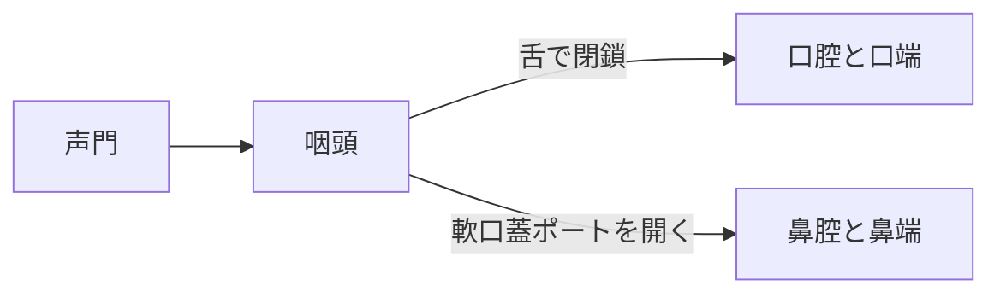

# 舌先と舌背の鼻音 /n ŋ/

## 固定上流の読解

発話は `render speech` からIPAを分けて `plan_utterance` に渡す。歌唱では `sung_lyrics` で韓国語のブロックを音節にし、`plan_song` が頭子音・母音・末子音に秒単位の時刻を割り当てて同じ発話計画を使う。韓国語では同じ語の中で後続の /m/ に先立つ終声 ㄱ が ㅇ、すなわち /ŋ/ に変わる。`국 물` のように空白を入れると別の語になり、前の音節の終声は /k/ のままになる。[発話の入口](../../../../docs/reference/chimera-vocal-synth/upstream/crates/chimera-cli/src/render.rs#L120)・[歌詞の鼻音化](../../../../docs/reference/chimera-vocal-synth/upstream/crates/chimera/src/phonetics/korean.rs#L209)・[歌唱の計画](../../../../docs/reference/chimera-vocal-synth/upstream/crates/chimera/src/phonetics/sing.rs#L167)

`phoneme` は /n/ に /t d/ と共通の舌先座標 (6.25, 9.68) cm、/ŋ/ に /k g/ と共通の舌背Y 8.35 cm・弱いX 2.3 cm・顎0.7 cmを渡す。鼻音では `nasal_closure_delay` が /m n ŋ/ の閉鎖開始をそれぞれ10、15、20 ms遅らせる。遅れは鼻音の長さから30 msを引いた値の正部分で上限を設ける。閉鎖と解放のランプは対応する場所の破裂音と共通で、鼻音の声門には破裂音の帯気を加えない。上流の `nasal_spans` は断面0.05 cm²を基準に発話中の閉鎖を検出し、計画開始との差が成人男性・成人女性の文例でどの範囲に収まるかを検証する。[鼻音の目標](../../../../docs/reference/chimera-vocal-synth/upstream/crates/chimera/src/phonetics/inventory.rs#L175)・[閉鎖時刻](../../../../docs/reference/chimera-vocal-synth/upstream/crates/chimera/src/phonetics/planner.rs#L694)・[上流テスト](../../../../docs/reference/chimera-vocal-synth/upstream/crates/chimera/tests/nasal_spans.rs)

鼻への開口は口腔閉鎖とは別のジェスチャーで与える。鼻音の開始を `s`、終了を `e` とすると、目標0.45 cm²、強さ4の保持区間は通常 `[s−20 ms, e−20 ms]`。直後が有声破裂音なら閉じ始めを `e−5 ms` に遅らせる。開閉ランプは50・30 ms。拍の境界で /ŋ/ と /m/ が隣り合う場合には、独立した二つの開口指示が重なる。[鼻腔を開く計画](../../../../docs/reference/chimera-vocal-synth/upstream/crates/chimera/src/phonetics/planner.rs#L486)

各制御刻みで軟口蓋には基準値とジェスチャー目標の差に `min(1, 合計重み/2)` を掛ける。固有角周波数 `2π×12 rad/s` の臨界減衰で速度と位置を順に更新する。実開口の目標は `max(0, 軟口蓋位置) × 体型の長さ倍率²` cm²で、内部サンプルに補間する。咽頭終端と鼻腔入口の枝の流量を更新し、鼻端と口端で別々の放射流量を得る。ポート面積が0ならその枝の流量は0になる。[軟口蓋の制御](../../../../docs/reference/chimera-vocal-synth/upstream/crates/chimera/src/control/articulators.rs#L109)・[面積への変換](../../../../docs/reference/chimera-vocal-synth/upstream/crates/chimera/src/anatomy/human.rs#L1270)・[鼻腔ポートと放射端](../../../../docs/reference/chimera-vocal-synth/upstream/crates/chimera/src/voice/human_airway.rs#L155)

## 事前登録

成人男性の `ɑnɑ`、`ɑŋɑ`、`ɑndɑ`、`ɑntɑ` と、同じ入力・音源で体型のみ変えた成人女性の `ɑŋɑ` を固定上流と比較する。鼻音の予定区間の中で、口側が閉じ、鼻腔への枝が開くフレームを抽出する。有声破裂音前の終端差は各鼻音の予定末尾を基準に15 msと予測する。歌唱の `국물` と `국 물` は同じ二音で歌い、`국물` で /ŋ/ から /m/ に移る区間の鼻端流量を照合する。[登録ケース](../cases/lingual-nasals.json)

初回 `a` は上流と候補の `ɑnɑ` を生成した後、既存のセル比較関数に閉鎖面積のキーを渡さずに停止した。登録した閾値をその関数のキーに渡して修正した。歌唱のブラウザ観測を有効にするため、WASMから受け取るジェスチャーの型に数値目標を明示した。[初回の記録](../runs/lingual-nasals-20261120-a/manifest.json)・[ブラウザの計画](../crates/vocal-wasm/host/planning.ts)

`b` では全条件をレンダーし、ブラウザの再演結果を比較する処理が一つ前の実験のレート設定キーを参照して停止した。比較対象の音源設定からレートを読むよう修正した。[2回目の記録](../runs/lingual-nasals-20261120-b/manifest.json)

## 舌背閉鎖中の口端流量を調べる追加条件

初版の完全な実行 `c` は71項目中68項目が通過した。鼻端と口端のRMSの和に対する鼻端の割合は /n/ で80%を超えた。/ŋ/ は成人男性61.23%、成人女性50.22%、`국물` の歌唱78.09%となり、固定上流も80%を下回った。鼻端と口端は異なる節点の放射負荷に結ばれている。直列枝は両端のどちらかのセルの最小断面が閉鎖閾値未満になると流量と運動量が0になる。閉鎖より口端側では、圧力、断面・長さの変化が作る体積流量源、口端の放射負荷が引き続き更新される。閉鎖を越えた流量の判定には直列枝の観測を使う。[初版の判定と測定値](../runs/lingual-nasals-20261120-c/summary.json)・[体積変化の流量源](../../../../docs/reference/chimera-vocal-synth/upstream/crates/chimera/src/airway/network.rs#L835)・[枝の遮断](../../../../docs/reference/chimera-vocal-synth/upstream/crates/chimera/src/airway/network.rs#L949)

第2版では80%の初期判定を保存し、/ŋ/ の鼻端流量の比は同じ時刻の上流と照合する。さらに、発話の成人男性・成人女性の /ŋ/ で、ポートが開き閉鎖した区間の先頭から64出力フレームごとにセル断面と口方向の流量を採取する。閉鎖セルの両側で枝流量が0であり、閉鎖中の同じ観測点で1 cm³/s以上の口端流量が現れると予測する。これによって閉鎖を越えた漏れと、閉鎖より口側の流量を区別する。[第2版の登録ケース](../cases/lingual-nasals.json)

## 実装と実測

Rustの発話・歌唱計画では、/n/ に舌先の閉鎖、/ŋ/ に舌背の閉鎖を割り当て、両唇鼻音 /m/ と同じ軟口蓋制御に接続した。CLIと上流計測は鼻端と鼻腔ポートの流量を各フレームに記録する。ブラウザ歌唱は軟口蓋を動かす計画を受け取ったときに、鼻端流量とポート面積を観測データへ加える。[調音計画](../crates/vocal-core/src/phonetics/speech.rs)・[CLIの観測](../crates/vocal-cli/src/timing_case/speech_voice.rs)・[ブラウザの観測条件](../crates/vocal-wasm/host/planning.ts#L100)

| 条件 | 閉鎖とポート開口が重なった時間 | 鼻端 / 口端の中央区間RMS |
| --- | ---: | ---: |
| 成人男性 `ɑnɑ` の /n/ | 24.27 ms | 177.86 / 0.52 cm³/s |
| 成人男性 `ɑŋɑ` の /ŋ/ | 57.60 ms | 142.49 / 90.22 cm³/s |
| 成人女性 `ɑŋɑ` の /ŋ/ | 62.90 ms | 93.28 / 92.45 cm³/s |
| 成人男性 `국물` の /ŋ/ | 38.35 ms | 158.52 / 44.47 cm³/s |

- /ŋ/ の閉鎖セルに接する枝流量は、成人男性44点・成人女性48点のすべてで0だった。同じ区間の口端流量の絶対ピークは264.45・215.25 cm³/s。固定上流も同じ結果となった。軟口蓋ポートの最大面積は母音で挟んだ /ŋ/ で成人男性0.44948 cm²、成人女性0.36408 cm²となり、長さ倍率0.9の二乗から計算した面積と照合した。全条件の軟口蓋の目標・位置・ポート面積における独立計算との差は最大 `6.39×10⁻¹³` cm²以内だった。[断面・枝流量・ポートの比較](../runs/lingual-nasals-20261120-d/summary.json)
- `ɑndɑ` と `ɑntɑ` は /n/ の予定区間が同じだった。ポートが0.01 cm²以上だった最後のフレームは、/n/ の予定末尾からそれぞれ50.04 msと35.04 ms後だった。閉じ始める指示の15 ms差が、開口の持続時間にも現れた。[開口の計画と実測CSV](../runs/lingual-nasals-20261120-d/artifacts/before-d/voicing.csv)・[無声破裂音前のCSV](../runs/lingual-nasals-20261120-d/artifacts/before-t/voicing.csv)
- `국물` では /ŋ/ が第一音の末子音、`국 물` では /k/ が第一音の末子音になった。実時間ブラウザでは両方のPCMがCLIおよび保存したケースのCLI再演とビット一致した。鼻端流量とポート面積を含め、各1,425観測点で状態を照合した。[歌唱を含む実行](../runs/lingual-nasals-20261120-d/manifest.json)
- 固定上流との最大PCM絶対差は成人女性の `ɑŋɑ` で `2.33×10⁻¹⁰`。この条件では0番フレームの放射流量の時間微分に `8.31×10⁻¹²` cm³/s²、3番の声門流量に `1.43×10⁻²²` cm³/sの差を観測した。鼻腔ポート面積は一致し、ポートを通る流量の最初の差は8129番で `2.58×10⁻¹⁷` cm³/sだった。RustテストとClippy、/mb/ の音響回帰も通過した。[比較結果](../runs/lingual-nasals-20261120-d/summary.json)・[両唇鼻音の回帰](../runs/lingual-nasals-20261120-labial-regression/manifest.json)
- 第2版は実験ディレクトリと `/tmp` からの実行で各80項目を通過した。発話・歌唱7条件の要約、WAV・PCM CSV・閉鎖断面CSVの36ファイルのSHA-256も一致した。口端流量に対する閉鎖より口側の体積変化と残留圧力の寄与を分ける試験は今後の比較に残した。[別の作業ディレクトリからの再実行](../runs/lingual-nasals-20261120-repeat/manifest.json)
