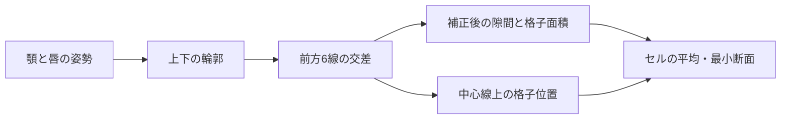

# 前突した下唇を引き込むときの断面積の段差

## 固定上流の経路

固定版は `c6147d0198890475dbe8a65a0bb8f56240c539b7`。通常の発声では `HumanVoice::control` が調音の位置・速度を更新し、`HumanAirway::apply → commit` が `HumanVocalTract::compute → resample` を呼ぶ。接触で調音位置が補正された場合は `reapply` で形状を計算し直す。 `commit` は前回のセル断面積を保持し、制御刻み `dt > 0` のときは平均と最小面積の変化速度をそれぞれ制限する。次に音響ネットワークのブロックを開始する。連続性テストは `Areas::at` で `compute` と `resample` までを直接呼び、時刻や過去の調音状態を持たずに各姿勢を比較する。ここで計測するのは速度制限前のセル目標値。[発声の制御更新](../../../../docs/reference/chimera-vocal-synth/upstream/crates/chimera/src/voice/human_voice.rs#L456)・[気道への適用](../../../../docs/reference/chimera-vocal-synth/upstream/crates/chimera/src/voice/human_airway.rs#L214)・[比較対象のテスト](../../../../docs/reference/chimera-vocal-synth/upstream/crates/chimera/tests/geometry_continuity.rs#L274)

1. **輪郭**。姿勢には顎・舌・唇などの制御値を渡す。長さはテンプレートの cm を体型に合わせて変換する。引き込み `labiodental` は無次元の0〜1。下唇の端は前突時の位置から上切歯より `0.05k` cm前にある目標へ線形補間し、切歯までの縦の差には唇の開きを使う。上唇も別の目標へ連続に動く。上下唇の内面はそれぞれ三次Bézierを端点込み7点に離散化する。音響用の内壁には下切歯から下唇内面を連結する。[唇端と上唇](../../../../docs/reference/chimera-vocal-synth/upstream/crates/chimera/src/anatomy/human.rs#L806)・[下唇と内壁](../../../../docs/reference/chimera-vocal-synth/upstream/crates/chimera/src/anatomy/human.rs#L893)
2. **交差と隙間**。前方6線は上切歯の少し前から唇へ並び、下から上へ向ける。上側は外壁との最初の交差、下側はその高さからさらに `1.5k` cmまでにある内壁交差のうち最も高いものを採る。`k` は体型スケール。下側の交差が上側を越せば隙間を0 cmにする。線上の頂点を片方の側に数え、輪郭が線に接すると交差は同じ高さの対として現れるか消える。下唇端より前の線では、別に外面を延長した下限を用いる。舌と唇の接触補正は、格子の内外の座標と生の隙間 `ray` を保存したまま、断面積用の隙間 `d` を更新する。上下の唇による上限は引き込み0.5で解除される。[交差の列挙](../../../../docs/reference/chimera-vocal-synth/upstream/crates/chimera/src/anatomy/geom.rs#L99)・[格子の走査](../../../../docs/reference/chimera-vocal-synth/upstream/crates/chimera/src/anatomy/human.rs#L995)・[接触補正](../../../../docs/reference/chimera-vocal-synth/upstream/crates/chimera/src/anatomy/human.rs#L1165)
3. **格子断面積と中心線**。上切歯付近は `2d^1.4` から楕円近似の `πdw/4` へ、奥行き `0.45k` cmの範囲で線形に移る。`w` は唇の横幅。隣接点から孤立した面積の突出を上限で抑える。中心線距離 `s` は、喉頭蓋の管長から始めて格子中点間の距離を順に加える。下側が切り替わると断面積と中点の両方が変わる。[面積と中心線](../../../../docs/reference/chimera-vocal-synth/upstream/crates/chimera/src/anatomy/human.rs#L1185)
4. **セル**。軟口蓋側の境界で咽頭と口腔に分け、各管を等長セルに分割する。格子点間を線形補間した面積をセル内の等間隔8中点で読み、その調和平均 `8 / Σ(1/Aⱼ)` を伝搬の断面積とする。格子点そのものも走査し、8点か格子点のいずれかが 10⁻⁵ cm²以下なら閉鎖になる。最小断面積も別に出せる。[セルへの変換](../../../../docs/reference/chimera-vocal-synth/upstream/crates/chimera/src/anatomy/human.rs#L1302)



## 事前登録と照合方法

中立姿勢の顎を0.3 cm、唇の開きを0.05 cmに固定した。成人男性・成人女性・子どもに対し、前突0.2・0.6 cmと唇の広がり0.5・1.0の全12条件で引き込みを0〜1へ動かす。上流の除外テストと同じく400分割、20咽頭セルと24口腔セルで測り、平均面積の最大差が0.05 cm²を超える区間は両半区間を深さ20まで調べる。この刻みの引き込み量は約 2.38×10⁻⁹。輪郭は連続、前方の下側交差は切り替わり、接触補正前の隙間から面積への順で段差が出ると予測した。[ケース定義](../cases/lip-tuck-area-continuity.json)

Rustの測定器は固定上流と候補の形状・面積の公開APIを同じ姿勢列に対して呼ぶ。段差の両端は候補の通常CLI `geometry`・`area`・`resample` と固定上流の公開フレーム出力でも再計測した。Pythonでは全交差と線分番号を縦線の内分で求め、前方の隙間から面積則と中心線を再構成した。セルの面積と境界はNumPyの線形補間、調和平均、セル内格子点のマスクで照合した。前方以外の接触後の隙間はフレームの値を入力にした。[Rust計測器](../tools/lip_tuck_sweep.rs)・[比較と独立計算](../tools/measure_lip_tuck_continuity.py)・[セルの独立計算](../tools/measure_resample.py)

代表例では、下側の交差が上がるのに口腔セル18の平均面積が増えた。段差を確認した後の追加対照として、同じ格子点の「面積列」と「中心線距離列」を段差前後から別々に選び、4通りを独立計算に通す。面積だけの差し替えでは平均面積は増えず、中心線距離だけの差し替えで増えると予測した。セル番号は0始まりとする。

## 段差が最初に出た段

固定上流の通常テストは5件合格した。除外指定を明示して実行すると終了コード101で失敗し、成人男性・成人女性・子どもで各6件を報告した。測定器でも4,812姿勢の粗い走査と2,075姿勢の追加計測で、同じ18件を同じ区間・セルで再現した。平均断面積の段差は0.210〜0.514 cm²。平均・最小断面積を両実装で照合した最大差は1.17×10⁻¹³ cm²だった。[固定上流の除外試験](../runs/lip-tuck-area-continuity-20261121-verified/artifacts/upstream-ignored-test.log)・[全条件の要約](../runs/lip-tuck-area-continuity-20261121-verified/summary.json)

18件すべてで、輪郭頂点の移動は最大2.88×10⁻⁹ cm。影響を受けた前方の線は1本目が12件、2本目が6件。いずれも上側の交差位置は同じで、下側は交差が1個から3個に増えた。新しい2個は下唇内面の同じ頂点を挟む線分58・59に現れ、最も高い交差が線分59へ移った。下側の高さは0.254〜0.448 cm上がり、その格子点の面積は0.492〜1.061 cm²減った。その線の前方延長処理は両端とも適用範囲外で、補正後の隙間は生の測定値と一致した。全36姿勢での独立計算と固定上流・候補の照合誤差は、位置が最大2.31×10⁻¹⁴ cm、面積が最大5.96×10⁻¹⁴ cm²だった。[交差・線分と独立計算の全記録](../runs/lip-tuck-area-continuity-20261121-verified/artifacts/crossing-details.json)

代表例は成人男性・前突0.2 cm・広がり0.5。引き込み0.8611794329〜0.8611794353で、前方の1本目は `x = 6.2232 cm` のまま、内壁頂点59の `x` が6.223200000383から6.223199998922 cmへ動いた。これにより内壁との交差は高さ7.282618 cmの1個から、約7.626300 cmの交差2個を含む3個へ変わった。格子点の面積は1.327994 → 0.564469 cm²に減った。口腔管末端の中心線距離が短くなり、セル18の積分区間は15.3181–15.6785 cmから15.1654–15.5173 cmへ移った。[段差直前の輪郭](../runs/lip-tuck-area-continuity-20261121-verified/artifacts/event-01/low/upstream-geometry.csv)・[段差直後の輪郭](../runs/lip-tuck-area-continuity-20261121-verified/artifacts/event-01/high/upstream-geometry.csv)

| 格子面積の入力 | 中心線距離の入力 | 口腔セル18の平均 cm² | 最小 cm² |
| --- | --- | ---: | ---: |
| 前 | 前 | 2.572154 | 2.186531 |
| 後 | 前 | 2.559931 | 2.118987 |
| 前 | 後 | 2.980292 | 2.626487 |
| 後 | 後 | 2.980292 | 2.626487 |

距離だけを差し替えたときに、約0.40814 cm²の増加がすべて再現された。格子点そのものの面積が減ることと、移動したセルがより後ろの広い範囲を測ることは同時に起きる。前突0.6 cm・広がり0.5の2件目では、同じ交差の切り替えでも、最大差のあるセルとその符号が体型で変わった。成人男性ではセル19で −0.47856 cm²、成人女性ではセル17で +0.41164 cm²、子どもではセル17で +0.32125 cm²だった。[代表例の全4条件](../runs/lip-tuck-area-continuity-20261121-verified/artifacts/event-01/)・[全姿勢の要約](../runs/lip-tuck-area-continuity-20261121-verified/summary.json)

## 実行と再開

macOS 15.6.1 arm64、Rust 1.94.1、Python 3.14.4、NumPy 2.4.4。外部ディスクRTL9210B-CGへ推定最大40 MBとして出力を指定した。全姿勢の平均・最小断面はgzip CSVに、段差の両端の輪郭と格子・セル、独立計算は別々のCSVに保存した。マニフェストに上流コミット、入力・ソース・出力のSHA-256、コマンドと終了コード、出力先を残した。 正式実行と `/tmp` からの再実行は8判定に合格した。成果は各約10.18 MB。両実行の全340出力を各マニフェストに照合し、要約、全姿勢の圧縮CSV、段差前後の観測を含む決定的な332出力はバイト単位で一致した。[正式実行](../runs/lip-tuck-area-continuity-20261121-verified/manifest.json)・[別の作業位置からの再実行](../runs/lip-tuck-area-continuity-20261121-repeat/manifest.json)

```bash
cd /Users/dolphilia/github/voice-simulator/research/experiments/chimera-rebuild
CHIMERA_RUN_STORAGE=rtl9210b CHIMERA_RUN_BYTES=40000000 ../../.venv/bin/python tools/measure_lip_tuck_continuity.py lip-tuck-area-continuity-local-1
../../.venv/bin/python tools/measure_area.py lip-tuck-area-regression-local-1 area-neutral
cargo test --workspace --locked
```

初回はシステムのPythonにNumPyがなく、研究環境の仮想環境で再実行した。その後、候補ライブラリのLTO、gzipの引数、姿勢JSONへの未対応キー、既知テストのパニックを読み出す先の順に試行が止まった。測定器側で対応し、各時点のコマンド・出力と一部の判定を保存した。候補ワークスペースの41試験と従来の中立姿勢の断面積計測は合格。全ワークスペースの整形チェックには既存の `phonetics.rs` のモジュール順の差があり、今回のRust測定器の整形チェックは合格した。[LTOで停止した実行](../runs/lip-tuck-area-continuity-20261121-a/manifest.json)・[gzipの引数で停止した実行](../runs/lip-tuck-area-continuity-20261121-b/manifest.json)・[姿勢JSONで停止した実行](../runs/lip-tuck-area-continuity-20261121-c/manifest.json)・[上流ログの判定を直す前の結果](../runs/lip-tuck-area-continuity-20261121-d/summary.json)・[中立姿勢の回帰](../runs/lip-tuck-area-regression-20261121-a/summary.json)

次は代表姿勢の前後を通る短い引き込み軌跡で、同じ駆動の下で速度制限前の面積、気道で実際に適用した面積、圧力、口端の放射流量とPCMを計測する。速度制限と放射への影響を照合してから、交差の選択を連続にする候補が閉鎖・摩擦音へ与える差を別ケースで評価する。
