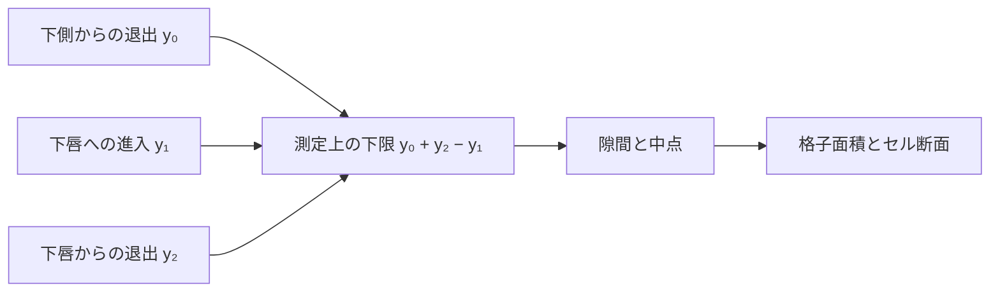

# 前方測定線で下唇の組織の厚さを数える対照

## 固定上流と比較する規則

固定上流 `c6147d0198890475dbe8a65a0bb8f56240c539b7` では、発声時の `HumanVoice::control` から `HumanAirway::commit` に渡る姿勢を使い、`HumanVocalTract::compute` で矢状面を作る。前方測定線は上切歯から唇へ6本を置き、声道の下から上に進む。外壁の最初の交差を上限、内壁との最も高い交差を下限に取る。元の下限が上限に達すると生の隙間は0になる。下唇の端より前では、下側の面を唇の外面から延ばして測る。内外の測定点の中点が中心線を決め、接触で補正された隙間から格子面積を算出する。幾何の後にセルへの再標本化、時間方向の面積の速度制限と補間、放射の計算が続く。[測定線と前端処理](../../../../docs/reference/chimera-vocal-synth/upstream/crates/chimera/src/anatomy/human.rs#L995)・[発声時の面積目標](../../../../docs/reference/chimera-vocal-synth/upstream/crates/chimera/src/voice/human_airway.rs#L233)

交差の左右は線の向きと輪郭の線分で判定する。上向きの線では輪郭の `Δx > 0` の交差が組織から空気への退出で、`Δx < 0` の交差が進入。扇状の測定線では、舌の折り返しで2つ目の組織層があると、通過した厚さだけを隙間から引く規則がすでにある。前方の縦線で新しい交差が2個現れると、従来の最大値の選択は短い時間で大きく変わる。この挙動を固定上流の前突12条件で18件再現し、音への伝わり方も別の有声ケースで検証した。[交差と向きの計算](../../../../docs/reference/chimera-vocal-synth/upstream/crates/chimera/src/anatomy/geom.rs#L117)・[扇状測定線の厚さ処理](../../../../docs/reference/chimera-vocal-synth/upstream/crates/chimera/src/anatomy/human.rs#L951)・[上流の通常・前突の連続性テスト](../../../../docs/reference/chimera-vocal-synth/upstream/crates/chimera/tests/geometry_continuity.rs#L236)・[静止と有声の基準](lip-tuck-area-continuity.md)

実験版では下唇端より後方の縦線が、低い組織退出 `y₀` と、下唇内面での進入 `y₁`、退出 `y₂` にこの順で交差し、`y₂` が外壁側の上限より低い場合に限り、測定上の下限を `y₀ + (y₂ − y₁)` にする。高さや隙間の単位は cm。折り返しをかすめる瞬間は `y₂ − y₁ = 0` なので、隙間は手前の交差に連続につながる。上側との接触・下唇以外の交差・唇端より前の外面延長には従来の経路を使う。各姿勢で現在の輪郭だけを使い、追加の時系列状態は持たない。切り替えはCargoの `labial-crossing-thickness` 機能で実験的に有効にする。[Rust実装と交差が重なる点の単体試験](../crates/vocal-core/src/anatomy/grid.rs)



## 事前に設定した比較

前突の12条件を400分割で走査し、各段差候補の区間を20回まで二分する。過去の18件の両端では、固定上流の輪郭を使った独立な縦線内分と、面積則・セルの調和平均を実験版と照合する。通常の唇歯の36条件も同じ手順で走査する。有声の動的条件では、固定・引き込み・従来版のPCMを同じ時計で比べ、20 msの圧力・口端流量・PCM差がどれだけ減るか測る。両唇破裂音2本で閉鎖・再開口・破裂時刻、唇歯摩擦音の発話8条件と歌唱1条件で狭窄と乱流の活動率および2–8 kHzを照合する。採否の基準と各基準実行のIDはケース定義に記録した。[候補ケース](../cases/lip-tuck-crossing-thickness.json)

## 静止時と発声中の結果

前突12条件の粗い4,812姿勢と区間を絞った点を合わせて、両版で6,944姿勢を計測した。0.05 cm²を超える段差は固定上流の18件から実験版で0件になった。18件の元の区間で測った実験版の最大変化は1.39×10⁻⁷ cm²。段差の両端36姿勢で独立計算との差は座標が最大5.69×10⁻¹⁴ cm、面積が最大1.40×10⁻¹³ cm²だった。前突0の36条件では17,648姿勢を照合し、新たな段差や閉鎖セルの差は0件で、最大面積差は1.01×10⁻¹³ cm²だった。[全走査と前後の独立計算](../runs/lip-tuck-crossing-thickness-20261121-b/artifacts/static-report.json)

最初に変わった量は、同じ矢状面輪郭から選ぶ前方測定線の下限だった。かすめた直後の組織層は、18件の測定位置でいずれも厚さ7.61×10⁻⁸ cm未満だった。実験版の隙間と中点の変化も小さく、面積則と再標本化へ連続につながった。折り返しが発達すると隙間や中点の差は大きくなる。成人男性の前突0.6 cm、広がり1.0、引き込み0.98625では、前方1本目の生の隙間が0.163→0.432 cmに変わり、口腔セル19の平均面積は0.589→1.380 cm²になった。これが前突走査中の両版の最大差0.791 cm²だった。[両版の全姿勢CSV](../runs/lip-tuck-crossing-thickness-20261121-b/artifacts/candidate-sweep.csv.gz)・[固定上流の全姿勢CSV](../runs/lip-tuck-crossing-thickness-20261121-b/artifacts/upstream-sweep.csv.gz)

代表の有声軌跡では、切り替え直後の口腔セル13の目標平均断面の変化が+0.317891から−0.00000838 cm²へ縮んだ。固定姿勢との差を切り替え後20 msで測ったRMSを示す。固定姿勢の波形と引き込み前の波形は基準版とビット一致した。[有声軌跡の比較](../runs/lip-tuck-crossing-thickness-20261121-b/artifacts/dynamic-report.json)

| 観測量 | 基準版のRMS差 | 実験版のRMS差 | 実験版と基準版の比 |
| --- | ---: | ---: | ---: |
| 口腔セル13の圧力 dyn/cm² | 38.7278 | 1.26295 | 3.26% |
| 口端流量 cm³/s | 29.4392 | 0.62848 | 2.13% |
| 全放射流量の微分 cm³/s² | 11,280.7 | 284.395 | 2.52% |
| PCM振幅 | 0.0059366 | 0.00015255 | 2.57% |

## 閉鎖・再開口と摩擦の回帰

両唇破裂音 /ɑpɑ/ と /ɑbɑ/ の閉鎖開始、再開口、再開口から5 ms内の破裂ピークの時刻は、固定上流とすべて同じだった。破裂のピーク振幅も両版で一致し、/p/ は0.127171、/b/ は0.044701だった。唇歯摩擦音は成人男性・成人女性・子ども・補間体型、速度と乱流倍率を変えた発話8本と、歌唱「ве́тер」の計9条件で確認した。中央の口腔最小面積の中央値、狭窄乱流の活動率、2–8 kHzのレベルは全条件で一致し、保存した再現版とのPCMも全サンプルでビット一致した。[閉鎖・破裂の計測](../runs/lip-tuck-crossing-thickness-20261121-b/artifacts/stops-report.json)・[唇歯摩擦音の全条件](../runs/lip-tuck-crossing-thickness-20261121-b/artifacts/fricatives-report.json)

## 実行と扱い

macOS 15.6.1 arm64、Rust 1.94.1、Python 3.14.4、NumPy 2.4.4、SciPy 1.17.1。測定の12判定に合格した。既定版の41試験、機能を有効にした42試験、追加の交差テスト、Clippyと対象Rustファイルの整形を確認した。掃引結果と内部サンプルは圧縮CSV、音声はf32 WAV、前後の36姿勢の独立計算はCSVで保存した。正式実行と `/tmp` からの再実行はいずれも約202 MBをRTL9210B-CGへ出力した。各197出力のハッシュを照合し、要約、CSV、WAVを含む決定的な185出力がバイト一致した。[別ディレクトリからの再実行](../runs/lip-tuck-crossing-thickness-20261121-repeat/manifest.json)初回は発話の測定結果だけにあった項目を歌唱に求めて中断した。修正後は発話・歌唱の両方で同じ中央区間から口腔最小断面の中央値を計算した。測定の閾値は登録した値を使い、初回の中断理由・完了済みの計測・ハッシュを残した。[正式実行](../runs/lip-tuck-crossing-thickness-20261121-b/manifest.json)・[初回の中断記録](../runs/lip-tuck-crossing-thickness-20261121-a/interruption.json)

```bash
cd /Users/dolphilia/github/voice-simulator/research/experiments/chimera-rebuild
CHIMERA_RUN_STORAGE=rtl9210b CHIMERA_RUN_BYTES=536870912 ../../.venv/bin/python tools/measure_lip_crossing_thickness.py lip-tuck-crossing-thickness-local-1
cargo test --workspace --locked --features vocal-core/labial-crossing-thickness
cargo run --locked --release -p vocal-cli --features vocal-core/labial-crossing-thickness -- render-pcm cases/lip-tuck-voiced-radiation.json /tmp/lip-tuck-thickness.wav --no-trace 128
```

通常の再現版を基準に、今回の規則を明示指定する実験条件として利用できる。深い引き込みで面積の値に残る差と、実際に聴こえる差は追加評価の対象。次の計画項目では、閉鎖を含む調音軌跡で同じ物理・時間条件のまま格子数だけを変更し、平均断面と最小断面が閉鎖時刻、圧力ピーク、スペクトルにどう効くか調べる。
