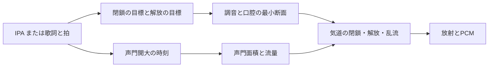

# 後部歯茎破擦音 /tʃ/

固定上流 `c6147d0198890475dbe8a65a0bb8f56240c539b7`。実装前に計画式、観測点、合否と再現条件を記録した。[登録ケース](../cases/postalveolar-affricate.json)

## 読解

IPA の字句解析は /tʃ/ を一つの音素として渡す。ロシア語の `word_before` は「ч」を /tʃ/ に写し、軟音として25 msの /j/ を足す。「чью」では母音の先行音からも /j/ が生じ、頭子音は /tʃ j j/、核は /u/。歌唱の `plan_song` は、既定長の子音を0.8倍にして拍の手前へ置き、明示長の /j/ には25 msを使う。音符に余裕があるロシア語デモ第2音節では、/tʃ/ は120 ms、後続の二つの /j/ は25、44 msとなる予定。同じ譜面とテンポ112 BPMを使い、男性用のオクターブ指定に合わせてMIDIを12下げる。発話の語中長は、Klatt 表の125 msと下限88 msに係数0.85を適用した119.45 msを話速で割る。[音素分割](../../../../docs/reference/chimera-vocal-synth/upstream/crates/chimera/src/phonetics/ipa.rs)・[ロシア語の軟音](../../../../docs/reference/chimera-vocal-synth/upstream/crates/chimera/src/phonetics/russian.rs#L200)・[音符への長さの割付け](../../../../docs/reference/chimera-vocal-synth/upstream/crates/chimera/src/phonetics/sing.rs#L193)・[デモ譜面](../../../../docs/reference/chimera-vocal-synth/upstream/crates/chimera/src/phonetics/songs.rs#L54)・[発話の長さ](../../../../docs/reference/chimera-vocal-synth/upstream/crates/chimera/src/phonetics/durations.rs#L55)

`plan_utterance` は音素区間 `[a,b]` を `split=a+0.45(b−a)` で分け、口腔の閉鎖と摩擦への解放を順に登録する。閉鎖の主要軸は舌先 `(5.75,10.0) cm`、唇の突出0.75 cm、幅制御0.2。強さ40、速度2.0、開始 `a−31 ms`、終了 `max(a+10 ms,split−20 ms)`。解放は `r=max(a,split−15 ms)` を起点に、/ʃ/ 自身の主要軸を速度1.4で適用する。開始は `r−8 ms`、終了は `max(r+10 ms,b)`。舌先Xは5.7 cm、較正したYは成人男性9.512、成人女性9.521、子ども9.538 cm。顎0.35 cm、唇2軸は閉鎖と同値。両ジェスチャーのランプは30/18 ms、解放保持は45 ms。体型の混合は較正値の重み付き平均を使う。[目標の定義](../../../../docs/reference/chimera-vocal-synth/upstream/crates/chimera/src/phonetics/inventory.rs#L189)・[較正表](../../../../docs/reference/chimera-vocal-synth/upstream/crates/chimera/src/phonetics/consonantTargets.generated.json)・[閉鎖と解放](../../../../docs/reference/chimera-vocal-synth/upstream/crates/chimera/src/phonetics/planner.rs#L472)・[調音ランプ](../../../../docs/reference/chimera-vocal-synth/upstream/crates/chimera/src/phonetics/planner.rs#L820)

既定の無声破擦音は `open=a+0.15(b−a)` に声門開大0.36 cm²を強さ6で指示する。上昇は35 ms。保持の終端は `max(open,b−30 ms)`、下降は `min(30 ms,b−open)` なので短い音では保持がない。明示的な帯気やVOTがあれば破裂音の声門計画を使う。IPA の二次口蓋化は、閉鎖目標が占有していない舌背X/Yに /j/ の目標を重ねる。上流の `Gesture::end` は保持終端に下降時間を足した時刻で、帯気した場合の口蓋化はそこまで延びる。話速が1より大きいとランプ・解放保持も話速で割る。[声門の分岐](../../../../docs/reference/chimera-vocal-synth/upstream/crates/chimera/src/phonetics/planner.rs#L508)・[短い開大](../../../../docs/reference/chimera-vocal-synth/upstream/crates/chimera/src/phonetics/planner.rs#L678)・[二次口蓋化と話速](../../../../docs/reference/chimera-vocal-synth/upstream/crates/chimera/src/phonetics/planner.rs#L737)

計画の時刻は制御への入力で、接触・開口は調音の追従と断面の補間で生じる。気道の `step` は閉鎖セルとつながる流量（cm³/s）を止める。開口後の噴流は枝の流量・面積に依存し、距離と噴流強度の条件を満たすと、上顎切歯側に乱流圧力（dyn/cm²）を注入する。開口、歯の乱流、声門面積の周期復帰をそれぞれ観測する。上流の `affricates.rs` は10 ms窓で1 kHzの二段ローパス後の電力比を測り、成人の /ɑtʃɑ/ で摩擦50 ms以上、母音までの間隔20 ms以内を確認する。関連する `consonant_artifacts.rs` は制御レートの音や子音の破裂時のクリックを検出する。[気道ステップ](../../../../docs/reference/chimera-vocal-synth/upstream/crates/chimera/src/airway/network.rs#L925)・[乱流の登録](../../../../docs/reference/chimera-vocal-synth/upstream/crates/chimera/src/voice/human_airway.rs#L329)・[破擦音の試験](../../../../docs/reference/chimera-vocal-synth/upstream/crates/chimera/tests/affricates.rs)・[子音アーティファクトの試験](../../../../docs/reference/chimera-vocal-synth/upstream/crates/chimera/tests/consonant_artifacts.rs)

## 事前登録した予測

成人男性と成人女性の通常発話では閉鎖、開口、歯の乱流、声門の周期復帰を確認し、上流のスペクトル検出条件も通ると予測する。子どもの前舌母音、混合体型の高速発話、23 msの口蓋化で調音と声門の独立計算を照合し、口腔と音響の観測値も保存する。ロシア語デモは全16音節と2句で未対応音素が空になり、「чью」で歯の乱流から声門の振動へ移行すると予測する。全PCMを上流と、加工前PCMと保存ケースを実ブラウザ・CLI間で照合する。

## 実装と計測器

既存の `affricate_gestures` が /tʃ/ の閉鎖と較正済みの /ʃ/ の解放を生成し、声門開大の時刻計算を /tɕ/ と共有する。二次口蓋化があれば舌背の2軸を重ねる。CLIとWASMは同じ調音計画を使い、通常の発話入力で乱流を有効にする。CLIの口腔セルと枝流量の観測を /tʃ/ でも使い、固定上流から同じ時系列を採る。計測器は既存の閉鎖・歯の乱流・声門周期の検出を利用し、10 msのスペクトル検出と歌唱の時刻を独立計算した。全譜例の系列は数値型のまま読み込み、音節数・音符数・2句の全ジェスチャー、内部状態、加工前PCMを照合する。[合成コア](../crates/vocal-core/src/phonetics/speech.rs#L400)・[候補の観測](../crates/vocal-cli/src/timing_case/speech_voice.rs#L935)・[固定上流の観測](../tools/upstream_bilabial_probe.rs)・[計測器](../tools/measure_postalveolar_affricate.py)

## 実測

発話5条件と歌唱1条件で58項目を通過した。固定上流との加工前PCMの最大絶対差は `9.31×10⁻¹⁰`。全例で出力ブロック長128と77のWAV・PCM CSVはバイト一致した。音素・ジェスチャー、口腔の面積と流量、声門と乱流、放射の各系列は登録許容差内だった。[計測結果](../runs/postalveolar-affricate-20261120-a/summary.json)・[環境と実行コマンド](../runs/postalveolar-affricate-20261120-a/manifest.json)

| 条件 | 完全閉鎖（ms） | 開口 − 計画上の境界（ms） | 開口から歯の乱流（ms） | 最初の周期 − 音素終端（ms） |
| --- | ---: | ---: | ---: | ---: |
| 成人男性 /ɑtʃɑ/ | 9.13 | −25.82 | 15.88 | +4.28 |
| 成人女性 /ɑtʃɑ/ | 9.85 | −24.88 | 17.13 | +5.20 |
| 子ども /itʃi/ | 66.04 | −4.98 | 2.27 | +5.57 |
| 成人男性「чью」 | 23.29 | −20.51 | 10.08 | +8.58 |

閉鎖中の両隣の枝流量は上表の全条件で0 cm³/s。成人男女の10 msスペクトル窓は摩擦をともに60 msと検出し、摩擦の最後の窓と母音の間はそれぞれ0、10 msだった。この間隔は口腔の開口を起点とした表の時刻や、声門の周期検出とは観測点が異なる。計画した45%の境界に対して、成人の /ɑtʃɑ/ の開口は約25 ms早い。閉鎖目標の解放と摩擦目標への移行の重なりを調べるには、同じ体型・入力で解放側の15 ms先行だけを変える比較ができる。[時系列・検出時刻](../runs/postalveolar-affricate-20261120-a/summary.json)

話速1.35の混合体型では最小口腔断面が0.001345 cm²、23 msの口蓋化では0.001019 cm²で、完全閉鎖の判定閾値0.0002 cm²を上回った。短い例は声門開大の保持が0、下降が19.55 ms。これらも上流と一致し、事前登録に従って計画・状態・PCMを判定した。両条件とも前後母音は /ɑ/ で、体型・区間長・口蓋化が異なる。最小の追加実験は、同じ混合体型・前後母音で話速だけを1.0と1.35に変え、最小断面と閉鎖前後のランプを比べること。[短縮条件の実測](../runs/postalveolar-affricate-20261120-a/summary.json)

ロシア語デモは全16音節と2句の計画が上流と一致し、音響未対応の欄は空になった。「чью」の /tʃ/ は0.846714〜0.966714 s。続く /j/ 2個は25、44 msで、/u/ は第2拍の1.035714 sから始まった。ChromiumのAudioWorkletは454,629サンプルを生成し、CLIと保存ケースの再演にビット一致した。内部状態の7,104点はCLIと上流に照合した。[ブラウザの結果](../runs/postalveolar-affricate-20261120-a/summary.json)・[保存ケース](../runs/postalveolar-affricate-20261120-a/artifacts/browser/night-wind-case.json)

候補の `cargo fmt --all --check`、`cargo test --locked --workspace`、`cargo clippy --locked --workspace --all-targets -- -D warnings` は通過した。固定上流の `affricates`、`consonant_artifacts`、`russian` の26テストと、韓国語側の歯茎硬口蓋破擦音のネイティブ回帰36項目を確認した。[上流の試験出力](../runs/postalveolar-affricate-20261120-a/artifacts/upstream-tests.log)・[韓国語の回帰結果](../runs/alveolopalatal-affricates-20261120-postalveolar-regression/summary.json)

研究ディレクトリと `/tmp` からの2実行は各58項目を通過した。全76出力のうち、候補と上流のPCM、内部状態のCSV、保存ケース、WASMを含む68件のSHA-256が一致した。要約に差が出たのはブラウザの停止時刻の記録で、観測値とPCMの判定値は一致した。[別ディレクトリからの再実行](../runs/postalveolar-affricate-20261120-repeat/manifest.json)
