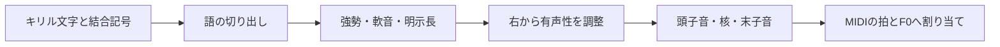

# ロシア語歌詞の音素化と音節化

固定版 `c6147d0198890475dbe8a65a0bb8f56240c539b7` を対象に、ロシア語歌詞の文字から歌唱計画までを調べる。弾き音 /ɾ/、二種の側音 /l ɫ/、渡り音 /j/ が揃ったため、これらを含む二つの譜例を波形まで照合する。[事前登録](../cases/russian-lyrics.json)・[弾き音の基準](alveolar-tap.md)

## 入力と処理順

- 上流の CLI `syllables` と歌唱レンダーは `lyrics_to_syllables_with` を共有する。ロシア語の `starts` はキリル文字、`continues` はそれに結合アキュート U+0301 とハイフンを加える。アキュートだけでは語が始まらない。トークンには担当する言語と綴りがあり、直前のトークンが同じ言語・句に属す場合、次の語の処理に渡る。句読点はその状態を消す。[上流の歌詞の入口](../../../../docs/reference/chimera-vocal-synth/upstream/crates/chimera-cli/src/main.rs#L117)・[上流の語の切り出し](../../../../docs/reference/chimera-vocal-synth/upstream/crates/chimera/src/phonetics/syllables.rs#L236)・[ロシア語の入口](../../../../docs/reference/chimera-vocal-synth/upstream/crates/chimera/src/phonetics/russian.rs#L298)
- `word_before` は小文字化し、語中のアキュートを母音の位置に対応づける。強勢位置は明示マーク → ё → 前置詞などの弱形には無指定 → 既知語の母音番号 → 最初の母音の順で決める。音節核の `stress` は0か1。歌唱では `reduce=false` なので、例えば「молоко́」の三つの母音はいずれも /o/ になる。語内部で無音字・綴り慣習・長子音を処理してから、音素列を後ろから走査して無声化と有声同化を行う。最後の阻害音は原則無声化される。母音を持たない前置詞は、次語の最初の字から無声化・有声化・元の値を選び、次の音節の頭に置く。[強勢と音素化](../../../../docs/reference/chimera-vocal-synth/upstream/crates/chimera/src/phonetics/russian.rs#L86)・[同化と語末](../../../../docs/reference/chimera-vocal-synth/upstream/crates/chimera/src/phonetics/russian.rs#L216)
- 軟音は子音の後ろに明示長0.025 sの /j/ を置く。軟音の л は /l/、硬音は /ɫ/。ь に続く и・о は母音側からも /j/ が出るため、「чьи」では二つが続く。母音間の重複子音は一音にまとめ、既定長の1.5倍とする。щ は /ʃ/ を0.18 sにする。歌唱計画は明示長があれば使い、通常の子音は既定長の0.8倍にする。音符内の時間が足りない場合は頭・末子音を短縮する。[子音と軟音](../../../../docs/reference/chimera-vocal-synth/upstream/crates/chimera/src/phonetics/russian.rs#L149)・[子音の長さ](../../../../docs/reference/chimera-vocal-synth/upstream/crates/chimera/src/phonetics/sing.rs#L28)
- 隣り合う母音核の間から、合法な最長の頭子音列を次の音節へ移す。ロシア語では英語の許可列に加え、一子音（後続 /j/ は数えない）か、最初が共鳴音 /ɾ ɫ l n m j/ 以外の列を許す。「я́блоко」では /bɫ/ が後ろの音節の頭へ移り、「се́рдце」では /ɾ/ が前の末尾に残る。表示綴りも母音・強勢記号・残った共鳴音の位置で切る。ハイフンで手書きした区切りとメリスマは共通の歌詞処理で音符に渡る。[共通の音節分割](../../../../docs/reference/chimera-vocal-synth/upstream/crates/chimera/src/phonetics/syllables.rs#L56)・[ロシア語の境界と綴り](../../../../docs/reference/chimera-vocal-synth/upstream/crates/chimera/src/phonetics/russian.rs#L258)・[歌詞テスト](../../../../docs/reference/chimera-vocal-synth/upstream/crates/chimera/tests/russian.rs#L176)

字句解析の結合記号の扱いも比較する。「поёт」と、ёを分解した「поёт」は語の切り出し時に同じ並びになるとは限らない。固定上流のトークンを解析結果と照合し、正規化の改善は別ケースとする。ロシア語デモ譜では、音節を全て抽出したうえで、現状の音響コアで不足する音素を歌唱計画から取り出す。歌唱譜例では拍を `t=t₀+拍数×60/BPM`、音高を `440×2^((MIDI−69)/12)` Hzで独立に計算する。[デモ譜](../../../../docs/reference/chimera-vocal-synth/upstream/crates/chimera/src/phonetics/songs.rs#L56)・[事前登録と観測条件](../cases/russian-lyrics.json)

## 実装と実測

候補の `syllables::read_lyrics` にロシア語の文字を認識する分岐を追加し、直前のロシア語トークンを渡す。英語とロシア語は同じ音節分割を使い、許可する頭子音列を言語別に指定する。ロシア語の有声同化は、右側の最も近い /j/ 以外の音の有声性を持って逆走査する。入力の処理はCLIとWASMで共有し、Webの歌詞欄にもロシア語を表示した。[音素化と綴り](../crates/vocal-core/src/phonetics/russian.rs)・[歌詞と音節](../crates/vocal-core/src/phonetics/syllables.rs)

23入力・81音節で、綴り、頭・核・末子音、強勢、明示長、語末と句末・メリスマが固定上流と一致した。独立に登録した以下の違いも確認した。

| 入力 | 観測 |
| --- | --- |
| мо́локо / молоко́ / молоко | 強勢がそれぞれ第1・第3・第3音節。母音は三つとも /o/ |
| по́ёт / поёт | 前者は明示アクセントで第1音節、後者は ё で第2音節に強勢 |
| лук / люк | /ɫuk/ と /ljuk/。後者の /j/ は0.025 s、核はどちらも /u/ 一つ |
| чьи | 頭子音 /tʃ j j/ と母音 /i/。最初の /j/ だけが0.025 s |
| я́блоко / се́рдце | /bɫ/ は次の頭に、/ɾ/ は前の末尾に付く |
| в лесу́ / с горы́ / в ти́хом | 前置詞が次の音節と一体になり、それぞれ /v z f/ |
| в, лесу́ | 句読点で直前の語の状態を消すため、「ле」の頭は /l j/ |
| поёт | 分解形では字句解析で U+0308 を境に分かれ、後ろの т が母音を持たない単独語になる。結果は /po.je/ |

歌唱時に `nucleus_part` はすべての核に強勢値1を設定する。各核の長さは音符の時間配分と前後の子音の割り当てから決まる。今回の「лук люк」では第2音の /j/ が0.975〜1.000 s、母音 /u/ は1.000 sの拍から始まった。25 msの明示長が核の開始をずらすことなく頭子音に割り当てられた。[歌詞と拍の実測](../runs/russian-lyrics-20261120-a/summary.json)・[上流の母音への変換](../../../../docs/reference/chimera-vocal-synth/upstream/crates/chimera/src/phonetics/sing.rs#L40)

「мо-ло-ко́ ~ рыба」の187,200サンプルと「лук люк」の91,200サンプルは、それぞれ実ブラウザ・CLI・ブラウザから保存したケースの再実行でビット一致した。固定上流とのPCM最大絶対差は `1.46×10⁻¹¹`。18件の候補ワークスペーステスト、整形、Clippy、固定上流の33テストも通過した。既存の英語歌唱計画と韓国語歌詞は回帰計測を通過した。[初回の実行](../runs/russian-lyrics-20261120-a/manifest.json)・[英語の回帰](../runs/song-plan-20261120-russian-regression/manifest.json)・[韓国語の回帰](../runs/korean-lyrics-20261120-russian-regression/manifest.json)

この実行では上流のロシア語デモ「Ночной ветер」の歌詞16音節と16音符を照合し、未対応の /tʃ v x/ を記録した。後続の実行では未対応欄が空になり、デモ全体のPCMを固定上流・CLI・実ブラウザで照合した。[初期のデモ計画](../runs/russian-lyrics-20261120-a/artifacts/lyric-candidate.json)・[デモ全体の実測](postalveolar-affricate.md#実測)

### 数値差と再実行

両譜例の最初のPCMビット差は冒頭のフレーム4,114（約85.7 ms）だった。両方とも歌詞の最初の拍は0.500 s。観測フレーム0で、唇の断面に候補1.7244517845712857、上流1.7244517845712855 cm²の差が見つかり、口端流量と放射系列にも小差があった。音素から調音までの計画と内部状態は登録した比較を通過した。[両譜例の時系列と比較](../runs/russian-lyrics-20261120-repeat/summary.json)

研究ディレクトリと `/tmp` から実行し、各75項目を通過した。両実行で音節JSON、PCM、内部系列、保存ケースなど67出力のうち56ファイルがハッシュ一致した。再実行の前にWebの歌詞欄の表示にロシア語を加えたため、ブラウザの画面画像は別のハッシュになった。要約で異なった数値は、ブラウザの停止までの時間だった。[再実行の記録](../runs/russian-lyrics-20261120-repeat/manifest.json)
