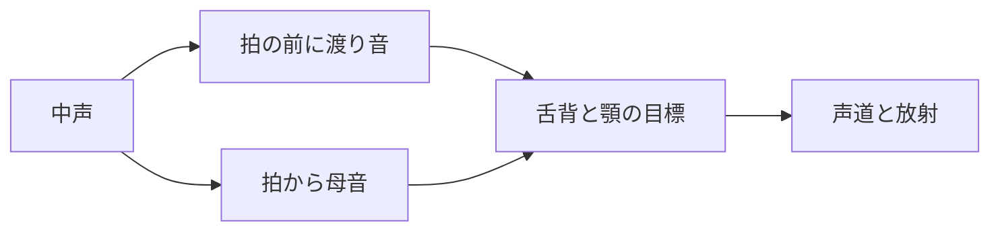

# 舌背の渡り音 /j ɰ/

## 固定上流の読解

発話の入口はIPAを `plan_utterance` へ渡す。歌唱の入口は `sung_lyrics` で歌詞を読み、`plan_song` が音節を音符へ割り当ててから同じ調音計画を使う。韓国語の `word_syllables` は中声を渡り音と母音に分ける。`야` では口蓋の /j/ を頭子音、/a/ を核に置く。`의` では /ɰ/ を頭子音、/i/ を核に置く。子音で始まる `희` では中声の /ɰ/ は脱落する。[発話と歌詞の入口](../../../../docs/reference/chimera-vocal-synth/upstream/crates/chimera-cli/src/render.rs#L63)・[韓国語の中声](../../../../docs/reference/chimera-vocal-synth/upstream/crates/chimera/src/phonetics/korean.rs#L67)・[音節の作成](../../../../docs/reference/chimera-vocal-synth/upstream/crates/chimera/src/phonetics/korean.rs#L277)

音素表の /j/ は舌背X・Yが (3.8, 7.95) cm、顎0.25 cm。/ɰ/ は舌背が (2.35, 7.45) cm。支配軸は両音とも舌背X・Yで、体型別の較正表にはこれらの音素の上書きがない。区間を `[a,b]` とすると、`oral_gestures_into` は舌背の指示を `[a−8 ms,max(a+10 ms,b)]` に置く。重みの最大値は40、前後ランプは30 ms、動きの速度倍率は `1+(1.3−1)×0.35=1.105`、解放保持45 ms。/j/ の顎は `[a,b]`、強さ2.2、ランプ50 msの別ジェスチャー。どちらも有声の接近音で、開大の追加はない。話速1を超えるとランプと解放保持を話速で割る。[音素目標](../../../../docs/reference/chimera-vocal-synth/upstream/crates/chimera/src/phonetics/inventory.rs#L227)・[ジェスチャーの分割](../../../../docs/reference/chimera-vocal-synth/upstream/crates/chimera/src/phonetics/planner.rs#L820)・[話速の処理](../../../../docs/reference/chimera-vocal-synth/upstream/crates/chimera/src/phonetics/planner.rs#L751)

歌唱は頭子音の通常長を0.8倍し、拍より前に並べる。今回の長い音符では /j/ は44 ms、/ɰ/ は48 msの頭子音となり、母音の開始と渡り音の終了が拍に揃う。頭子音も次の音符のF0目標を持つ。メリスマの継続には頭子音が付かない。上流の `rising` テストは構造化された二重母音でも最初の短い要素が拍より前になることを検査する。[歌唱の音素長](../../../../docs/reference/chimera-vocal-synth/upstream/crates/chimera/src/phonetics/sing.rs#L29)・[頭子音と拍](../../../../docs/reference/chimera-vocal-synth/upstream/crates/chimera/src/phonetics/sing.rs#L203)・[上流の関連テスト](../../../../docs/reference/chimera-vocal-synth/upstream/crates/chimera/tests/rising.rs)

形状を作る各制御刻みで、ランプに応じた重みと基準姿勢の重み0.05で目標を混ぜる。顎は固有角周波数 `2π×10 rad/s` の臨界減衰で、加速度 `ω²(目標−位置)−2ω×速度` を計算して速度を更新し、新しい速度で位置を積分する。舌背では解放保持中の速度と接触補正も作用する。形状は断面に写され、圧力、流量、放射、PCMの順に出力となる。[調音の更新](../../../../docs/reference/chimera-vocal-synth/upstream/crates/chimera/src/control/articulators.rs#L109)・[解放保持](../../../../docs/reference/chimera-vocal-synth/upstream/crates/chimera/src/control/score.rs#L214)

## 事前登録

成人男性の `ɑjɑ` と `ɑɰɑ` で、口腔が開いた状態の舌背位置と短時間LPCを比較する。話速1.8、成人女性、語末の条件も登録する。顎の位置に限り、計画した目標から独立に積分する。歌詞は `빵야 ~` と `의사` を使い、音節の分解、拍、渡り音、F0目標、実時間ブラウザの舌背位置とPCMを照合する。[登録ケース](../cases/tongue-glides.json)

## 実装と実測

共通の発話・歌唱計画に舌背用の接近音ジェスチャーを追加した。既存の接近音の立ち上がりと解放保持を使い、舌背の解放を30 ms、速度倍率を1.105に設定する。/j/ の顎の指示は別に出す。舌をすでに高く置いたかどうかを判断する後続の舌背破裂音の経路も、二つの音素を参照する。CLIと上流計測は舌背・顎、咽頭・口腔の断面を保存し、ブラウザ歌唱は舌背位置を保存する。[共通の計画](../crates/vocal-core/src/phonetics/speech.rs)・[CLIの観測](../crates/vocal-cli/src/timing_case/speech_voice.rs)・[ブラウザの計画](../crates/vocal-wasm/host/planning.ts#L100)

| 成人男性のIPA | 音素の予定長 | 中央の舌背X | 中央区間の口腔最小断面 | LPC第2極の周波数 |
| --- | ---: | ---: | ---: | ---: |
| `ɑjɑ` の /j/ | 74.00 ms | 3.730 cm | 0.203 cm² | 2,103.92 Hz |
| `ɑɰɑ` の /ɰ/ | 56.40 ms | 2.332 cm | 0.197 cm² | 1,604.03 Hz |

- 同じ /ɑ/ に挟んだ条件で、舌背の前後位置は1.398 cm、第2極の周波数は499.89 Hz離れた。固定上流との差は測定した第2極で0 Hzだった。話速1.8では /j/ の予定長が41.11 ms、中央の舌背Xは3.554 cm、口腔の最小断面は0.530 cm²。2体型と語末を含む全発話条件で渡り音の中央区間の開口が保たれた。顎の全時系列と独立計算の最大絶対差は、発話・歌唱7条件で `9.98×10⁻¹³` cm以内だった。[比較結果](../runs/tongue-glides-20261120-a/summary.json)
- `빵야 ~` の /j/ は0.956〜1.000秒で、2音目の音高目標329.63 Hzを持つ。母音 /a/ は1.000秒、続くメリスマの /a/ は1.500秒に始まり、/j/ は一度だけ計画された。`의사` の /ɰ/ は0.452〜0.500秒で音高目標220 Hzを持ち、/i/ は最初の拍0.500秒から始まった。ブラウザの実時間観測はそれぞれ1,800点・1,425点でCLIに一致し、ブラウザ波形は元のCLI出力と保存ケースのCLI再演の両方とビット一致した。[歌唱の実行記録](../runs/tongue-glides-20261120-a/manifest.json)
- 固定上流とのPCMの最大絶対差は成人女性の `ɑjɑ` で `7.45×10⁻⁹`。同条件のPCMの最初のビット差は1963番で、渡り音の開始前だった。観測系列では口端流量の差が0番で `1.33×10⁻¹⁶` cm³/s、声門流量の差は3番で `1.43×10⁻²²` cm³/s、口腔最小断面の差は9863番で `8.88×10⁻¹⁶` cm²だった。観測した顎・舌背の位置と音素区間・ジェスチャーは一致した。Rustテスト、Clippy、/w/ の回帰も通過した。[差の記録](../runs/tongue-glides-20261120-a/summary.json)・[/w/ の回帰](../runs/tongue-glides-20261120-w-regression/summary.json)
- 実験ディレクトリと `/tmp` からの再実行で各69項目を通過した。発話・歌唱7条件の計測要約が一致し、WAVとPCM CSVの32ファイルでSHA-256も一致した。[別のディレクトリからの再実行](../runs/tongue-glides-20261120-repeat/manifest.json)

LPCの第2極はこの短時間窓で求めた近似値。音素長と顎目標も二つの条件で異なるため、舌背位置だけの寄与を求めるには音素長・顎目標をそろえた介入条件が必要になる。[計測窓と仮説](../cases/tongue-glides.json)
