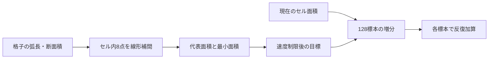

# FK61_01の節点29・34の断面積が決まる過程

[第87版](tsp-fk61-onset-to-control5504-volume-history.md#実測)では、4992〜5119と5120〜5247に生じた節点29・34の体積速度の差が、5503の平滑状態にほぼ逆向きに残った。今回は体積速度の入力となった断面積を、再標本化直後、速度制限後、標本ごとの補間の順にたどる。女性設定のFK61_01を固定上流、研究版、下唇の内側の数値計算を変更した試験版で比較する。内部96 kHz、出力48 kHz。標本と節点の番号は0始まり。

## 断面積分布から標本ごとの面積まで

通常テキストCLIが英語の発話計画を作り、上流の `HumanVoice::control` が調音姿勢を進める。接触補正で姿勢が変わった場合は同じ制御周期内で形状を再計算する。`HumanVocalTract::resample` は、中心線の咽頭端 \(s_0\) から唇 \(s_1\) までを16セルに等分する。各セルに等間隔で置いた8区間の中点について、格子点の面積を弧長に沿って線形補間する。代表面積は8点の調和平均 \(8/\sum_i(1/A_i)\)。最小面積は8点とセル内にある元の格子点から求め、代表面積を上限とする。どちらかの点列が閉鎖閾値に達すると代表面積と最小面積をゼロにする。面積は cm²、弧長とセル長は cm。研究版でも同じ8点と閾値を使う。 [通常CLI](../../../../docs/reference/chimera-vocal-synth/upstream/crates/chimera-cli/src/render.rs#L179)・[上流の制御更新](../../../../docs/reference/chimera-vocal-synth/upstream/crates/chimera/src/voice/human_voice.rs#L495)・[上流の再標本化](../../../../docs/reference/chimera-vocal-synth/upstream/crates/chimera/src/anatomy/human.rs#L1305)・[研究版の再標本化](../crates/vocal-core/src/anatomy/resample.rs#L95)



`HumanAirway::commit` は直前に確定した制御目標を基準に、新しい目標への変化を制限する。開口時は開きの基準速度と新面積に比例する項を使い、閉鎖時は狭窄付近で下がる速度と旧面積に比例する項を使う。制御周期 \(dt\) を掛けて許容面積差を求める。接触補正でやり直す場合も基準は同じ。研究版は `TractTargets::limit_against` と `limit_area` でこの処理を行う。幾何の補間は、その時点で気道ソルバーが持つ実際の面積を出発点とする。制御目標との差を128で割って増分を固定し、標本ごとに加算する。したがって速度制限で参照する面積は前回の目標、補間で参照する面積は前回のブロックを反復加算した最終値である。 [上流の制限基準と速度制限](../../../../docs/reference/chimera-vocal-synth/upstream/crates/chimera/src/voice/human_airway.rs#L213)・[研究版の速度制限](../crates/vocal-core/src/airway/tract_control.rs#L287)・[上流の増分](../../../../docs/reference/chimera-vocal-synth/upstream/crates/chimera/src/airway/network.rs#L708)・[研究版の増分と加算](../crates/vocal-core/src/airway/network/geometry.rs#L47)

上流の形状連続性試験は調音パラメータと校正母音の間で断面積の急変を検出する。通常CLIと同時に走らせる気道試験では、閉鎖移動と急な絞り込みに対する圧力の安定性を照合する。研究版ではポート更新と他の幾何補間の併存を確認する。 [上流の形状連続性試験](../../../../docs/reference/chimera-vocal-synth/upstream/crates/chimera/tests/geometry_continuity.rs#L119)・[上流の気道境界条件試験](../../../../docs/reference/chimera-vocal-synth/upstream/crates/chimera/tests/airway_adversarial.rs#L165)・[研究版の補間試験](../crates/vocal-core/tests/geometry_ramp.rs)

## 比較条件

4992・5120の格子面積、弧長座標、口腔の区間両端を採り、節点29・34の代表面積と最小面積を独立に再計算する。格子面積、座標、両端の個別交換で、入力差が再標本化直後の代表面積へ伝わる過程を分ける。速度制限前後と保持した基準値を採り、増分と標本ごとの代表面積を検査する。

4992〜5119、5120〜5247で節点29のみ、34のみ、両節点を選び、補間開始面積、目標面積、両方を上流に交換する。各ブロックで交換した開始面積から体積も初期化して局所の体積速度を採取値と比較する。5504〜5631の体積速度を上流に揃え、5632以降は前回の全形状・咽頭流入の交換条件を使う。通常CLIを観測前の基準とし、反実仮想のPCMは冒頭から2937まで比較する。 [事前登録](../cases/tsp-fk61-control4992-5120-area-targets.json)・[計測器](../tools/measure_tsp_fk61_control4992_5120_area_targets.py)

## 実測

4箇所とも代表面積の上流と試験版の差は、速度制限前に既にあった。代表面積と最小面積を格子分布から独立に再計算し、3版で採取値に一致した。今回の代表面積の変化は上限の最大約1.53%で、再標本化直後の値がそのまま補間目標へ入った。4箇所の代表面積の変化をL2ノルムで集計すると、格子面積の交換が1.571×10⁻¹⁴ cm²、格子弧長座標が6.233×10⁻¹⁵ cm²、口腔の区間両端が6.466×10⁻¹⁵ cm²。格子面積の効果は節点34で大きかった。4992の節点29では格子面積交換の効果はゼロで、座標と両端を個別に交換した効果は互いに逆向きだった。 [再標本化・速度制限の比較](../runs/tsp-fk61-control4992-5120-area-targets-20261123-first/summary.json)

| 内部標本・節点 | 制限前の代表面積差（cm²） | 前ブロックの目標面積差（cm²） | 今ブロックの開始面積差（cm²） |
| --- | ---: | ---: | ---: |
| 4992・29 | +1.776×10⁻¹⁵ | +4.441×10⁻¹⁶ | 0 |
| 4992・34 | +1.066×10⁻¹⁴ | +9.770×10⁻¹⁵ | +1.155×10⁻¹⁴ |
| 5120・29 | −1.776×10⁻¹⁵ | +1.776×10⁻¹⁵ | +5.684×10⁻¹⁴ |
| 5120・34 | +1.421×10⁻¹⁴ | +1.066×10⁻¹⁴ | −4.530×10⁻¹⁴ |

表の差は固定上流から試験版を引いた値。5120の節点29では前の目標差の32倍が開始面積に現れた。節点34では前の目標差と逆符号になった。4992からの128回の加算で、1回あたりの増分を面積に足したときの丸め誤差は節点29で上流 +2.151×10⁻¹⁶ cm²、試験版 −2.151×10⁻¹⁶ cm²。節点34では上流 −2.186×10⁻¹⁶ cm²、試験版 +2.186×10⁻¹⁶ cm²だった。丸め誤差を128倍した値は、各版のブロック終了時の目標からのずれに一致した。 [上流の補間系列](../runs/tsp-fk61-control4992-5120-area-targets-20261123-first/artifacts/upstream-ramp-step.csv)・[試験版の補間系列](../runs/tsp-fk61-control4992-5120-area-targets-20261123-first/artifacts/trial-ramp-step.csv)

5120〜5247の節点29・34では、開始面積だけを交換した条件と、開始面積と目標を両方交換した条件の計算軌道が一致した。どちらも冒頭からPCM 2937まで上流と一致した。目標だけの交換は軌道が無交換と一致し、PCMの差は2937に残った。開始面積を節点29だけ交換すると2936、節点34だけ交換すると2933に差が現れた。2節点の寄与の組合せが出力に効いている。 [交換条件ごとのPCM](../runs/tsp-fk61-control4992-5120-area-targets-20261123-first/summary.json)・[保存した軌道](../runs/tsp-fk61-control4992-5120-area-targets-20261123-first/artifacts/trajectories.npz)

次は、開始値と標本番号から面積を毎回計算する補間を、隔離ビルドの対象2節点で試す。5120の開始面積のずれが減るか、既存の体積速度と口端出力にどう伝わるかを比較し、全発話で最初に分かれるPCMフレームも調べる。 [標本ごとの面積更新](../crates/vocal-core/src/airway/network/geometry.rs#L124)

## 再実行

固定上流 `c6147d0198890475dbe8a65a0bb8f56240c539b7`、macOS arm64、Rust 1.94.1、Python 3.14.4、NumPy 2.4.4。研究ワークスペースと `/tmp` で各4判定とRustの11試験に通過した。3版それぞれで通常CLI・観測版・保存済みPCMの全116,132フレームを照合した。格子・面積・軌道・要約を含む34出力がバイト一致した。採取と軌道はRTL9210B-CGに保存した。別途、固定上流で `cargo test --offline --locked -p chimera --test geometry_continuity` を実行し、5件に通過した。突き出した下唇を引き込む既知の不連続の1件は上流の既定どおり除外された。 [初回マニフェスト](../runs/tsp-fk61-control4992-5120-area-targets-20261123-first/manifest.json)・[再実行マニフェスト](../runs/tsp-fk61-control4992-5120-area-targets-20261123-repeat/manifest.json)・[上流の除外理由](../../../../docs/reference/chimera-vocal-synth/upstream/crates/chimera/tests/geometry_continuity.rs#L274)

```bash
CHIMERA_RUN_STORAGE=rtl9210b CHIMERA_RUN_BYTES=4294967296 \
  ../../.venv/bin/python tools/measure_tsp_fk61_control4992_5120_area_targets.py tsp-fk61-control4992-5120-area-targets-new
```
