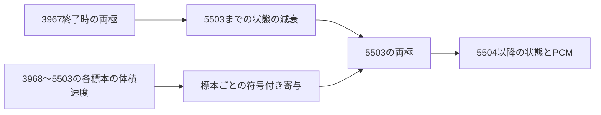

# FK61_01の発声初期から5503までの体積源の寄与

[第86版の計測](tsp-fk61-control5504-oral-history.md#実測)では、5503終了時に持ち越された平滑状態が、次の128標本の断面積より強くPCM 2937に効いた。今回は発声初期の3968まで範囲を広げ、5503での状態差を、3967終了時の初期差と以降の体積速度の差に分ける。固定上流、研究版、下唇の数値計算を変更した試験版を、女性設定のFK61_01で比較する。内部96 kHz、出力48 kHz。内部標本、出力フレーム、節点の番号は0始まり。

## 体積差が二段平滑器に残る過程

通常テキストCLIが発話計画を作る。上流の `HumanVoice::render` は制御境界で `control` を呼び、姿勢と接触補正の後に幾何の補間を始める。各内部標本では声門開口と肺圧を設定して `AirwayNetwork::step` に入る。研究版も `begin_tract_block` で断面積・セル長の目標を渡し、`MovingAreas::step` を枝と壁の更新より先に行う。 [上流のテキストCLI](../../../../docs/reference/chimera-vocal-synth/upstream/crates/chimera-cli/src/render.rs#L179)・[標本の更新順](../../../../docs/reference/chimera-vocal-synth/upstream/crates/chimera/src/voice/human_voice.rs#L375)・[制御境界の接触補正](../../../../docs/reference/chimera-vocal-synth/upstream/crates/chimera/src/voice/human_voice.rs#L494)・[研究版の制御更新](../crates/vocal-core/src/voice.rs#L610)

下限を適用した断面積とセル長の積 \(V_n\) は cm³、収縮を正とする体積速度 \((V_{n-1}-V_n)/\Delta t\) は cm³/s。上流は前後の体積差に刻みの逆数を掛け、研究版は体積差を刻みで割る。開口が小さい節点では、体積速度の一部が開いている隣接節点へ移る。配分後の入力を \(r[n]\)、平滑係数を \(\alpha\) とする。第一極を \(p_1[n]=p_1[n-1]+\alpha(r[n]-p_1[n-1])\) で進め、同じ標本で更新した第一極を第二極の入力に使う。第二極は節点へ加える体積速度になる。 [上流の体積速度と配分](../../../../docs/reference/chimera-vocal-synth/upstream/crates/chimera/src/airway/network.rs#L832)・[上流の平滑](../../../../docs/reference/chimera-vocal-synth/upstream/crates/chimera/src/airway/network.rs#L899)・[研究版の体積源](../crates/vocal-core/src/airway/network/geometry.rs#L110)

5503から \(j\) 標本前に入った入力差 \(\Delta r\) の寄与は、\(d=1-\alpha\) とすると、第一極では \(\alpha d^j\Delta r\)、第二極では \(\alpha^2(j+1)d^j\Delta r\)。3967終了時から \(k\) 標本持ち越された初期状態の寄与は \(d^k\Delta p_1\) と \(d^k(\Delta p_2 + k\alpha\Delta p_1)\)。入力差に重みを掛けた値を符号付きで足し、開始状態の寄与を加える。これを逐次のフィルター計算とは別に求め、5503の観測差と照合する。



上流の密閉空洞試験では、断面積の変化が生む圧力を断熱圧縮の解析式と照合する。狭窄の移動と急閉鎖の試験では、圧力と出力が有限で過渡が抑えられることを確認する。本計測では一様管の試験も実行し、研究版ではポートの即時更新中に他の形状補間が続くことを確認する。 [上流の密閉空洞と閉鎖試験](../../../../docs/reference/chimera-vocal-synth/upstream/crates/chimera/tests/airway_adversarial.rs#L56)・[研究版の補間試験](../crates/vocal-core/tests/geometry_ramp.rs)

## 比較条件

3966〜5875を採取し、3968〜5503の節点28〜37で寄与を分解する。観測したフィルター入力から、丸めた体積で求めた局所入力を引くと配分などの残差が得られる。採取した断面積とセル長を有理数として体積差を出し、幾何の入力差と、体積・差分の浮動小数点演算による差を分ける。第二極での寄与の大きさには10節点のL2ノルムを使う。

3967終了時の状態、全入力、各制御ブロックの入力、最後まで連続する複数ブロックの入力を交換する。寄与が最大のブロックを除く全区間の交換も検証する。5504〜5631の体積速度は上流に、5632以降は先の全形状と咽頭流入の交換条件に揃える。この条件で状態が口端流量に伝わる過程を再計算し、PCM 2937まで調べる。 [事前登録](../cases/tsp-fk61-onset-to-control5504-volume-history.json)・[計測器](../tools/measure_tsp_fk61_onset_to_control5504_volume_history.py)

## 実測

固定上流と試験版は、3967終了時の10節点の両極がすべてゼロだった。3968〜5503の観測入力から逐次更新した両極は、3版とも全標本で観測とビット一致した。閉形式の寄与の和と5503の観測差の最大残差は8.30×10⁻¹⁶ cm³/s。5503の第二極の観測差は10節点のL2ノルムで7.526×10⁻¹³ cm³/sで、積を丸めない幾何の寄与は7.523×10⁻¹³ cm³/s、体積の丸めと差分演算の寄与は2.809×10⁻¹⁵ cm³/sだった。対象10節点では局所の体積速度と配分後に観測した入力が3版とも一致した。 [寄与の集計](../runs/tsp-fk61-onset-to-control5504-volume-history-20261123-repeat/summary.json)

第二極の重みは5249の入力が最大で、入力差も掛けた標本の寄与は5135が最大だった。ブロックの寄与は5120〜5247が5.026×10⁻¹² cm³/sで最も大きく、直前の4992〜5119は4.276×10⁻¹² cm³/sだった。両者の符号付きベクトルのコサインは −0.99997で、合わせると7.507×10⁻¹³ cm³/sまで打ち消し合った。大きな寄与は節点29と34に集中した。例えば節点29は両ブロックで −3.037×10⁻¹²、+3.568×10⁻¹² cm³/s、節点34は +3.010×10⁻¹²、−3.539×10⁻¹² cm³/sだった。 [標本とブロックの符号付き寄与](../runs/tsp-fk61-onset-to-control5504-volume-history-20261123-repeat/artifacts/trajectories.npz)

| 3968〜5503の交換条件 | PCM 2937の変換前の変化（無交換の試験版に対して） | PCM 2937までの一致 |
| --- | ---: | --- |
| 早期区間の交換なし | +1.238×10⁻¹⁴ | 2937で差 |
| 5120〜5247の入力だけ | +1.964×10⁻¹⁴ | 一致 |
| 全入力 | +1.421×10⁻¹⁴ | 一致 |
| 5120〜5247を除く全入力 | +6.955×10⁻¹⁵ | 2937で差 |

5504以降を同じ条件に揃えた比較で、最大のブロック単独でもPCMの差が残るという予測を棄却した。単独交換と全入力交換の変換前の値には5.427×10⁻¹⁵の差があり、どちらも同じ `f32` 値に丸められた。終端まで続くブロックをまとめる条件では、5120〜5503の交換で冒頭から2937まで一致した。 [出力交換の結果](../runs/tsp-fk61-onset-to-control5504-volume-history-20261123-repeat/summary.json)

追加集計では、4992〜5247で積を丸めない体積速度の差を断面積とセル長の個別交換で分けた。両ブロックの第二極の寄与は全て断面積から生じ、セル長の交換の寄与はゼロだった。次は、寄与が大きく符号が反対になった節点29・34の4992・5120を採る。断面の再標本化、速度制限後の面積目標、各標本の加算を順に照合し、面積の差が最初に生じる段を特定する。 [面積とセル長の個別交換の式](../tools/measure_tsp_fk61_control5632_oral_geometry.py#L124)・[採取した試験版の形状](../runs/tsp-fk61-onset-to-control5504-volume-history-20261123-repeat/artifacts/trial-ramp-step.csv)

## 再実行

固定上流 `c6147d0198890475dbe8a65a0bb8f56240c539b7`、macOS arm64、Rust 1.94.1、Python 3.14.4、NumPy 2.4.4。研究ワークスペースと `/tmp` で各4判定とRustの11試験に通過した。3版それぞれで通常CLI・観測版・保存済みPCMの全116,132フレームを照合した。両実行の採取系列・寄与と状態の軌道・要約の28出力がバイト一致した。採取系列と軌道をRTL9210B-CGに保存した。 [初回のマニフェスト](../runs/tsp-fk61-onset-to-control5504-volume-history-20261123-first/manifest.json)・[再実行のマニフェスト](../runs/tsp-fk61-onset-to-control5504-volume-history-20261123-repeat/manifest.json)

```bash
CHIMERA_RUN_STORAGE=rtl9210b CHIMERA_RUN_BYTES=4294967296 \
  ../../.venv/bin/python tools/measure_tsp_fk61_onset_to_control5504_volume_history.py tsp-fk61-onset-to-control5504-volume-history-new
```
