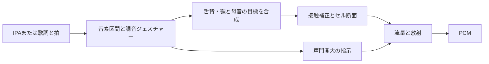

# 舌背の閉鎖音 /k g/

## 上流の読解

発話はCLIの `render speech` からIPAを読み、`plan_utterance` の音素区間とジェスチャーを `HumanVoice` に渡す。韓国語歌唱では `read_lyrics` で一音節を割り当て、`plan_song` が母音を拍に置いて頭・末子音の時間を確保したあと、同じジェスチャー計画を使う。`phoneme` が返す /k g/ の未較正姿勢は舌背X 2.3 cm、舌背Y 8.35 cm、顎0.7 cm。閉鎖を担う軸はYのみ。固定版の3体型の子音較正表に /k g/ の上書きはなく、実際の形状は体型ごとの声道で決まる。[発話の入口](../../../../docs/reference/chimera-vocal-synth/upstream/crates/chimera-cli/src/render.rs#L120)・[歌唱の時間割り当て](../../../../docs/reference/chimera-vocal-synth/upstream/crates/chimera/src/phonetics/sing.rs#L167)・[目標表](../../../../docs/reference/chimera-vocal-synth/upstream/crates/chimera/src/phonetics/inventory.rs#L139)

`stop_closure_delay` は音素の開始 `s` に母音後15 ms、歯擦音後20 ms、その他0 msを足す。前方の閉鎖が先行し、その直前の音が舌背を置いていると25 ms。短い区間用に遅れは `max(0, 区間長−30 ms)` で制限して、閉鎖の基準時刻 `a` を作る。区間末尾を `b` とすると、`oral_gestures_into` はYの強い区間を `[a−24 ms, max(a+10 ms, b−34 ms)]` に置く。前後のランプは30 ms、解放保持は45 ms、強さ40、舌背の速度倍率は `1 + (1.55−1)×0.35 = 1.1925`。顎は強さ2.2、Xは0.25で `[a,b]` に置き、前後に50 msずつのランプを付ける。母音のX目標を残すので、閉鎖時の前後位置は周囲の母音で変わる。[閉鎖の遅れ](../../../../docs/reference/chimera-vocal-synth/upstream/crates/chimera/src/phonetics/planner.rs#L712)・[前方閉鎖の判定](../../../../docs/reference/chimera-vocal-synth/upstream/crates/chimera/src/phonetics/planner.rs#L785)・[口腔目標の配分](../../../../docs/reference/chimera-vocal-synth/upstream/crates/chimera/src/phonetics/planner.rs#L820)

/k/ の帯気は音素区間の25%で開大を指示する。母音の直前で /s/ の直後以外は既定で開大0.36 cm²、破裂後20 msの保持と45 msの解放になる。明示したVOTは保持を調整する。無帯気の指定では開大0.22 cm²、保持4.8 ms、解放20 ms。/g/ の通常条件にはこのジェスチャーがない。/kʲ/ では口蓋化がXだけを /j/ の3.8 cmへ引き、Yは閉鎖に使い続ける。話速を上げると、ジェスチャーのランプ・解放保持も逆比例で短くする。上流テストはIPAと歌唱の帯気指定、および話速1.8でも /k/ 間の母音が開くことを確認する。[帯気と口蓋化](../../../../docs/reference/chimera-vocal-synth/upstream/crates/chimera/src/phonetics/planner.rs#L499)・[話速とランプ](../../../../docs/reference/chimera-vocal-synth/upstream/crates/chimera/src/phonetics/planner.rs#L751)・[帯気のテスト](../../../../docs/reference/chimera-vocal-synth/upstream/crates/chimera/tests/aspiration.rs)・[高速発話テスト](../../../../docs/reference/chimera-vocal-synth/upstream/crates/chimera/tests/fast_speech.rs)

各制御時点では、ランプから求めた重みで各軸の目標を平均し、舌背の位置と速度を臨界減衰で更新する。解放保持は目標の重みが消えた後にも速度倍率を維持する設定。接触補正後の形状を各セルの目標断面に写し、内部サンプルごとの体積・最小断面の変化を使って圧力と流量を更新する。閉鎖が口腔と咽頭の区切り付近に出るため、両者の最小断面が観測点になる。[目標と調音状態](../../../../docs/reference/chimera-vocal-synth/upstream/crates/chimera/src/control/articulators.rs#L109)・[解放保持の定義](../../../../docs/reference/chimera-vocal-synth/upstream/crates/chimera/src/control/score.rs#L214)・[声道計算の入口](../../../../docs/reference/chimera-vocal-synth/upstream/crates/chimera/src/voice/human_airway.rs#L214)

## 事前登録

同一初期姿勢・音源で `ɑkɑ` と `ɑgɑ`、母音を入れ替えた `iki`、帯気なし・口蓋化・速い反復を測る。話速1と1.8の反復では、内部の各母音における最も広い最小断面の比を求める。閉鎖は咽頭と口腔の両方の最小断面から判定する。歌唱は同じMIDIと拍で `먹어` の /g/ が2音目の頭子音、`먹 어` の /k/ が1音目の末子音となることを確認する。ここで上流の帯気の既定則は直後の母音を見るので、歌唱の末子音 /k/ にも開大を予測する。[登録ケース](../cases/velar-stops.json)

初回 `a` は、口蓋化の関数に軸を指定する引数を加えた際に、側音の呼び出しへ引数を渡していなかったため候補のコンパイルで止まった。側音では従来通りXとYを動かすよう修正し、登録条件を維持して再試行した。[初回の実行記録](../runs/velar-stops-20261120-a/manifest.json)・[ビルドログ](../runs/velar-stops-20261120-a/artifacts/cargo.log)

## 実装と実測

Rustの共通発話計画に /k g/ を接続し、舌背Y・顎・舌背Xを三つのジェスチャーで与える。/k/ の開大は両唇・歯茎の閉鎖音と同じ式を使う。CLIと上流計測では舌背座標、各口腔セル、咽頭の最小断面を追加で保存した。WASMの発話・歌唱計画は同じRust関数を使い、歌唱画面から得たケースをCLIで再実行できる。[発話計画](../crates/vocal-core/src/phonetics/speech.rs)・[CLIの観測](../crates/vocal-cli/src/timing_case/speech_voice.rs)・[上流の観測プローブ](../tools/upstream_bilabial_probe.rs)

| 入力 | 閉鎖中央の舌背X | 計画開始に対する閉鎖 | 計画末尾に対する開口 |
| --- | ---: | ---: | ---: |
| `ɑkɑ` | 2.507 cm | +24.97 ms | −1.03 ms |
| `ɑgɑ` | 2.507 cm | +24.90 ms | −1.17 ms |
| `iki` | 3.352 cm | −2.78 ms | +3.26 ms |
| `ɑkʲɑ` | 3.464 cm | +26.43 ms | −5.01 ms |

- 全発話条件で閉鎖中央の口腔最小断面は0 cm²で、唇は開いていた。無帯気の `ɑk˭ɑ` は `ɑkɑ` と閉鎖・開口フレームが同じで、開大目標とPCMは変わった。話速1.8の反復では、内側の母音二つで咽頭も含めた最小断面がそれぞれ0.95 cm²に回復した。口腔のみに絞った補足計測では、母音区間で最も広い口腔最小断面が約5.06 cm²から3.57・3.58 cm²に減った。咽頭を含めた指標だけを使うとこの差は見えない。[発話7条件の結果](../runs/velar-stops-20261120-b/summary.json)
- 同じMIDI 57・64で、`먹어` の /g/ は2音目の329.63 Hzの頭子音、`먹 어` の /k/ は1音目の220 Hzの末子音になった。/g/ の口腔は958.10〜1002.69 msで閉鎖し、/k/ は950.10〜1000.02 msで閉鎖した。/k/ には開大目標0.36 cm²が計画時刻1.020秒まで続き、/g/ にこの開大の指示はなかった。[歌詞・音素区間・閉鎖の比較](../runs/velar-stops-20261120-b/summary.json)
- 上流への最大PCM絶対差は発話で `2.91×10⁻¹¹`、歌唱で `1.86×10⁻⁹`。歌唱 `먹어` の最初のPCMビット差は4114番で、閉鎖音の区間より前だった。観測した時系列では放射流量の時間微分に0番で `4.75×10⁻¹²` cm³/s²、声門流量に2番で `3.11×10⁻²³` cm³/sの差があった。口腔最小断面の最初の差は44006番で `−1.15×10⁻¹⁴` cm²。各条件の閉鎖・開口・破裂区間のピークのフレームは一致した。[PCMと内部状態](../runs/velar-stops-20261120-b/summary.json)
- 実時間ブラウザで二つの歌詞の内部状態を各1,425点で照合した。ブラウザ、元のCLIケース、画面から保存したケースのCLI再演のPCMはビット一致した。Rustビルド・テスト・Clippyのほか、話速1.8の /t/ と韓国語音節・両唇歌唱の回帰も通過した。[実行記録](../runs/velar-stops-20261120-b/manifest.json)・[歯茎閉鎖の回帰](../runs/velar-stops-20261120-alveolar-regression/manifest.json)・[韓国語の回帰](../runs/velar-stops-20261120-korean-regression/manifest.json)
- 実験ディレクトリと `/tmp` からの実行で各88項目を通過した。発話7条件と歌唱2条件の測定値はどちらも一致し、WAVとCLIのPCM CSVの計40ファイルもSHA-256が一致した。音響の代表条件は成人男性。別の体型、前後の母音を独立に変えた位置の比較、実測VOTは今後調べる。[別ディレクトリでの再実行](../runs/velar-stops-20261120-repeat/manifest.json)
