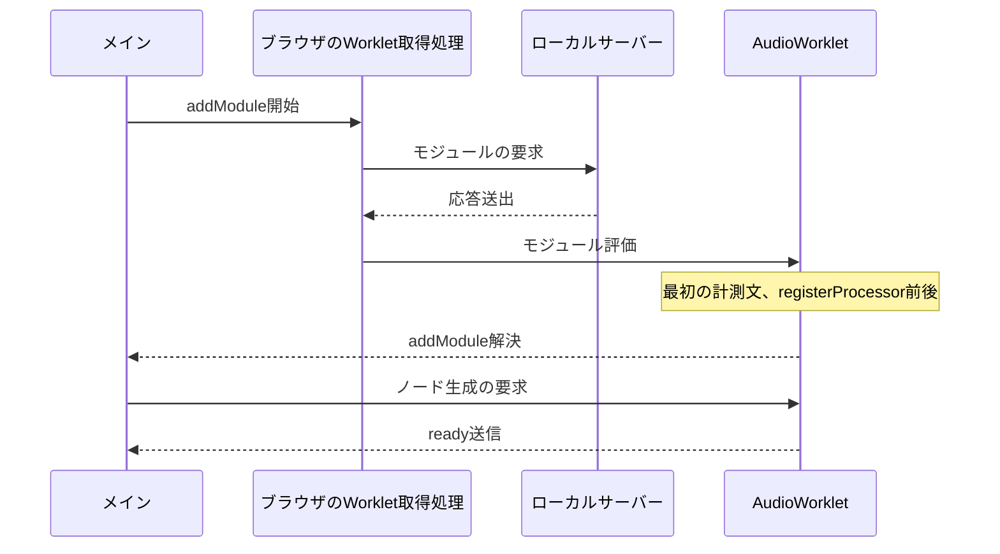

# 実時間歌唱のWorklet登録を評価の前後に分ける

## 入口と観測点

固定上流 `c6147d0198890475dbe8a65a0bb8f56240c539b7` の `AudioEngine.build` はContextの再開を要求し、`audioWorklet.addModule` を待ってからコンパイル済みWASMをノードへ渡す。歌唱側は `playTune` が音符を計画し、`engine.schedule` がエンジン上にスコアを置く。上流の試験では拍と母音核、句末の開大と呼気、ホストの分割に対するPCMの不変性を確かめる。[固定上流の準備](../../../../docs/reference/chimera-vocal-synth/upstream/src/audio/AudioEngine.ts#L108)・[歌唱の入口](../../../../docs/reference/chimera-vocal-synth/upstream/src/ui/singing.ts#L330)・[歌唱の拍](../../../../docs/reference/chimera-vocal-synth/upstream/crates/chimera/tests/sing_fast.rs#L30)・[語尾](../../../../docs/reference/chimera-vocal-synth/upstream/crates/chimera/tests/sung_release.rs#L49)・[ブロック分割](../../../../docs/reference/chimera-vocal-synth/upstream/crates/chimera/tests/engine.rs#L78)

`addModule` の仕様では、Workletの実行環境を用意し、モジュールを取得・評価してからPromiseを解決する。`AudioWorkletNode` に対応する `AudioWorkletProcessor` はレンダリング側に作られ、メッセージで制御側に結果を返す。Firefoxの公開ソースは、`WorkletFetchHandler` でモジュールの準備を行い、メインスレッドに戻ってPromiseを解決する。公開ソースの手順は観測点を選ぶ根拠に使う。今回の実行でブラウザ内部の関数の滞在時間を直接測るのは対象外とした。[Workletの登録仕様](https://html.spec.whatwg.org/multipage/worklets.html#dom-worklet-addmodule)・[AudioWorkletの処理モデル](https://www.w3.org/TR/webaudio-1.1/#AudioWorklet)・[Firefoxの登録処理](https://searchfox.org/firefox-main/source/dom/worklet/WorkletFetchHandler.cpp)

候補は現行順と並行登録の両方で同じ `FixedProcessor` を呼ぶ。研究用クエリ `songModuleEvaluation=1` を指定すると、最初の実行文にエポックミリ秒を読む計時用エントリーを使う。`registerProcessor` の直前・直後も同じWorkletの `Date.now()` で採る。ノードの準備が終わると、これらの時刻と `ready` を送った時刻を一つの通知に格納する。ビルド結果でも計時用ファイルの先頭に時刻の読み出しが置かれ、その後に合成器の定数定義と登録が続くことを確認した。計時用と通常用のJS、同じWASMを成果に保存する。[計時用エントリー](../../../../web/prototypes/chimera-research/src/fixed-processor-measured-entry.ts)・[準備通知](../../../../web/prototypes/chimera-research/src/fixed-processor.ts)・[メイン側の登録と受信](../../../../web/prototypes/chimera-research/src/render-fixed-voice.ts)

メイン側では `addModule` の呼び出し・完了、ノードの作成要求、`ready` の受信を採る。Viteの計測用ミドルウェアは、WorkletのJSに対するリクエストを処理し始めた時刻と、Node側の応答送出イベントも記録する。3か所の `Date.now()` をエポックミリ秒で比べ、メイン側では単調時計の `performance.now()` でも区間長を照合する。時計の境界が5 msを超えて逆転する試行は分解に使わない。評価前の時間は `Workletの最初の計測文 − addModule開始`、評価時間は最初の計測文から `registerProcessor` の戻りまでとする。応答送出と最初の計測文の間には、受信側の処理、スレッド間の待ち、評価前の処理が含まれる。[サーバーでの計時](../../../../web/prototypes/chimera-research/tools/capture-worklet.mjs)・[区間を照合する処理](../tools/measure_worklet_song_module_evaluation.py)



## 事前登録

FirefoxとChromiumの新しいブラウザで、通常モジュールを使う `...` の歌詞エラーから復帰する。その後 `Pop Dee` を現行順と並行登録の両方で歌い、計時用と通常用のエントリーを各3対比較する。Firefoxで評価前の比率が登録の75%以上、JavaScriptで観測した評価時間が各順序の中央値5 ms以内と予測した。計時による接続までの中央値差の目安は20 ms。開始は `armedContextFrame + 2,048`、音符の拍は開始から24,000と48,000フレーム。全713量子の連続性と、基準CLIのPCM 91,200点、観測1,425行とスコアの一致を検証する。[事前登録](../cases/worklet-song-module-evaluation.json)・[歌唱の参照](../runs/worklet-live-song-cross-browser-20261121-a/manifest.json)・[前回の登録比較](../runs/worklet-song-parallel-registration-20261121-repeat/summary.json)

## 初回の登録時間

初回の機能133判定が通過し、24試行のPCM・音響観測・拍・スコアは保存済みの基準と一致した。Firefoxの評価前の時間は、現行順で中央値153 ms、並行登録で204 ms。登録全体に対する比率は各99.4%と100%だった。評価開始から `registerProcessor` の戻りまでの中央値は各1 msと0 ms、登録からメイン側のPromise完了までは両条件とも中央値0 msだった。0 msは `Date.now()` で同じ値を読んだ区間を示す。[初回の区間別の値と判定](../runs/worklet-song-module-evaluation-20261121-a/summary.json)

Firefoxの現行順では、`addModule` を呼んでからサーバーが要求を受けるまでの中央値が139 ms。並行登録では、応答を2〜4 msで送出した後に最初の計測文まで約187 msかかった試行と、サーバーが要求を受けるまで185 msで応答送出後は8 msの試行があった。応答送出イベントはローカルサーバーで採っているため、ブラウザがデータを受け取った時刻はこの比較からはわからない。[初回の生の時刻と試行別の区間](../runs/worklet-song-module-evaluation-20261121-a/manifest.json)

## 再実行と残る差

`/tmp` からの再実行も133機能判定すべてを通過した。Firefoxの計時付き12試行を通して、登録時間の99.35〜100%が計測文の実行前だった。最初の計測文から `registerProcessor` の戻りまでは両ブラウザの全計時試行で0〜1 ms。Firefoxで登録から完了までの記録は全12試行で0 msだった。メインの `Date.now()` と `performance.now()` で測った登録時間の差は最大1 msで、三か所の境界の逆転はなかった。[再実行の時間と判定](../runs/worklet-song-module-evaluation-20261121-repeat/summary.json)

| 計時付き試行の中央値 | 初回 | 再実行 |
| --- | ---: | ---: |
| Firefox 現行順の評価前 | 153 ms | 151 ms |
| Firefox 並行登録の評価前 | 204 ms | 194 ms |
| Chromium 現行順の評価前 | 9 ms | 8 ms |
| Chromium 並行登録の評価前 | 51 ms | 50 ms |

Firefoxの現行順の全6試行では、`addModule` の呼び出しからHTTP要求まで134〜144 ms、応答送出後から最初の計測文まで7〜12 msだった。並行登録の全6試行は二つに分かれた。3試行は要求まで184〜188 ms、応答送出後は6〜8 ms。ほかの3試行は要求まで6〜15 ms、応答送出後は180〜189 msだった。サーバーが要求を受けてから応答を送出するまではFirefoxの全12試行で2〜14 msだった。長い待ちがHTTP境界の前後に移る原因はブラウザ内で未特定である。[初回の試行別の区間](../runs/worklet-song-module-evaluation-20261121-a/summary.json)・[再実行の試行別の区間](../runs/worklet-song-module-evaluation-20261121-repeat/summary.json)

計時ありとなしの接続時間を対で比べた中央値の差は、ブラウザ・開始順・実行ごとに−5〜+16 msで20 msの目安に収まった。再実行のFirefoxの並行登録1対では、計時ありの接続が138 ms遅れた。計画の完了はContextの作成開始から56 msと58 ms、接続は56 msと194 msだった。この対の計時あり条件は応答送出から評価開始まで180 msを要した。計時の追加と試行間の変動の寄与はこの対からは分離できない。次は、Firefoxのネイティブプロファイルで `AudioWorklet.addModule`、`Worklet::StartFetchRunnable`、`Worklet::FetchCompleteRunnable` に対応する区間または実行スレッドを探し、HTTP要求と評価開始に対応づける。[再実行の比較と生の時刻](../runs/worklet-song-module-evaluation-20261121-repeat/manifest.json)・[Firefoxの登録マーカー](https://searchfox.org/firefox-main/source/dom/media/webaudio/AudioWorkletImpl.cpp)・[Firefoxの取得処理](https://searchfox.org/firefox-main/source/dom/worklet/WorkletFetchHandler.cpp)

## 再現と保存

研究ワークスペースから以下を実行する。macOS 15.6.1 arm64、Firefox 157.0、Chromium 156.0.8078.4、Rust 1.94.1、Node 24.19.0、Bun 1.4.4を使った。両実行の各151成果をハッシュ検査し、約30.24 MBの実体をRTL9210B-CGに保存した。展開後のWAV48本はバイト一致した。固定上流との差は最大2.33×10⁻¹⁰で、関係する17試験を各実行で通過した。別途、計時付き並行登録での停止・再開を両ブラウザで、従来の実時間IPA `/ɑpɑ/` をChromiumで照合した。物理出力の時間は未計測である。[初回マニフェスト](../runs/worklet-song-module-evaluation-20261121-a/manifest.json)・[再実行マニフェスト](../runs/worklet-song-module-evaluation-20261121-repeat/manifest.json)

```bash
export CHIMERA_FIREFOX=/Volumes/RTL9210B-CG/voice-simulator/build/playwright/firefox-1555/firefox/Nightly.app/Contents/MacOS/firefox
CHIMERA_RUN_STORAGE=rtl9210b CHIMERA_RUN_BYTES=150000000 \
  ../../.venv/bin/python tools/measure_worklet_song_module_evaluation.py worklet-song-module-evaluation-next
```
